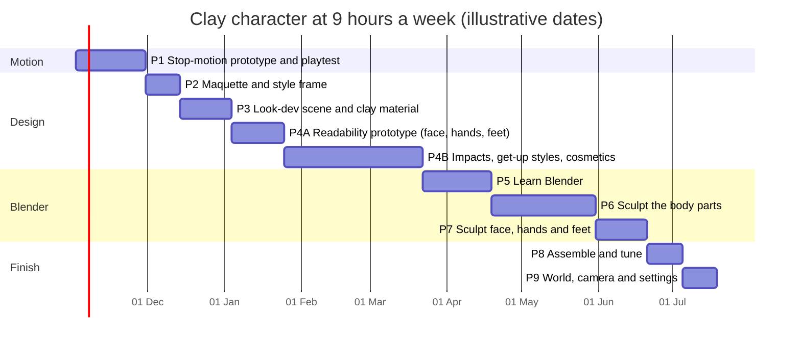
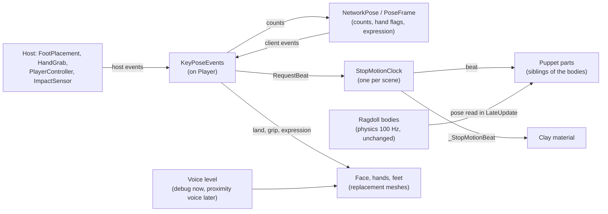

# Stop-Motion Look — Master Design Document

**Project:** Physical Walking Prototype (drunk active-ragdoll character). Moves into the game repo with the
character.
**Version:** 0.4, 2026-10-28. Revised after eight reviews (section 17).
**Owner of every look decision and asset:** Alan. This document guides; it contains no finished shaders, meshes
or code to paste.

## How to use this document

- **Scope.** This is the starting point of the master design document for the game's stop-motion look:
  - Part I holds the look's principles.
  - Part II holds the design.
  - Part III is the build plan.
  - Part IV records decisions, risks, reviews and sources.
- **Steps.** Work them in order. Each step gives a time estimate in focused hours. Each phase ends with a
  **Done when** checklist; tick every box before starting the next phase.
- **Decisions.** When a step says "record in section 15", add a row to the decision log with the date, the
  decision and why. A decision recorded there overrides any default in this document.
- **Defaults.** Where a value is a starting default, it is in the dials table (section 13). Change it there
  and log why.
- **Play mode.** Never save a script while play mode is running; Unity stops play mode.

## Units and scale

- **Every size is in game metres** unless it says "maquette".
- **The game character is 1.85 m tall.** Its head is a 0.36 m sphere, its forearms are 0.09 × 0.30 m capsules,
  its hands are about 0.11 m across, and its feet are 0.16 × 0.10 × 0.30 m boxes (width × height × length).
- **The maquette is 1:9.25.** At 20 cm tall, multiply a maquette size by 9.25 to get the game size.
- **Pixels at play distance.** The gameplay camera sits 5 m behind the character with a 60° vertical field of
  view. At 1080p, 1 pixel covers:
  - about 5.4 mm at 5 m (your own character, about 345 px tall);
  - about 11 mm at 10 m;
  - about 16 mm at 15 m (other players across a room).

  Anything smaller than about 1 pixel at the distance it must read is invisible.

## Timeline

Estimates assume **9 hours a week** (evenings and weekends) and a beginner in 3D art. Phases run one after
another because one person does them all. Dates are illustrative; they don't include holidays.



| Phase | What | Focused hours | Weeks at 9 h |
|---|---|---|---|
| 1 | Stop-motion clock, visual puppet, network signals, debug settings, blind playtest | 30–40 h | 4 |
| — | **Gate:** continue only if a stepped variant passes the playtest (section 12.1) | | |
| 2 | Design: references, maquette at ragdoll proportions, style frame | 12–18 h | 2 |
| 3 | Look-dev scene, clay material on the primitives, scale look | 22–32 h | 3 |
| 4A | Readability prototype: placeholder face, voice-driven mouth, hands and feet; readability test | 25–35 h | 3 |
| 4B | Impact dents, get-up styles (jump cut, invisible hand, re-sculpt) and physical cosmetics, on placeholders | 60–85 h | 8 |
| 5 | Learn Blender, graded exercises | 30–45 h | 4 |
| 6 | Sculpt the 16 body parts, one at a time | 40–70 h | 6 |
| 7 | Sculpt the face pieces, hand poses, shoes and cosmetics | 24–36 h | 3 |
| 8 | Assemble, tune, compare with the style frame | 12–20 h | 2 |
| 9 | World look, camera, settings menu, flash check | 18–26 h | 2 |
| 10 | Optional: continuous skinned body (a second project) | 60–100 h | 7–11 |

**Total for phases 1–9: about 275–405 hours, roughly 37 weeks (8½ months) at 9 hours a week.** Phase 4B is the
largest optional block. Its three parts (dents, get-up, cosmetics) can each be postponed without blocking the
art phases.

- **Phase 1 comes first** because it answers the riskiest question (does stepped motion play well?) without any
  art.
- **Gate.** If no stepped variant passes the playtest in section 12.1, stop the stop-motion holds and record it
  in section 15. The clay look (phases 2–9) still applies without them.
- **Slow progress** in phases 5–7 is normal: they are where new skills are learned.

---

# Part I — The look

## 1. Summary

The character becomes a hand-made-looking clay puppet whose physics stay exactly as they are.

- **The puppet.** A separate visual puppet copies the ragdoll's pose only on the beats of a shared stop-motion
  clock, and holds it between beats, as a puppet holds still between photographs.
- **Chosen beats.** The character also asks for a beat on its key moments (a foot plant, a stumble, an impact,
  a grab). So the held poses are the ones an animator would have chosen.
- **Reads at a distance.** The face, hands and feet are oversized and high-contrast. A mouth that opens and
  closes with each player's voice shows who is talking once proximity voice is added.
- **Reads as clay.** A sculpted, imperfect shape; fingerprints; a soft, oily surface; and "boil" where the
  puppet was handled.

Every effect is a dial with an off position, and players get separate settings for each, because games that
tried stepped motion found players split on it and some got motion sick (section 3).

## 2. Look principles

Every later decision is checked against these. Change one only through the decision log (section 15).

1. **Physics never steps.** Only what is drawn holds.
2. **The camera never steps.** It follows the physics smoothly.
3. **Hold the poses that matter.** Key moments get their own beat and one extra beat of hold.
4. **Hand-made before stepped.** Holds on a smooth, plastic shape read as lag; judge motion only with the clay
   surface on.
5. **Imperfect, not random.** Puppet "chatter" is a small per-part pose error (section 13). Timing stays
   rhythmic, because rhythm sells the comedy.
6. **Clay remembers.** Squashes and dents stay until a later beat restores them. Boil appears on handled
   parts, not everywhere.
7. **Readable at play distance.** The face, hands and feet are exaggerated and high-contrast so their state
   reads at 15 m (section 7). Fingerprints are for close-ups.
8. **You can tell who is talking** by their mouth, at any distance where you can hear them.
9. **Every player is identifiable at a glance**, by colour and silhouette.
10. **Physical comedy stays clay.** Hard hits dent the clay; getting up looks handled by an animator; loose
    cosmetics are real objects.
11. **Comfort is a setting.** Each effect can be reduced or switched off. Flicker never exceeds ±3%
    luminance (the flash threshold is 10%).
12. **Alan's hand is in it:** his maquette, his proportions, his fingerprints, his palette.

## 3. What makes stop motion read

| Layer | What it is | Notes and evidence |
|---|---|---|
| **Pose holds** | The drawn pose changes on beats and holds between them. | Classic TV clay (Morph, Gumby) is the "twos" look, 12 poses a second. Feature films often shoot more on ones. Spider-Verse (CG imitating drawn animation, an analogy only) found a 3-frame hold starts to be noticed. |
| **Uneven spacing** | Each part moves a slightly different, slightly wrong amount each frame. | What gives hand animation away is irregular spacing, not frame rate. Even steps sampled from a smooth simulation read as a low frame rate. |
| **Chosen poses** | Animators hold the extremes: contact, the top of a lurch, a reversal. | Guilty Gear Xrd's stepped 3D characters read well at 60 fps because the held poses are hand-keyed. A plain sampler lands between the extremes. |
| **No motion blur** | Every frame is a sharp still. | Spider-Verse: "if you stop on any frame in the movie, it's solid, sharp." |
| **Hand-made surface** | Fingerprints, tool marks, lumps, oily highlights, lint. | Heavy prints and boil belong to shorts, Morph and Adam Elliot's films; Aardman's features smooth most prints out. These set the two ends of the boil dial. |
| **Boil** | The surface changes where it was touched. | Johansson's clay material re-seeds its texture on a stepped timer. Real boil is local to handled parts. |
| **Moving holds** | A puppet with nothing to do still breathes a little. | Without it, the figure goes dead between actions. |
| **Flicker** | Small exposure changes between frames. | ±1% reads as photographed. Kept at ±3% or less (section 9). |
| **Set scale** | Lamps close to the set, steep light falloff, camera height. | Shallow focus says "toy"; features avoid it so sets read full-size. Decided in phase 3, step 9; until then, deep focus. |

### Lessons from games that tried it

- **Harold Halibut** (Unity; real puppets and sets scanned with photogrammetry). A developer post on Steam says
  they "experimented with reducing the fps for the character movements to get more of the stop-motion feel".
  They dropped it: "since camera movements still need to be very fluid, we felt the effect was more distracting
  than pleasing." They felt Sable's similar stepping "doesn't feel fully right" either.
- **South of Midnight** (Unreal 4) shipped it:
  - tuned per character;
  - gameplay at a stable 60 fps;
  - a toggle covering gameplay but not cutscenes.

  When it was "a bit too heavy handed, it induced some motion sickness in some people". Players still split on
  it.
- **Spider-Verse** simulated hair and cloth on ones while characters were on twos, because simulations stepped
  on twos "jump all over the place".
- **Guilty Gear Xrd:** stepped 3D characters work even in a fighting game when the held poses are keyed.

### The risk this design takes on

A character that holds its world position while a smooth camera follows its physics drifts behind the camera
and snaps forward on every beat. The result is a 12 Hz judder at the centre of the screen, which is the likely
cause of motion sickness. Phase 1 compares two variants:

- **World hold.** Every part holds in world space. This is the most authentic.
- **Root-smooth hold.** The pelvis part follows every frame, and the other parts hold their pose relative to
  the pelvis. There is no judder against the camera, and the limbs still step.

## 4. Decisions so far

| Question | Decision | Consequence |
|---|---|---|
| How will the form be made? | Alan is new to 3D art | A physical maquette first; Blender learned with graded exercises; first sculpt is separate small pieces. |
| How strong should it read? | Explore the range | Every layer is a dial with an off position; a setting per effect. |
| Body style? | Undecided; compare | Section 6 compares three; start with the segmented puppet. |
| Who builds? | Alan builds everything | Steps say what and why, with exact names and values, not finished code. |
| Face | Eyes and mouth readable from a distance; mouth shows who is talking in proximity voice | Section 7.1: oversized, high-contrast face; replacement mouths driven by voice level. |
| Hands and feet | Exaggerated so it's easy to read where they are and what they touch | Sections 7.2–7.3: oversized gloves and shoes, grip poses, contact squash. |
| Hard impacts | Deform the clay temporarily | Section 7.5: shader dents where the hit lands, repaired over beats. |
| Getting up | Not fixed; explore several styles, the invisible hand among them | Section 7.6: four styles behind one switch, compared in a playtest. |
| Cosmetics | Wanted, ideally physical (a hat falls off a jolted head) | Section 7.7: slots, detach rules, networked loose items. |
| Default stepped rate | 12 beats a second, re-judged in phase 3, step 8 | Section 13 |
| Root-smooth default | Decided by the phase 1 playtest | Section 12.1 |
| Scale look | Decided in phase 3, step 9 | Section 10 |

---

# Part II — Design

## 5. How it fits the character

### 5.1 Today

The prefab draws the character with 16 Unity primitive meshes on **13 physics bodies**, all with
interpolation on:

| Physics body (Rigidbody) | Extra drawn parts on it |
|---|---|
| Pelvis, Torso, Head | Nose (child of Head) |
| UpperArm_L/R, Forearm_L/R | Hand_L/R (children of the forearms; their SphereColliders are part of the forearm's collision) |
| Thigh_L/R, Shin_L/R, Foot_L/R | |

- **Hierarchy.** The bodies, `CameraTarget` and the ghost rig are flat children of `Player`. The root never
  moves after spawn.
- **Renderers.** No script reads or changes renderers, materials or render layers, so the renderers can move
  freely.
- **Clients.** `NetworkPlayer.OnNetworkSpawn` disables the simulation scripts on clients. So `FootPlacement`,
  `HandGrab` and `PlayerController`'s physics never run there, and their events never fire on a client.
  `NetworkPose` places client bodies from `PoseFrame`s sent unreliably on every network tick (60 Hz).

### 5.2 The new arrangement



- **The ragdoll keeps its colliders and drives** and only loses its renderers. Balance, feet, grabs, benches
  and networking stay as they are.
- **`Puppet` is a child of `Player` and a sibling of the bodies**, never a child of one. Network despawn
  destroys it with the rest.
- **Puppet parts hold no Collider or Rigidbody.** Several scripts gather components from the whole `Player`:
  - `BalanceSensor` (line 54) builds the pose stream's body list from every Rigidbody, and `NetworkPose` drops
    frames whose body count differs.
  - `PlayerController` and `HandGrab` gather colliders the same way.

  Create parts as empty GameObjects with a MeshFilter and MeshRenderer only. GameObject > 3D Object adds a
  collider.
- **One shared clock.** Every held thing (all players, props) changes on the same beat.
- **`KeyPoseEvents`** is one new component on `Player`. It is the single place puppet code listens to on both
  host and client. Section 5.4 defines it.

### 5.3 Rules for the puppet

- **Copy in `LateUpdate`.** The clock advances in `Update`. A part copies in `LateUpdate` when the beat number
  has changed. The order between the clock's `Update` and `NetworkPose.Update` is undefined, so a copy in
  `Update` could take last frame's client pose.
- **Read the Transform**, not `Rigidbody.position`: it holds the interpolated pose.
- **Scale.** The bodies carry non-uniform scale that the colliders depend on, and Hand and Nose add more on top.
  - Set each part's scale once to its source's `lossyScale` when building the puppet.
  - Never change the bodies' scale.
  - Sculpted meshes (phase 6) are modelled in metres at game scale, in their body's orientation, so their parts
    go back to scale (1, 1, 1).
- **Domain reload is off** in this project (Project Settings > Editor > Enter Play Mode Options). Statics
  survive between play sessions, so reset every static in a
  `[RuntimeInitializeOnLoadMethod(RuntimeInitializeLoadType.SubsystemRegistration)]` method.
- **Snapping.** On spawn, the root and bodies are moved after `OnEnable`. On a client, the bodies sit at the
  prefab pose until the first pose frame arrives. A part therefore:
  - copies every frame until the first beat after `OnEnable`;
  - snaps (copies immediately) when `KeyPoseEvents.Snapped` fires (section 5.4).
- **One beat per frame at most.** Benches raise `Time.maximumDeltaTime`; the clock never catches up on missed
  beats.
- **Contact.** A gripping hand and the thing it holds step together, because both are on the shared clock.
  Hands never run on a faster rate than their forearm.
- **Shadows hold too**, since the puppet casts them. Shader Graph's vertex displacement also feeds the shadow
  pass.

### 5.4 Key-pose events and networking

**`KeyPoseEvents`** (new, `Assets/DrunkCharacter/Scripts/KeyPoseEvents.cs`, one on `Player`):

```
enum KeyPose { LandL, LandR, GripL, GripR, StumbleStarted, Impact, Reversal, RecoverStart, RecoverStand }
event Action<KeyPose> Raised      // on host and clients
event Action Snapped              // a teleport: spawn reset or CharacterReset
byte HandFlags                    // bit0 L reaching, bit1 L holding, bit2 R reaching, bit3 R holding
Expression Expression             // Neutral, Grimace, Shock
```

**On the host, events come from:**

| KeyPose | Source (existing code) | What to add |
|---|---|---|
| LandL / LandR | `FootPlacement.AdvanceSwing`, where `LastLandTime = Time.time` is set (line 677) | `public event Action Landed` on `FootPlacement`, raised there |
| GripL / GripR | `HandGrab.TryGrip`, right after `gripping = true` (line 137) | `public event Action Gripped` on `HandGrab` |
| StumbleStarted | `PlayerController.UpdateFallMeter` (line 280) | `public event Action StumbleStarted`, raised when `charge > 0` this tick and `charge` was 0 on the previous tick |
| Impact | No signal exists (`Fell` fires when the meter fills, while still upright) | New `ImpactSensor` component on the Pelvis, Torso and Head body objects. While `IsFallen`, on the first `OnCollisionEnter` with `relativeVelocity.magnitude > 1 m/s` and a collider not under this `Player`, raise once per fall. |
| Reversal | No signal exists | In `KeyPoseEvents.FixedUpdate` on the host, track the pelvis Rigidbody's horizontal velocity `v`. While `v.magnitude > 0.3 m/s`, remember its direction `d`. Raise when `Vector3.Dot(v, d) < 0` and `v.magnitude > 0.3`, at most once per 0.3 s. |

`KeyPoseEvents` takes serialized references to the left and right `FootPlacement` and `HandGrab`, the
`PlayerController` and the pelvis Rigidbody. It subscribes in `OnEnable` and unsubscribes in `OnDisable`.

**Hand flags and expression on the host:**

- **Reaching:** `PlayerController.CurrentInput.GrabLeft` (or `GrabRight`) is true, and that hand is not
  holding.
- **Holding:** `HandGrab.IsHolding`.
- **Expression:**
  - `Shock` while `IsFallen` and the pelvis speed is above 1 m/s;
  - `Grimace` while `FallMeterFraction` is above 0.3;
  - otherwise `Neutral`.

**To clients, through `PoseFrame`:**

- **Add one `byte` counter per `KeyPose`** to `PoseFrame` (seven in phase 1; phase 4B adds the two recovery
  ones), plus `byte HandFlags` and
  `byte Expression`, and serialize them like `ResetCount`.
- **On the host**, `KeyPoseEvents` increments the counter for each event, and `NetworkPose.SendPose` copies the
  counters, flags and expression into the frame.
- **On a client**, `NetworkPose` compares each counter with the last frame's. For each changed counter it calls
  `KeyPoseEvents` to raise that event, and it copies the flags and expression. Counters survive dropped
  unreliable frames; one-shot flags would not.
- **Snapping:**
  - On a client, `NetworkPose` raises `Snapped` where it detects `from.ResetCount != to.ResetCount`
    (line 118).
  - On the host, `KeyPoseEvents` raises `Snapped` on `PlayerController.CharacterReset`.

**On every machine,** `KeyPoseEvents.Raised` calls `StopMotionClock.RequestBeat(holdExtra: true)` for any
key pose. The face, hands and feet listen to the same event (section 7). Clocks on different machines don't
need to agree.

### 5.5 The stop-motion clock

| Feature | Exact behaviour |
|---|---|
| Base rate | `beatsPerSecond`, default 12 |
| Requested beats | `RequestBeat` sets a pending flag (safe from `FixedUpdate`). The next `Update` beats at once unless the last beat was less than 1/24 s ago. A requested beat schedules the next one after `1 + extraHoldBeats` intervals. |
| Timing variation | Each interval is multiplied by `1 + Random.Range(-timingVariation, timingVariation)`; default 0, at most 0.05 |
| Off | Beat every `Update` |
| Shader | After each beat, `Shader.SetGlobalFloat("_StopMotionBeat", Beat % 1200)`. 1200 divides by 3 and 4, so 3- or 4-variant swaps have no jump at the wrap. |

### 5.6 Puppet part behaviour

| Feature | Exact behaviour |
|---|---|
| World hold | On a beat, copy `source.position` and `source.rotation`. |
| Root-smooth hold | The pelvis part copies every frame. Other parts store their pose relative to the pelvis source on a beat, and every frame apply it on top of the pelvis part's current pose. |
| Moved | More than 1 mm or 0.5° since this part's last beat. |
| Chatter | On a beat, if the part moved, add a fresh random rotation of up to `chatterDegrees` about a random axis and an offset of up to `chatterMetres` in a random direction. Replace it on the next beat; never accumulate. |
| Moving hold | Idle means pelvis speed below 0.05 m/s for 0.5 s. On each beat while idle, add a breathing rotation to the Torso and Head parts: `idleAmplitude × sin(2π × 0.25 × Time.time)` degrees about the pelvis's right axis. Remove it on the first beat that is not idle. |
| Squash | When told to squash (section 7), multiply the part's base scale by (1.08, 0.85, 1.08) in its local axes, with the 0.85 along the contact normal, for `squashBeats` beats, then restore it on a beat. |

## 6. Body style: three options

| | **A. Segmented puppet** | **B. Continuous skinned body** | **C. Volumetric blobs (SDF)** |
|---|---|---|---|
| What it is | One sculpted clay piece per drawn part, overlapping at the joints | One mesh bent by 13 bones following the bodies | Shapes that melt together, computed on the GPU |
| Look | Puppet-like; joints show as creases or hide under clothing | Bends like one lump of clay | Goopiest; blends at every contact |
| Fit with the ragdoll | One-to-one with the 16 parts; no rigging | One bone per body; needs skin weights | Each body becomes a shape |
| Skills | Sculpting, exporting | Adds retopology, UVs, rigging and weight painting | Tool settings; little hand sculpting |
| Risk | Seams at extreme drunk poses | Skin stretches in untested poses | Third-party tool, compute shaders; the look is the tool's |
| Beginner effort | Low | High | Low to start, hard to make your own |

**Decision: A, with B as optional phase 10, and C skipped.**

- **Why A.** Real stop-motion puppets are built from parts: plug-in limbs, removable heads, and clothing over
  the joints. As one puppet-making guide puts it, "there is no need to hide any seams where the plug-in sockets
  are". It also suits the readability goals: replacement mouths, eyelids and hand poses are separate pieces
  anyway.
- **Why not C.** MudBun supports URP but needs compute shaders and is sold as a VFX tool. Clayxels doesn't
  support recent Unity. Both put the look in the tool's hands, which goes against principle 12.

## 7. Readability: face, voice, hands, feet, players

All sizes are game metres on the existing 0.36 m head. Pixel figures are at 1080p (see "Units and scale").

### 7.1 Face

**Eyes.**

| Piece | Size and colour | Pixels at 15 m |
|---|---|---|
| Eye whites | Two spheres 8 cm across, centres 10 cm apart, set into the upper front of the head; value at least 90% | 5 px each |
| Pupils | Black discs 3.5 cm across, value at most 10% | 2 px |

- **Pupils lead the head.** Each pupil is a separate piece that rotates within its eye. On each beat its yaw is
  the head part's yaw rate (degrees per second, measured from the Head source between beats) × 0.2 s, clamped
  to ±25°. This works on clients without new network data.
- **Lids** are three replacement meshes per eye: Open, Half and Closed.
  - **A blink** runs over 5 beats (Half, Closed, Closed, Half, Open), every 2–6 s at random.
  - **The rest pose** is Half while `NetworkPlayer.DrunkAmount` is 0.6 or more, which is replicated already;
    otherwise it is Open.

**Mouth.** The mouth is one face piece whose mesh is swapped among replacement shapes, as in clay animation:

| Shape | Opening (width × height) | Used for | Pixels tall at 15 m |
|---|---|---|---|
| Closed | 14 cm crease, 1.5 cm deep | Silent, Neutral | 1 |
| Mid | 16 × 8 cm | Talking, medium level | 5 |
| Wide | 18 × 12 cm | Talking, loud | 7 |
| Grimace | 18 × 5 cm, teeth band | Expression Grimace | 3 |
| Shock | 9 × 11 cm oval | Expression Shock | 7 |

- **Contrast.** The mouth interior is near-black (value at most 10%), against clay of value at least 60%
  around it. This contrast makes open against closed readable at distance.
- **There is no "small" talking shape.** Talking alternates between Closed and at least Mid, because a 4 cm
  opening is under 3 px at 15 m.

**Driving the mouth from voice.** A new `VoiceLevel` component on `Player` holds `public float Level` (0–1):

- **Now:** a `DebugVoice` component, on any one machine, writes a synthetic syllable pattern to a chosen
  character's `VoiceLevel`. The pattern is 5 Hz, peaks between 0.4 and 1.0 at random. F8 cycles the talking
  character, ordered by `OwnerClientId`, then none.
- **Later:** proximity voice writes each player's playback loudness on each listening machine. Every machine
  computes the level from the audio it plays, so no new network data is needed.

`MouthDriver` (on the mouth piece):

1. **Smooth the level** every frame into an envelope: attack 0.03 s, release 0.12 s.
2. **On each beat, pick the shape:**
   - envelope below 0.15: Closed (or the expression's shape);
   - 0.15–0.55: Mid;
   - above 0.55: Wide.
3. **Talking overrides the expression** while the envelope is above 0.15.
4. **Minimum hold.** A shape holds at least 1/12 s even when the clock beats faster (holds Off or Light), so
   the mouth never flutters.

**Constraint for the voice design.** The phase 4A readability test measures the largest distance at which
viewers still tell who is talking. Proximity voice's audible range must not exceed it. Record it in section 15.

### 7.2 Hands

- **Size.** Mitten-like gloves with a thumb, about 20 cm across (1.8× today's 11 cm hand). The glove's centre
  stays at the hand sphere's centre.
- **Colour.** The glove's value differs from the body clay and from the floor by at least 30 points (0–100
  scale). White gloves with a dark body, or the reverse, are the classic choices. Record the choice in
  section 15.
- **Replacement hand poses**, swapped on beats from `HandFlags`:

  | Pose | When |
  |---|---|
  | Relaxed | Default |
  | Reach | Open, fingers spread, while reaching (grab held, not holding) |
  | Grip | A fist closed around a hollow, while holding |

- **Contact.** On `GripL` or `GripR`, that hand part squashes for `squashBeats` beats (section 5.6).

### 7.3 Feet

The feet are physics bodies tuned for stairs, so the shoe must not change where the foot collides.

- **Sole.** The sole stays flush with the bottom face of the Foot collider box.
- **Size limits** (collider box 0.16 × 0.10 × 0.30 m):

  | Dimension | Limit | Growth |
  |---|---|---|
  | Width | up to 0.22 m | — |
  | Height | up to 0.16 m | upward only |
  | Length | up to 0.36 m | 3 cm past the toe, 3 cm past the heel |

  The toe curls up 2 cm ("toe spring") so a slight overhang doesn't visibly cut into stair risers.
- **Colour.** The shoe's value differs from the floor by at least 30 points.
- **Contact.** On `LandL` or `LandR`, that foot part squashes for `squashBeats` beats. This shows the plant.
- **Check.** On the Stairs15 and Stairs20 flights, no shoe visibly sinks more than 2 cm into a riser or tread.
  If it does, shorten the overhang. Enlarging the colliders instead would change the stair physics. It is a
  separate decision that needs the TerrainBench suite rerun, and is not part of this plan.

### 7.4 Player identity

- **Hues.** Four player hues, at least 60° apart on the colour wheel. Each player must still be told apart from
  the floor and walls with Color Adjustments Saturation set to −100 (a value-only check).
- **Assignment.** Hue index = `OwnerClientId % 4`. Every machine computes it alike, so no new network state is
  needed.
- **Identity never depends on a cosmetic.** Hats can fall off (section 7.7), so the player hue on the clothing
  is what identifies a player. Cosmetics add personality on top.
- **Environment.** Saturation stays lower than any player hue.

### 7.5 Hard impacts: the clay dents

A hard hit visibly dents the clay where it landed. The dent stays, like real plasticine, until it is
"re-sculpted" back over a few beats.

**Trigger** (host only):

- **Sensor.** `ImpactSensor` goes on all 13 bodies, not only Pelvis, Torso and Head. Self-collisions never
  reach it: `PlayerController.IgnoreOwnCollisions` already ignores every pair of the character's own colliders.
- **Hardness.** On `OnCollisionEnter` with a collider not under this `Player`:
  - Take `contact = collision.GetContact(0)`.
  - The hit speed is the approach speed, `Δv = |Vector3.Dot(collision.relativeVelocity, contact.normal)|`.
  - Don't use `collision.impulse / body.mass`. For jointed bodies it includes joint load and weight support,
    about 4 m/s on any standing foot.
- **Feet.** Foot_L/R dent only while `IsFallen`, or when the other collider has a Rigidbody. A foot stepping
  down the 0.5 m goal step lands at about 3.1 m/s and would otherwise dent on every step.
- **A dent** forms when `Δv ≥ 2.5 m/s`:
  - Depth = 1 cm at 2.5 m/s, rising linearly to 6 cm at 7 m/s, and clamped there.
  - Radius = 2.5 × depth, at least 6 cm, and at most half the smallest world-size axis of the part renderer's
    `bounds`.
  - It is centred on `contact.point`, and pushed in along `contact.normal`.
- **A whole-part flatten** happens when `Δv ≥ 5 m/s`. The hit part also squashes for 3 beats: scale 0.75 on the
  part's local axis most parallel to the contact normal, and 1.15 on the other two.
- **Any hard hit counts:** falls, collisions with other players, thrown objects.
- **Which part dents.** It is chosen from `contact.thisCollider`:
  - a Hand_L/R collider (these are SphereColliders on the forearm bodies) dents the hand part;
  - any other collider dents its own body's part;
  - the nose never dents, because it has no collider.

**Shape** (vertex displacement in `SG_Clay`, sub-graph `SG_Dent`):

- **Slots.** Each part holds up to 2 dents in its material instance:
  - `_DentA` and `_DentB` (float4): the local centre xyz and the depth w.
  - `_DentADir` and `_DentBDir` (float4): the local push direction xyz and the radius w.

  A new dent replaces the older one.
- **Work in world space.** Part scales are non-uniform, so object-space distances aren't metres.
  - Transform Object→World on the vertex, the dent centre and the push direction.
  - Compute distance, push and rim in metres.
  - Transform World→Object for the Position output.
- **Push.** For each vertex, `w = (1 − saturate(distance / radius))²`. Move the vertex along the push direction
  by `depth × w`.
- **Rim.** Clay is pushed aside, not lost. Push the vertex outward along its normal by
  `depth × 0.3 × (4 × s × (1 − s))`, where `s = saturate(distance / (1.4 × radius))`.
- **Normals.** Evaluate the dent sub-graph three times:
  - on the vertex;
  - on a point 5 mm along the tangent;
  - on a point 5 mm along the bitangent.

  Output the cross product of the two displaced edges as the Normal. Without this, the lighting doesn't show the
  dent. Imported meshes need tangents: in the FBX's Model tab, set Tangents to Calculate Mikktspace.
- **Shadows.** Displacement feeds the shadow pass, so the dent shadows correctly.

**Repair:**

- **Hold.** A dent holds for 6 s, or until the character is recovered (section 7.6), whichever comes first.
- **Re-sculpt.** It then shrinks in 3 steps, one per beat: to 2/3 depth, then 1/3, then gone.
- **Within the hold**, the depth never changes between beats.

**Network:**

- **To clients.** The host sends each dent with a reliable `DentRpc(byte partIndex, Vector3 localCentre,
  Vector3 localDirection, byte depthMm, byte radiusMm)`, sent to `NotServer`.
- **Part index.** `partIndex` is the part's position in a fixed `parts` list on a new `Puppet` component, on
  the `Puppet` object.
- **Repair** runs locally on each machine.
- **The beat.** The dent appears on the next regular beat, at most 1/12 s later. The Impact key pose is
  unchanged (section 5.4: while fallen, once per fall).

**Why shader dents.** The alternatives are sculpted "dented" replacement meshes per part, or Blender shape keys
(blend shapes) per part. Both only show dents you sculpted in advance, in fixed places. Shader dents land
where the hit was. Shape keys stay useful for one signature deformation, such as a flattened head; add one
later if wanted.

**Mesh density.** Dents need vertices to move. At the section 8.6 budgets, vertices are about 1–2 cm apart on
the limbs, so the 6 cm minimum radius always spans several of them.

### 7.6 Getting up: recovery styles

**Today there is no get-up.** A fallen character stays down until its owner resets it, and
`ResetCharacter` teleports it back to spawn. Getting up is new gameplay. The plan builds several styles behind
one switch and compares them; the choice is not fixed.

**Shared rules for every style:**

- **The get-up input.** No get-up input exists yet, and R is reset-to-spawn.
  - Add `bool GetUp` to `CharacterInput`, and serialize it.
  - In `LocalPlayerInput`, add an action bound to `<Keyboard>/space` and `<Gamepad>/buttonSouth`.
- **When.**
  - Recovery starts when the owner presses get-up, at least `minDownSeconds` (1.5 s) after the fall.
  - It starts automatically `autoRecoverSeconds` (8 s) after the later of two moments: the fall, and the last
    time another player's grip held this character.
  - Record the final rule in section 15.
- **Not while carried.** Carrying a limp friend is core, so recovery never happens while held.
  - Add `bool IsHeld()`: true if any `HandGrab` in the scene has a `HeldBody` in this character's
    `BalanceSensor.Bodies`.
  - Check it when recovery would start, and every physics step during recovery.
  - If it becomes true, cancel the recovery (destroy the style A joint) and stay fallen.
  - A reset (R) also cancels recovery.
- **Own grips.** Nothing to add: `HandGrab` already releases every tick while `IsFallen`.
- **`StandAt(Vector3 pelvisXZ, float yaw)`**, a new host method on `PlayerController`. `ResetCharacter` places
  bodies relative to the root, which never moves, so `StandAt` builds a new origin instead:
  - `rot = Quaternion.Euler(0, yaw, 0)`.
  - `origin` = `pelvisXZ` minus the horizontal part of `rot × spawnLocalPositions[pelvis]`.
  - `origin.y = Ground.HeightAt(pelvisXZ, pelvis.position.y) − soleLocalY`, where `soleLocalY` is the spawn
    foot's local y minus `FootGroundOffset`.
  - Each body goes to `origin + rot × spawnLocalPositions[i]`, with rotation `rot × spawnLocalRotations[i]`.
  - Add `FootPlacement.PlantAt(Vector3 origin, Quaternion rot)`. `PlantAtSpawn` becomes a call to it with the
    root.
  - Set `headingYaw = yaw` and keep `CurrentInput`.
  - Clear the fall meter, momentum and sway, and set `IsFallen = false`.
  - Invoke `CharacterReset`. That bumps `ResetCount`, so clients snap, and clears `isFallen`.
  - Don't call `ResetInputRpc`.
- **Arguments.** `pelvisXZ` = the pelvis's current horizontal position; `yaw` = the owner's current heading.
- **Blocked spaces.** Before teleporting, check the standing pose with `Physics.OverlapCapsule` around the spawn
  torso and pelvis positions, transformed as above, ignoring this character's colliders. If it overlaps
  geometry (a wall, a stair), stay fallen and log it.
- **`Stand(float yaw)`** is `StandAt` without the body teleport and without `CharacterReset`. It plants each
  ghost foot under its physical foot through `PlantAt`, clears the meter, momentum and sway, sets
  `IsFallen = false` and `isFallen` false, and raises `RecoverStand`. Style A uses it, because a teleport would
  pop every limb to the spawn pose.
- **Timing.** Beats are local to each machine, but `StandAt` runs on the host, so styles time themselves on the
  host clock in seconds: one "beat" there means `1 / beatsPerSecond` s after `RecoverStart`.
- **Network.**
  - `RecoverStart` and `RecoverStand` are already in the `KeyPose` enum (section 5.4). Give them their
    `PoseFrame` counters.
  - Add `NetworkVariable<byte> recoveryStyle` on `NetworkPlayer`.
- **Settle and clay touches.** On `RecoverStand`, on every machine:
  - call `Puppet.BoostChatter(3f, 4)`, which multiplies chatter by 3 for 4 beats;
  - repair the dents (section 7.5).

  On the host, it also puts detached cosmetics back on: despawn the loose items and clear their bits
  (section 7.7). This is the "animator's hand" at work.

**The styles:**

| Style | What the player sees | How it works | Effort | Risk |
|---|---|---|---|---|
| **C. Jump cut** | The fallen pose holds for 3 beats, then the character is standing, wobbling for 4 beats | `StandAt` at `3 / beatsPerSecond` s after `RecoverStart` (host clock); settle chatter on `RecoverStand` | Low (2–3 h) | Can look like a glitch; judge it in play |
| **A. Invisible hand** | The puppet is lifted by its upper back, dangles, turns upright, is set down on its feet, and wobbles as it is let go | Physics on the host: a spring joint lifts and rights the Torso (below); visuals step on the beat as usual | Medium (8–12 h) | Lift can snag on geometry or other players; a 3 s timeout falls back to style C |
| **B. Re-sculpt** | The puppet slumps into a clay lump, then the lump re-forms into the standing character | Visual only, on each machine: parts shrink into a lump mesh over 4 beats from `RecoverStart`, then grow out over 6 beats from `RecoverStand`. The host calls `StandAt` at `4 / beatsPerSecond` s after `RecoverStart`. | Medium (6–10 h, plus a lump mesh) | Hides the character for about 1 s |
| **D. Scramble up** | The character gets itself up: rolls to its knees and pushes up | A get-up controller on the ghost rig | High (20+ h) | Not specific to stop motion; only if A–C all fail |

**Style A in detail** (host):

While fallen, nothing needs disabling: balance, legs, arms and head are already limp.

1. **Attach.** Add a ConfigurableJoint to the Torso body.
   - **Anchoring:** no connected body, so it anchors to the world; `autoConfigureConnectedAnchor` off.
   - **Anchor:** the Torso's top centre. Set `connectedAnchor` to that point's current world position.
   - **Linear X, Y and Z:** Free, with drives of spring 4000 N/m and damper 1000 (damping ratio about 0.8 for
     the 62 kg body). The body sags about mg/k = 0.15 m below the anchor.
   - **Angular:** `rotationDriveMode = Slerp`, with a slerp drive of spring 800 and damper 80.
   - **Target rotation:** record `start = torso.rotation`, then set
     `targetRotation = Quaternion.Inverse(rot × spawnLocalRotations[torso]) × start`, with `rot` built from the
     owner's heading as in `StandAt`.
2. **Lift.** Over 0.8 s, move `connectedAnchor` up until the feet hang 0.3 m above the ground. At the same time,
   move its x and z over the pelvis. The legs stay limp, so they dangle.
3. **Right.** Hold for 0.4 s while the angular drive brings the body upright.
4. **Set down.** Lower the anchor at 0.6 m/s until both Foot bodies touch the ground.
5. **Release.** Call `Stand(yaw)`, then destroy the joint.
6. **Timeout.** Steps 2–4 normally take about 2 s. If 3 s pass after attaching without reaching step 5, destroy the joint and end with `StandAt`
   (style C).

**Variant A2: visible hand.** A large clay hand (a sculpted mesh, a puppet part on the clock) appears above
the character, closes, and does the lift. It is a fun, very stop-motion option; try it after A works.

**Order to build:** C (baseline), then A, then B. Compare them in the recovery playtest (section 12.3), and
record the choice, or a rule for using several, in section 15.

### 7.7 Cosmetics

Players wear cosmetic items. Some are physically simulated: a hat can fall off if the head is jolted too far,
and lands as a real object that anyone can grab.

**Slots:**

| Slot | Examples | Can fall off |
|---|---|---|
| Head | Hats, caps, bobble hat | Yes |
| Face | Glasses, false moustache | Yes |
| Neck | Scarf (soft, see below) | No |
| Back | Backpack | No |
| Hands, feet | Glove and shoe variants | No |

**Data:**

- **`CosmeticItem`** (a ScriptableObject):
  - `id` (ushort), `slot`, `attachedMesh`, `material`;
  - `attachPart` (which puppet part) and its local position and rotation;
  - `detachable`, plus the detach thresholds (below);
  - `loosePrefab`.
- **`CosmeticCatalogue`** (a ScriptableObject) lists every item.
- **What a player wears:**
  - **Prototype (phase 4B):** a serialized `CosmeticItem[] worn` on `NetworkPlayer`, set in the Inspector.
  - **Later:** a `NetworkList<ushort>` of item ids on `NetworkPlayer`. The owner sends its choice to the host
    with an RPC on spawn, and the host writes it.
- **Customisation menus and unlocks** belong to the game repo. This document defines slots, data and physics.

**Attached items** are visual only:

- Each is a child of its puppet part, so it holds with that part.
- No collider and no Rigidbody, so `BalanceSensor` and `HandGrab` don't gather it.
- No network data beyond the worn-item list.

**Falling off** (Head and Face items with `detachable` on; checked by the host in `FixedUpdate`).

**Calibrate first.** The defaults below are untested guesses. A drunk head is soft, so ordinary footsteps and
shoves shake it.

1. Log the Head body's peak angular speed and peak acceleration over 5 minutes of play at `drunkAmount` 1.0,
   without falling.
2. Set each default to 1.5 × that peak.
3. Update section 13.

**Acceleration** = the change in the Head's velocity averaged over 3 physics steps, ÷ 0.03 s. A one-step
difference picks up solver noise: 0.6 m/s in one step already reads as 60 m/s².

An item falls off when any one of these is true. Each threshold is per item, so a beanie stays on longer than a
top hat.

| Condition | Default threshold |
|---|---|
| Head angular speed | above 12 rad/s |
| Head acceleration (3-step average, above) | above 60 m/s² |
| An impact on the Head body | Δv ≥ 3 m/s (section 7.5) |
| Upside down: the angle between head-up and world-up | above 110° for 0.2 s |
| Another player's hand holds the Head body, and the head moves faster than | 3 m/s |

**On detach:**

1. **Spawn.** The host spawns the item's `loosePrefab` at the attached item's world pose.
   - Set its `LooseCosmetic` fields (`owner`, `slot`) before calling `Spawn()`.
   - Velocity = `head.GetPointVelocity(point)` + 1 m/s upward.
   - For 0.5 s, `Physics.IgnoreCollision` between it and each of the owner's colliders, so it doesn't spawn
     inside the Head collider and pop.
   - Touch put-back is ignored for the first 1 s.
2. **Hide.** The host sets that slot's bit in a `NetworkVariable<byte> detachedSlots` on `NetworkPlayer`.
   Every machine hides the attached item while the bit is set.

**Loose items** (`loosePrefab`):

- **Where.** Its own NetworkObject, spawned at scene level and **never under `Player`**. A Rigidbody under
  `Player` would enter `BalanceSensor`'s body list and break the pose stream.
- **Components:**
  - a NetworkObject;
  - a Rigidbody with mass 0.2–0.5 kg, and a convex MeshCollider or a primitive collider;
  - a NetworkTransform with Authority Mode Server, plus a NetworkRigidbody. The NetworkRigidbody makes client
    copies kinematic, so they don't simulate against the host's. Clients need no collision of their own.
  - `LooseCosmetic` (host fields: `NetworkPlayer owner`, `slot`);
  - a visual child with a `PuppetPart`: `source` = the item's root, `pelvisPart` empty, `isPelvis` off (world
    hold), so it steps on the clock.
- **Layer `PlayerBody`.** `Ground` ignores that layer, so foot raycasts and step probes never treat a hat as
  floor. `HandGrab` grips any layer, so it can still pick the hat up.
- **Registration.** Add it to the NetworkManager's network prefabs list.
- **Grabbing.** `HandGrab` can grab it like any Rigidbody, so players can pick up and throw hats.

**Putting it back on:**

- **Touch.** In `LooseCosmetic.OnCollisionEnter` on the host: if `collision.collider` is the owner's Head
  collider or Hand_L/R collider, and the 1 s grace has passed, despawn the item and clear the bit.
- **Recovery.** It also goes back on at the owner's `RecoverStand` (section 7.6).
- **Timeout.** After 60 s on the ground, the host despawns it and clears the bit.
- **Only the owner** can put an item back on.

**Soft items** (scarf ends, bobble, straps):

- **Spring chains.** A visual-only chain of 3 segments, computed locally on each machine, with no network:
  spring 60, damping 6, gravity on.
- **Timing.** Simulate every frame and display on beats. This is the Spider-Verse rule: simulate on ones, show
  on the character's beats.

**Sculpting.** The cosmetic meshes are sculpted in phase 7 like any other part.

## 8. The clay surface

There is one master clay Shader Graph. Every part and prop uses a material made from it.

### 8.1 Light response

Modelling clay is mostly matte with slight translucency, and glossier where oily (Rowbotham's report). Try these
in order:

1. **URP Lit** with smoothness 0.2 and +0.15 where fingerprints are (section 13). Start here.
2. **Custom lighting** for a softer falloff. Import it from Window > Package Manager > In Project > Shader
   Graph (17.6.0) > Samples tab > the Custom Lighting sample, the only sample with "Lighting" in its name. Compare
   it against Lit in the look-dev scene for SSAO, reflection probes, additional-light shadows and Forward+.
3. **A layered model** (an oily layer over a matte base), as in Rowbotham's report. Only if 1 and 2 fall short.

### 8.2 Colour

- **Vertex colour holds variation, not hue**, so player hues (section 7.4) can be applied on top:

  | Channel | Meaning |
  |---|---|
  | R | Value streaks; 0.5 is neutral |
  | G | Grime |
  | B | Clothing mask; 1 is clothing |

  The shader takes the player hue for clothing and the skin colour elsewhere from material properties, then
  applies R and G. Paint it in Blender's Sculpt mode (phase 6); no UVs are needed.
- **Lint, hair and dust specks** go in a tiling triplanar mask texture, `T_Specks_M`, because vertices are
  about 7 mm apart after reduction.
- **Palette.** Clay comes in a few colours that get mixed. Keep 6–8 swatches on the style sheet (phase 3).

### 8.3 Fingerprints and tool marks

- **Scale decision: puppet scale.** Prints are sized as on the 20 cm maquette, so they appear 9.25× larger on
  the game character. A 1.5 cm thumb smear on the maquette becomes 14 cm (26 px at 5 m), which reads in play.
  Record this in section 15 when you confirm it in phase 3.
- **Start with a stock fingerprint texture** (cgbookcase, as used by joebinns's clay shader).
- **Later, your own prints** (phase 3, step 6):
  - Press prints across a flat 10 cm slab.
  - Use a tripod, manual exposure, and a ruler and grey card in frame.
  - Take four shots lit from north, east, south and west.
  - Combine them into a normal map in Materialize (free; Windows-only, so run it through Wine or Proton).
  - Make it tileable.

  A single raking-light photo bakes its light into the map.
- **Mapping on rigid parts.** Use Shader Graph's **Triplanar** node with Type = Normal.
  - **Tile:** a 10 cm slab at puppet scale covers 0.925 m of game character, so set Tile to 1.08.
  - **Scale correction:** while parts are scaled primitives, feed Position (Object) × the Object node's Scale
    into the Triplanar node's Position input. Without it, prints come out six times bigger on the torso than on
    the nose. Sculpted parts at scale 1 don't need it.
- **Mapping on a skinned body** (phase 10): use UVs, because skinned object space slides as limbs bend. Never
  use world space.
- **Smoothness** rises by +0.15 where the prints are (skin oil). That is what makes them catch light.
- **Distance fade.** Fade the print normal strength from full at 3 m to zero at 8 m. Keep mipmaps on and
  anisotropic filtering at 4.

### 8.4 Boil

- **The beat property.** The clock sets `_StopMotionBeat`. In Shader Graph's Graph Inspector > Node Settings,
  untick Exposed and set Scope to Global. Exposed properties live per material, and `SetGlobalFloat` can't
  reach them.
- **Swap between 3 baked variants** of the fingerprint and noise textures. Variant = `(_StopMotionBeat +
  floor(_PartSeed × 3)) % 3`. Sliding one texture is a CG giveaway.
- **Boil where it was handled.**
  - `PuppetPart` writes `_BoilMotion` to its own material instance on each beat: metres moved since the last
    beat ÷ 0.05, clamped to 0–1.
  - Create that instance once with `renderer.material` in `Awake`. This stays SRP Batcher compatible; a
    MaterialPropertyBlock does not.
  - Boil strength is multiplied by `_BoilMotion`, so a part that didn't move doesn't boil.
- **Per-part seed.** `_PartSeed` (0–1) is set once per part when the puppet is built. Never derive it from
  position, which changes every beat.
- **Vertex displacement.** Displace along the normal by a baked noise texture, at the section 13 strength. Never
  on Unity's cube primitive: its split normals open cracks at the edges.
- **Bake noise into textures.** joebinns warns that procedural noise every frame is too expensive.

### 8.5 Squash, dents and smears

- **Squash.** Landing and grip squash are in phase 4A (sections 5.6, 7.2, 7.3). Plasticine doesn't spring back,
  so a squash holds for whole beats and restores on a beat.
- **Dents:** section 7.5, built in phase 4B.
- **Smears:** a one-beat stretch along a violent lurch. A later idea, not scheduled.

### 8.6 Performance budget

| Part | Triangles |
|---|---|
| Head | 8,000 |
| Torso | 4,000 |
| Pelvis | 2,500 |
| Each UpperArm, Forearm, Thigh, Shin | 2,500 |
| Each Hand pose | 2,000 |
| Each Foot | 1,500 |
| Nose | 500 |
| Face pieces (eyes, pupils, lids, mouths) | 5,000 total |
| Worn cosmetics, all slots together | 1,500 |
| **Total drawn at once** | **about 46,000** |

- **Draw calls.** One material, about 25 renderers per player; the SRP Batcher handles this.
- **LODs.** None needed at 2–4 players.
- **Colour.** Use per-player material instances, not MaterialPropertyBlocks.

## 9. Comfort and accessibility settings

The phase 1 debug window has these from the start; the phase 9 menu exposes them to players.

| Setting | Options | Default |
|---|---|---|
| Pose holds | Off (beat every frame) / Light (18 beats/s, no extra hold, no chatter) / Full (section 13 values) | Full, unless the playtest says otherwise |
| Beats per second (Full) | 8 / 12 / 18 / 24 | 12 |
| Root-smooth hold | On / Off | Set by the phase 1 playtest |
| Chatter | On / Off | On |
| Flicker | Off / On (±1%); the code clamps it to ±3% | Off |
| Boil | Off / On | On |
| Film grain | Off / On | On |
| Depth of field | Off / On (tabletop look only) | Per scale look |

- **Photosensitivity.** Flicker at 12 Hz sits in the frequency band most likely to provoke photosensitive
  reactions. WCAG 2.3.1 and Xbox Accessibility Guideline 117 treat a 10% luminance change as a flash, and boil
  can also make specular glints blink.
- **Before release:**
  - check recorded footage with EA's IRIS analyser (phase 9);
  - show a photosensitivity notice before flicker or boil is on.
- **Scope.** The settings cover everything, cutscenes included. South of Midnight's toggle did not cover
  cutscenes.

## 10. The world and camera

- **No motion blur.**
- **No temporal smoothing.** Temporal anti-aliasing and temporal upscaling smear each beat's pose change.
  - **Current setting.** The project's PC URP asset (`Assets/Settings/PC_RPAsset`) has MSAA off
    (`m_MSAA: 1`).
  - **What to use:** MSAA 4× in the URP asset (phase 9, step 1), or SMAA on the camera (Camera > Rendering >
    Anti-aliasing). Never TAA or STP.
- **Scale look**, decided in phase 3, step 9:
  - **Tabletop:** shallow depth of field, camera looking down.
  - **Full-size set:** deep focus.
- **Lamps.** Spot lights with Range at most 15 m, placed 3–5 m from the play area, so the far side of the set
  is at least 1 stop darker.
  - Key light 3200 K (Light > Emission > Light Appearance: Color Temperature).
  - Soft shadows.
  - Visible practical lamps as emissive meshes.
- **Flicker**, if on: Color Adjustments > Post Exposure changed on each beat. ±1% luminance is ±0.0144 EV; the
  ±3% cap is ±0.0426 EV.
- **Camera:** smooth, always. No per-beat jitter.
- **Props** use hand-made materials (Harold Halibut used wood, metal, plaster and fabric). Physics props get
  `PuppetPart`s on the same clock, so contact with hands stays in step.

---

# Part III — Build plan

## 11. Phases

Times are focused hours. Do steps in order unless a step says otherwise.

### Phase 1 — Stop-motion prototype and playtest (30–40 h, 4 weeks)

Work on a branch named `feature/stop-motion-prototype`.

1. **`StopMotionClock` (3–4 h).**
   - Create `Assets/DrunkCharacter/Scripts/StopMotionClock.cs`, a MonoBehaviour.
   - Put one on a new `StopMotionClock` GameObject in TestScene.
   - **Serialized fields** (defaults in section 13): `holdsOn`, `beatsPerSecond`, `extraHoldBeats`,
     `timingVariation`, `rootSmooth`, `chatterDegrees`, `chatterMetres`, `idleAmplitude`, `squashBeats`.
   - **Statics:** `Instance`, `int Beat`, `event Action Beaten`, and
     `static void RequestBeat(bool holdExtra)`.
   - Behaviour exactly as section 5.5; static reset as section 5.3.

   **Done when** a log in `Beaten` shows 12 beats a second, and `RequestBeat` from a test key gives an
   immediate beat followed by a two-interval hold.
2. **Host signals (4–6 h).** Add `Landed` to `FootPlacement`, `Gripped` to `HandGrab` and `StumbleStarted` to
   `PlayerController`, and write `ImpactSensor`, exactly as the section 5.4 table.

   **Done when** each event logs once per occurrence in play mode as host: walk, grab a cube, get shoved,
   fall.
3. **`KeyPoseEvents` (3–4 h)** as section 5.4: events, the reversal check, `HandFlags`, `Expression`,
   `Snapped`, and `RequestBeat` on every key pose.

   **Done when** a log shows each `KeyPose` with the right side (L/R).
4. **Network fields (3–4 h).** Add the counters, `HandFlags` and `Expression` to `PoseFrame`. Fill them in
   `NetworkPose.SendPose`, and raise the events on clients, as section 5.4.

   **Done when** a client's log shows the same key poses as the host's for the same character.
5. **`PuppetPart` (4–5 h).** Create `Assets/DrunkCharacter/Scripts/PuppetPart.cs`:
   - **Fields:** `Transform source`, `PuppetPart pelvisPart` (empty on the pelvis part), `bool isPelvis`,
     `Vector3 baseScale`.
   - **Behaviour:** exactly as sections 5.3 and 5.6, except squash (phase 4A) and dents (phase 4B).
   - **Boil:** leave `_BoilMotion` and `_PartSeed` for phase 3.
6. **Build the puppet in the prefab (2–3 h).** Open `Player.prefab` in Prefab Mode.
   1. Add an empty GameObject `Puppet` under `Player`, at position 0, rotation 0, scale 1. Give it a new
      `Puppet` component with a `List<PuppetPart> parts`. Fill the list after step 4, in the order below; the
      order is fixed, because dents (section 7.5) address parts by index.
   2. For each of the 16 renderer objects (Pelvis, Torso, Head, Nose, UpperArm_L/R, Forearm_L/R, Hand_L/R,
      Thigh_L/R, Shin_L/R, Foot_L/R), add an empty child of `Puppet` named `P_<source>`, for example
      `P_Head`.
   3. On the source, use the MeshFilter's ⋮ menu > Copy Component, then on the part, ⋮ > Paste Component As
      New. Repeat for the MeshRenderer.
   4. Add `PuppetPart`, set `source`, `pelvisPart` and `isPelvis`.
   5. Read the source's `lossyScale`: put the Inspector in Debug mode, or log it once from a temporary script.
      Type it into the part's scale, and leave `baseScale` at that value.
   6. Remove the MeshRenderer and MeshFilter from the source. Keep every collider.

   **Done when:**
   - [ ] the character looks unchanged with holds off;
   - [ ] the `BalanceSensor.Bodies` count is still 13 (log it once);
   - [ ] no part has a collider.
7. **Debug window (2–3 h).** An IMGUI window toggled with F9 that sets every section 9 setting live, and keys
   1–4 that switch the four playtest presets (section 12.1) without showing which is active.
8. **Network test (2 h).**
   - Run MPPM with Player 2 as a **client**. Player 2 may need a forced recompile after new scripts.
   - Set `NetworkSession`'s `clientConnection` to `Mobile4G` (100 ms ±20, 4% loss); F10 cycles presets live.

   **Done when**, on the client's screen:
   - [ ] the remote character beats on its key poses;
   - [ ] during a grab, the gripping hand and the held body change pose on the same frame. Check this with the
     Game view paused and stepped frame by frame (Ctrl+Alt+P).
9. **Playtest logger (3–4 h).** Write `Assets/Sandbox/Debug/PlaytestLogger.cs` on `Player`. The existing
   benches drive the character themselves and can't log human play.
   - **Output:** one CSV row per event to `Logs/playtest_<player>_<variant>.csv`.
   - **Events logged:**
     - `Fell`;
     - `StumbleStarted`;
     - stumble recovered (the fall meter returns to 0 without `Fell`);
     - grab attempt (rising edge of `CharacterInput.GrabLeft` or `GrabRight`);
     - `Gripped`;
     - stair start and end (trigger boxes at the bottom and top of the `Stairs15` flight).
10. **Blind playtest (5–8 h including setup)** as section 12.1.

**Done when:**
- [ ] all four presets switch live in play mode;
- [ ] `SwayBench.Run` on seeds 1–5 gives fall times within ±1 s of the same runs on `main`, so the physics is
  unchanged;
- [ ] the playtest result, the chosen default rate and the root-smooth default are recorded in section 15;
- [ ] the gate is passed, or its failure is recorded.

### Phase 2 — Design: references, maquette, style frame (12–18 h, 2 weeks)

1. **References (2 h).** Save 30–50 images or clips into `ArtSource/References/`, in the subfolders `films`,
   `games`, `puppets` and `drunk_poses`, with at least 5 in each. Include Morph and Adam Elliot's work (heavy
   boil) and Aardman features (smooth).
2. **Buy materials (1 h; order early, shipping takes days).**
   - **Clay:** Chavant NSP Medium, 2 lb (about 1 kg), for the maquette; 1 lb (about 450 g) of Newplast or Van
     Aken Plastalina to feel animation clay.
   - **Armature:** 1.5 mm and 2 mm aluminium armature wire, about 5 m each.
   - **Tools:** a 5–10-piece wire-loop and ball-stylus set; two silicone colour shapers (flat and cone).
   - **Finishing:** petroleum jelly; a microfibre cloth.
3. **Print the ragdoll (1 h).**
   - In TestScene's Scene view, click the axis gizmo's centre to switch to orthographic.
   - Click the gizmo's axes for a front view, then a side view, framing the ragdoll in its spawn pose.
   - Screenshot both, and print each so the head-top to foot-sole height measures 20 cm with a ruler.
4. **Armature (2 h).** Mark the 12 joint centres (neck, shoulders, elbows, wrists, hips, knees, ankles) on the
   print. Bend the 2 mm wire for the spine and legs and the 1.5 mm wire for the arms, so each bend sits on a
   mark within 2 mm.
5. **Sculpt the maquette (4–6 h)** over the armature, in separate parts as in option A. Maquette sizes for the
   readability features (section 7 ÷ 9.25):

   | Feature | Maquette size |
   |---|---|
   | Head | 3.9 cm across |
   | Eye whites | 9 mm |
   | Mouth, wide | 19 × 13 mm |
   | Gloves | 22 mm across |
   | Shoes | 24 × 39 mm, at most 17 mm tall |

   Choose clothing from none, coat, scarf or baggy trousers. Record it in section 15. Keep hands and the work
   surface clean; light colours stain fast.
6. **Style frame (1–2 h).** Make a tabletop set from card and fabric.
   - **Lights (desk lamps):**
     - Key: 45° front-left and above, a warm bulb of about 3000 K.
     - Fill: opposite the key, about half its brightness.
     - Rim: behind the maquette.
   - **Camera:** a phone on a tripod at maquette chest height, manual exposure.
   - **Save** the best shot as `ArtSource/StyleFrame.jpg`. Note the phone's distance and height in
     `ArtSource/StyleFrame.txt`.
7. **Reference photos (1 h).** Front and side photos of the maquette against plain paper, with a ruler in
   frame. Save them in `ArtSource/Maquette/`.

**Done when:**
- [ ] the maquette's joint marks sit within 2 mm of the printed ragdoll's;
- [ ] `ArtSource/StyleFrame.jpg` exists;
- [ ] `ArtSource/References/` meets step 1;
- [ ] `ArtSource/Maquette/` has front and side photos with a ruler;
- [ ] the clothing choice is in section 15.

### Phase 3 — Look-dev scene and clay material (22–32 h, 3 weeks)

1. **Learn Shader Graph (3–4 h).** Unity Learn, "Get started with Shader Graph".
2. **`LookDev` scene (2–3 h)** at `Assets/Sandbox/LookDev.unity`. Judge materials only here.
   - **Lights:** the style frame's three lights, as spot lights matching its directions.
   - **Floor:** albedo RGB 128, 128, 128.
   - **Reflection:** one reflection probe.
   - **Volume:** a Global Volume with Tonemapping = Neutral.
   - **Cameras:** one at the gameplay camera's offset (5 m, shoulder offset 0.3, −0.4, 0, as in TestScene's
     CinemachineCamera), and one close-up at 1.5 m.
   - **Character:** the Player prefab standing still.
3. **Build `M_Clay_Base` from a new Shader Graph `SG_Clay`, in these steps (1–2 h each).** After each step,
   check it in the LookDev scene.
   1. Base colour property.
   2. A texture.
   3. A Triplanar texture.
   4. Triplanar normal (Type = Normal) with the stock fingerprint, scale-corrected (section 8.3).
   5. Smoothness 0.2, plus 0.15 on the prints.
   6. The distance fade on prints.
   7. Boil: the 3-variant swap, `_BoilMotion`, `_PartSeed` and the global beat (section 8.4). Add
      `_BoilMotion` and `_PartSeed` writing to `PuppetPart`.
   8. Vertex displacement, tested on the capsules and spheres only.
4. **Compare lighting models (2–3 h):** Lit against the custom lighting sample (section 8.1). Record the
   choice in section 15.
5. **Turntable (1 h).**
   - Install Unity Recorder (Window > Package Manager > Unity Registry > Recorder).
   - Rotate a sphere with the clay material 360° in 8 s under the LookDev lights.
   - Record it with Window > General > Recorder > Movie.
6. **Your own fingerprints (2–4 h, optional now).** Capture them as section 8.3 and swap them in.
7. **Style sheet (2 h).** Create `Docs/stop-motion-style-sheet.md` with:
   - the 6–8 palette swatches (hex values);
   - the smoothness range;
   - the mark sizes in centimetres at game scale;
   - the rule "no hard edges, everything thumb-pressed".
8. **Re-judge the rate (1 h).** Play presets 8, 12 and 18 in LookDev with the clay on. Record the rate you
   prefer in section 15.
9. **Pick the scale look (1 h).** Render one tabletop screenshot (Depth of Field: Bokeh, Focal Length 50 mm,
   Aperture 2.8) and one full-size screenshot (no depth of field). Choose one and record it in section 15.

**Done when:**
- [ ] a screenshot from the gameplay camera sits beside the style frame;
- [ ] 2 of 3 people who don't know the project, asked "What is this made of?", answer clay or plasticine
  unprompted;
- [ ] steps 4, 8 and 9 are recorded in section 15.

### Phase 4A — Readability prototype (25–35 h, 3 weeks)

Placeholder primitives first, so readability is tested before any sculpting.

1. **Placeholder face (3–4 h).** Under `P_Head`, add the face pieces at the section 7.1 sizes. Make each from
   an empty GameObject with a MeshFilter and MeshRenderer, using Unity's sphere mesh for eyes and pupils and
   flattened spheres for the mouth shapes and lids.
   - **Mouths:** a `MouthShapes` list of 5 meshes, in the section 7.1 order.
   - **Lids:** a `LidShapes` list of 3 meshes per eye.
   - **Colours:** the section 7.1 contrast values, on unlit placeholder materials.
2. **`VoiceLevel` and `DebugVoice` (2–3 h)** as section 7.1, with F8 to cycle the talking character.
3. **`MouthDriver` (3–4 h)** as section 7.1: envelope, shape choice on beats, expression override, minimum
   hold.
4. **`EyeDriver` (3–4 h)** as section 7.1: pupil lead, blinks, drunk rest pose.
5. **Hands (3–4 h).** Placeholder gloves at the section 7.2 size and colour.
   - Three placeholder pose meshes: Relaxed (sphere), Reach (flattened sphere), Grip (small sphere).
   - `HandPoseDriver` swaps them on beats from `HandFlags`.
6. **Feet (2–3 h).** Placeholder shoes: a scaled cube at the section 7.3 limits, sole flush with the collider.
   Run the Stairs15 and Stairs20 check in section 7.3.
7. **Squash (2 h).** Implement it in `PuppetPart` (section 5.6). Call it from `KeyPoseEvents` for LandL/LandR on
   the foot parts and GripL/GripR on the hand parts.
8. **Player identity (2–3 h).** Hue from `OwnerClientId % 4`, applied to per-player material instances.
   Check the hues with the section 7.4 value test (Saturation −100).
9. **Readability test (4–6 h)** as section 12.2.

**Done when:**
- [ ] the section 12.2 readability test passes;
- [ ] the maximum talking-readable distance is recorded in section 15;
- [ ] the stair check passes.

### Phase 4B — Impacts, get-up styles and cosmetics prototype (60–85 h, 7–9 weeks)

All three run on the primitive placeholders. Each part ends with its own check, so it can stop at any part.

**Dents (section 7.5), 12–16 h:**

1. **`SG_Dent` sub-graph (4–6 h).**
   - Push, rim and recomputed normals, as section 7.5.
   - Test it on a sphere with a hand-typed `_DentA`, and check the dent shades correctly under the LookDev
     lights.
2. **Dent slots (2 h).** On `PuppetPart`:
   - `AddDent(localCentre, localDirection, depth, radius)` fills the older slot.
   - The values are written to the part's material instance on the next beat.
   - Repair runs on beats, as section 7.5.
3. **Host detection (2–3 h).** Extend `ImpactSensor` to all 13 bodies, with the section 7.5 thresholds,
   flatten, and the hit part.
4. **`DentRpc` (2 h)** to clients, addressing parts through `Puppet.parts`.
5. **Check (2–3 h).** Test on sphere and capsule parts only, Head first. Cubes (the Nose and the four box
   parts) have 24 vertices and cannot show a dent. Drop the character from 2 m onto the floor, and shove it
   into a wall at a run. Walk the stair course and confirm no foot dents appear.

   **Done when:**
   - [ ] a dent is visible from the gameplay camera at 5 m;
   - [ ] it appears on the client too;
   - [ ] it repairs in 3 beats after 6 s.

**Get-up styles (section 7.6), 30–40 h:**

6. **`StandAt`, `Stand`, `FootPlacement.PlantAt` and the get-up input (4–6 h)**, exactly as section 7.6.

   **Done when**, calling it from a debug key:
   - [ ] a fallen character stands up where it lay, facing the owner's heading;
   - [ ] on a stair and against a wall it never explodes: it stays fallen and logs when the standing pose
     overlaps;
   - [ ] a client sees it snap, not sweep across the floor.
7. **`RecoveryController` (3–4 h)** on `Player`, host side:
   - `minDownSeconds` and `autoRecoverSeconds`;
   - `IsHeld()`, the not-while-carried rule, and cancelling on a hold or a reset;
   - `Puppet.BoostChatter` and the dent repair on `RecoverStand`;
   - `RecoverStart`, and the `recoveryStyle` NetworkVariable;
   - style selection from the F9 debug window.
8. **Style C, jump cut (2–3 h).**
9. **Style A, invisible hand (8–12 h)**, steps 1–6 of section 7.6, including the 3 s timeout.
10. **Style B, re-sculpt (6–10 h)** with a placeholder lump (a squashed sphere at the pelvis).
11. **Recovery playtest (4–6 h)** as section 12.3. Record the choice in section 15.

**Cosmetics (section 7.7), 18–25 h:**

12. **Data (3–4 h).** `CosmeticItem`, `CosmeticCatalogue`, the worn-items NetworkVariable and the choice RPC.
13. **Attached items (2–3 h)** as children of their puppet parts. Use a placeholder hat (a cylinder on a
    disc) and a placeholder scarf.
14. **Calibrate, then detach (5–7 h).** Run the section 7.7 calibration log, set the thresholds, then build the
    detach checks, the spawn and the `detachedSlots` bits.
15. **Loose prefab (3–4 h):** NetworkObject, Rigidbody, collider, NetworkTransform, `PuppetPart` visual, and
    registration in the network prefabs list.
16. **Putting it back on (2–3 h):** touch, recovery and the 60 s timeout.
17. **Soft scarf (3–4 h):** the spring chain, simulated every frame and shown on beats.

**Done when:**
- [ ] a hard fall knocks the placeholder hat off, on host and client alike;
- [ ] another player can grab and throw the hat;
- [ ] the owner puts it back on by touching it;
- [ ] `BalanceSensor.Bodies` is still 13 while the hat lies loose.

### Phase 5 — Learn Blender (30–45 h, 4 weeks)

**Courses, in order:**

1. **Grant Abbitt's "Get Started With Blender"** (free on GameDev.tv; 8–12 h with practice). Use the Blender
   Guru 5.0 donut instead only if you can't follow his pace. For the donut, do modelling, materials and
   sculpting; skip sprinkles, geometry nodes and the render finale.
2. **CGBoost's "Blender Sculpting for Beginners"** (free; 23 lessons, about 3.5 h of video; 8–10 h with
   practice). It covers remesh and Dyntopo.
3. **Ryan King Art's free two-part "Stylized Male Head"** (Blender 4.1; works the same in 5.x; 4–6 h).
4. **The Blender manual's sculpt brush pages:** Clay, Clay Strips, Clay Thumb (1 h).

Avoid Blender Studio's "Stylized Character Workflow" for now: it is mostly paid, recorded in 2.8, and about
film topology.

**Graded exercises.** Save each in `ArtSource/Practice/`.

1. **Navigation (1 h).** Without looking anything up, do this ten times in a row: orbit, pan, zoom, frame the
   selection (numpad .), and switch to front (numpad 1), side (numpad 3) and top (numpad 7) views.
2. **`pebble.blend` (1 h).** A remeshed sphere, flattened on one side, with three uneven bumps.
3. **`bean.blend` (1–2 h).** A bean shape with one Clay Thumb dent.
4. **`forearm.blend` (2–3 h).** One forearm piece. Overlaid on the maquette side photo (as a reference image
   scaled by its ruler), its outline is within 3 mm at maquette scale.
5. **`head.blend` (3–5 h).** A head matching the maquette, front and side, within 3 mm at maquette scale.

Coarse, low-detail and asymmetric is the target, not a flaw. Tutorial projects are copied exactly and are only
practice; every character decision comes from your maquette.

**Hardware.**
- **Tablet.** Buy one (Wacom One S, XP-Pen Deco or Huion, about $40–70) if exercise 3 took more than 2 h with a
  mouse. On Sway, Wacom tablets work through libinput. Check pressure in Blender: Edit > Preferences > Input >
  Tablet.
- **No numpad?** Turn on Edit > Preferences > Input > Emulate Numpad.

**Done when:**
- [ ] all five exercises are saved;
- [ ] exercise 5's outlines are within 3 mm of the reference photos at maquette scale.

### Phase 6 — Sculpt the body parts (40–70 h, 6 weeks)

Option A needs no UVs, no retopology and no rigging.

1. **Conventions (1 h).**
   - **Blender source:** one file, `ArtSource/Puppet/Puppet.blend`, holds every part. Track `*.blend` with
     Git LFS (`git lfs track "*.blend"`). `*.blend1` is already in `.gitignore`.
   - **Exports:** each part goes to `Assets/DrunkCharacter/Art/Meshes/SM_Puppet_<Part>.fbx`, where `<Part>`
     is the Unity name (`Head`, `Forearm_L`, …). The Blender object has the same name.
   - **Other assets:** materials `M_…` in `Art/Materials`, textures `T_…` in `Art/Textures`.
2. **Bring the ragdoll into Blender (2 h).**
   1. In Blender: Properties > Scene > Units: Unit System Metric, Unit Scale 1.000, Length Meters. Save.
   2. In Unity: Window > Package Manager > + > Add package by name: `com.unity.formats.fbx`.
   3. In a new empty scene, place `Player.prefab` at (0, 0, 0). Select `Puppet`, then GameObject > Export To
      FBX…: Export Format Binary, Include Model(s) Only, Object(s) Position World Absolute.
   4. Save as `ArtSource/Guide/Guide.fbx`. If the dialog only saves inside `Assets/`, export there, then move
      the file out and delete its `.meta`.
   5. In Blender: File > Import > FBX (.fbx) with the default settings.
   6. Check: select the Head guide; the N panel > Item > Dimensions reads 0.36 m on each axis. If it reads 36 m
      or 0.0036 m, re-import with Scale 0.01 or 100.
   7. Select all guide objects, then Alt+P > Clear and Keep Transformation. Press M > New Collection,
      named `Guide`. Set Object Properties > Viewport Display > Display As: Wire.
3. **First round trip (2–3 h)**, before sculpting anything real.
   1. **Make a test part:** duplicate the Head guide (Shift+D, Esc) and apply its scale (Ctrl+A > Scale). In
      Sculpt Mode, add a 5 cm bump on its nose side and one on its left side.
   2. **Export it:** File > Export > FBX with these settings, then save them as an operator preset named
      `Unity Part` (the + at the top of the export dialog):
      - Limit to Selected Objects ✓; Object Types: Mesh only
      - Scale 1.00; Apply Scalings: FBX All; Forward −Z; Up Y; Apply Unit ✓; Apply Transform ✗
      - Smoothing: Face; Apply Modifiers ✓
      - Vertex Colors: sRGB; Prioritize Active Color ✓
      - Bake Animation ✗
   3. **Import settings in Unity:** select the FBX and set these, then save them as a Preset:
      - Model tab: Scale Factor 1, Convert Units ✓, Bake Axis Conversion ✓, Import Cameras ✗, Import Lights ✗,
        Import BlendShapes ✗, Generate Colliders ✗, Normals: Import
      - Rig tab: Animation Type None
      - Animation tab: Import Animation ✗
      - Materials tab: Material Creation Mode None
   4. **Swap it in:** expand the FBX in the Project window, and assign its mesh to `P_Head`'s MeshFilter. Set
      `P_Head`'s scale to 1 and its `baseScale` to (1, 1, 1).

   **Done when:**
   - [ ] both bumps point the same way as in Blender (the nose bump toward the Nose part);
   - [ ] the size matches the old sphere within 1 cm;
   - [ ] the head holds between beats.

   If an axis is wrong, change only Forward/Up and repeat.
4. **Start each part (Object Mode, 15 min each).**
   1. Select its guide primitive, then Shift+D and Esc.
   2. Rename it with F2 to `SM_Puppet_<Part>`, and move it to a collection named `Puppet` (M).
   3. Apply Object > Apply > Scale only, never Rotation or Location. The origin and rotation now equal the
      body's pivot.

   **Done when** N panel > Scale reads 1, 1, 1 and Rotation matches the guide's.
5. **Sculpt (2–6 h per part).**
   - **Order:** Head, Nose, Hand_L, Torso, Pelvis, UpperArm_L, Forearm_L, Thigh_L, Shin_L, Foot_L, then the
     mirrored right parts (step 6).
   - **Each part:**
     1. Mode menu (top left) > Sculpt Mode. Open the header's Remesh popover: Voxel Size 0.005 m to block in,
        0.002 m for detail (Hands and Nose 0.0015 m); Preserve Volume ✓; Preserve Color Attributes ✓.
     2. Press Remesh (Ctrl+R) whenever the brush stretches the mesh.
     3. Block in with Clay Strips against the maquette photos, loaded as reference images in front (numpad 1)
        and side (numpad 3) views.
     4. Add marks with Clay Thumb at puppet scale (section 8.3).
     5. Smooth with Shift held while brushing.
   - **Joint overlap:** end each piece at a joint in a rounded ball centred on the joint point, with a radius
     equal to the piece's own radius (arms about 4.5–5 cm, legs about 7–9 cm). The neighbour's end then sits
     inside it at any bend angle.
   - **Hands and feet** are sculpted in phase 7. For now, keep the placeholder gloves and shoes.

   **Done when** the part's front and side silhouettes match the maquette photos at maquette scale.
6. **Mirror a left part (15 min each).**
   1. Shift+C (cursor to world origin). Set Pivot Point to 3D Cursor.
   2. Duplicate the left part, then Object > Mirror > X Global.
   3. Duplicate the right guide. In Edit Mode, delete all its vertices (A, then X > Vertices).
   4. Select the mirrored copy, then Shift-click the emptied duplicate so it is active, and press Ctrl+J. The
      joined mesh takes the right body's origin and rotation.
   5. Rename it with `_R` and apply Scale.

   **Done when** Overlays > Face Orientation shows only blue. If any red shows: Edit Mode, A, Shift+N.
7. **Colour (1–2 h per part, before reducing).**
   1. Object Data Properties > Color Attributes > +: name `Col`, Domain Vertex, Data Type Byte Color.
   2. Set Viewport Shading > Solid > Color to Attribute.
   3. In Sculpt Mode, paint with Paint Hard from the brush asset shelf's Paint category, using the channel
      scheme in section 8.2. Soften edges with Paint Soft or Blur. Painting goes into the active colour
      attribute, so check that `Col` is active (highlighted) in the Color Attributes list first.
   4. The `Unity Part` preset exports colour as sRGB. In Shader Graph, put the Vertex Color node through a
      Colorspace Conversion node (RGB to Linear).

   **Done when** a 50% grey patch matches a 50% grey Color property side by side in LookDev.
8. **Reduce (30 min per part).**
   1. Duplicate the painted sculpt, rename it `<name>_HP`, and hide it (H). Keep it: phase 10 needs it.
   2. On the original: Properties > Modifiers > Add Modifier > Generate > Decimate, Collapse.
   3. Set Ratio = the section 8.6 budget ÷ the current triangle count (Overlays > Statistics). Adjust until the
      modifier's Face Count is at or below the budget.
   4. Apply it (Ctrl+A over the modifier), then Object > Shade Smooth.

   **Done when** Viewport Shading Solid with MatCap shows no pinches or streaks.
9. **Export and swap in (15 min per part).**
   1. File > Export > FBX with the `Unity Part` preset, to `Assets/DrunkCharacter/Art/Meshes/SM_Puppet_<Part>.fbx`.
   2. In Prefab Mode, set the part's MeshFilter mesh to it, and its scale and `baseScale` to 1, 1, 1.
   3. Check it in play mode before starting the next part.

   **Done when** it sits on its body in play mode with no gap, seen from the gameplay and close-up cameras.

**Done when:**
- [ ] all body parts except hands and feet are clay in the game;
- [ ] the triangle totals are within section 8.6 (Statistics overlay with all parts selected).

### Phase 7 — Sculpt face, hands, feet and cosmetics (24–36 h, 3–4 weeks)

Same tools and steps as phase 6 (start a part, sculpt, colour, reduce, export).

1. **Eyes, pupils and lids (4–6 h).** Eye whites, pupils, and three lid shapes per eye (Open, Half, Closed), at
   the section 7.1 sizes.
   - **Pivot:** each lid shape's origin is the eye's centre.
   - **Names:** `SM_Puppet_Lid_Open` and so on.
2. **Mouths (5–7 h).** The five shapes in section 7.1, all on the same origin, at the mouth's centre.
   - **Names:** `SM_Puppet_Mouth_<Shape>`.
   - **Interior:** paint it with G = 1 and the base dark (value at most 10%).
3. **Hand poses (5–8 h).** Relaxed, Reach and Grip for the left hand, then mirror them (phase 6, step 6).
   - **Size:** 20 cm across.
   - **Centre:** the origin is the hand sphere's centre.
4. **Shoes (3–5 h).** Left shoe within the section 7.3 limits, sole flush with the guide box's bottom face; then
   mirror it.
5. **Cosmetics (4–6 h).**
   - At least one hat, one face item, the scarf and one backpack.
   - Hats: also export a loose version for `loosePrefab`, with the same origin.
   - Lump (1–2 h): the clay lump for recovery style B, if it was chosen.
6. **Swap in (1–2 h):** replace each placeholder mesh in the driver lists.
7. **Re-run the readability test** (section 12.2).

**Done when:**
- [ ] every placeholder is replaced;
- [ ] the readability test passes again;
- [ ] the stair check in section 7.3 passes.

### Phase 8 — Assemble and tune (12–20 h, 2 weeks)

1. **Worst poses (3–5 h).**
   - In play mode, reach each pose: a fall, a deep stumble, a grab, a carry, and standing at the top of Stairs20.
     Pause (Ctrl+Shift+P) in each.
   - Inspect from the gameplay and close-up cameras.
   - Fix gaps only by reshaping in Blender, never by moving origins. Re-export.

   **Done when** no gap shows in any of the five poses.
2. **Re-tune the dials (3–5 h)** in section 13. Record every change in section 15.
3. **Match the style frame (2–3 h).**
   - In LookDev, set the close-up camera to Physical Camera ✓, Focal Length 26 mm.
   - Place it at 9.25 × the phone's distance from `StyleFrame.txt`, at the same height ratio.
   - Take a screenshot.

   **Done when** a 50%-opacity overlay of the screenshot on the style frame lines up in silhouette and joint
   positions, and the hues read as the same.
4. **Turntable (1 h)** of the whole character, as phase 3, step 5.

### Phase 9 — World, camera and settings (18–26 h, 2 weeks)

1. **Anti-aliasing (30 min).** In `Assets/Settings/PC_RPAsset`, set Quality > Anti Aliasing (MSAA) to 4x. On
   the Main Camera, set Rendering > Anti-aliasing to No Anti-aliasing (or SMAA). Never TAA or STP.
2. **URP Volume (3–4 h)** on TestScene's Global Volume profile:
   - **Motion Blur:** remove it if present (its ⋮ menu > Remove).
   - **Film Grain:** Type Thin1, Intensity 0.15, Response 0.8.
   - **Tabletop look only:** Depth Of Field, Mode Bokeh, Focal Length 50 mm, Aperture 2.8. A script sets Focus
     Distance each frame to the distance from the camera to `CameraTarget`.
   - **Flicker:** a script sets Color Adjustments > Post Exposure on each beat, through `volume.profile` (not
     `sharedProfile`), within ±0.0426 EV.

   **Done when** each override switches from the debug window, and Post Exposure never goes beyond ±0.043.
3. **Light TestScene as a set (4–6 h):** section 10's lights, hand-made materials on the floor, walls and
   stairs, and 2–3 practical lamps.

   **Done when** a gameplay screenshot matches the style frame's light direction and warmth.
4. **Settings menu (4–6 h):** the section 9 settings, in the UI system the game uses, saved with
   `PlayerPrefs`. On first launch, show the photosensitivity notice before any flicker or boil is on.
5. **Flash check (1–2 h).** Record 2 minutes at 1080p 60 fps with Unity Recorder, with flicker at maximum and
   boil on. Run it through EA's open-source IRIS analyser, which builds on Linux.

   **Done when** no segment fails.

**Done when:**
- [ ] step 5 passes;
- [ ] every section 9 setting works in a build.

### Phase 10 (optional) — Continuous skinned body (60–100 h)

A second project, only if the segmented seams don't work for you.

1. **Mesh.**
   1. Join the `_HP` parts (Ctrl+J) and voxel remesh at 0.003 m to fuse them.
   2. Retopologise to 15,000–25,000 triangles (Remesh panel > QuadriFlow, then fix by hand with Poly Build).
   3. Mark seams and unwrap (U > Unwrap).
   4. Bake in Cycles (Render Properties > Bake, Selected to Active, Extrusion 0.02 m): Normal to `T_Puppet_N` and
      Color Attribute to `T_Puppet_VC`, both 2048 px.
2. **Armature.** One bone per body, named the same, with no parents (flat). Weight the hands to the forearms
   and the Nose to the Head. In `Awake`, `PuppetPart` stores each bone's offset from its body in the bind pose,
   then applies body × offset.
3. **Weights.** Weight paint, then test the five phase 8 poses in Blender.
4. **Export** with Add Leaf Bones ✗ and Only Deform Bones ✓. In Unity, set Rig > Animation Type to Generic.
5. **In Unity.** `PuppetPart` drives the bones, copying only position and rotation, never the bodies'
   non-uniform scale. Turn on SkinnedMeshRenderer > Update When Offscreen, because a sprawled ragdoll leaves
   its bind-pose bounds and gets culled.
6. **Fingerprints:** switch them to UVs (section 8.3).

**Done when:**
- [ ] the five phase 8 poses show no stretching you don't accept;
- [ ] the triangle total is at most 46,000.

## 12. Test protocols

### 12.1 Motion playtest (phase 1)

- **Who:** 3–5 players who don't know the project, including at least one who gets motion sick easily.
- **Variants** (keys 1–4 in the debug window, so the player never sees a menu):
  1. Smooth (holds off)
  2. 12 world hold
  3. 12 root-smooth
  4. 8 root-smooth
- **Order:** a Latin square over the four variants, so each player gets a different order.
- **Session:** each variant for 4 minutes with `drunkAmount` fixed at the current default.
- **Course:** TestScene's `TerrainCourse` from its start to its far end and back, then the `Stairs15` flight
  from bottom to top.
- **Logs:** from the playtest logger.
  - falls per minute;
  - recovered ÷ started stumbles;
  - stair seconds;
  - gripped ÷ grab attempts.
- **Questions:**
  - After each variant, before revealing anything: "Did anything feel laggy or broken?"
  - Then the 16-item Simulator Sickness Questionnaire.
- **Pass, for a stepped variant:**
  - Falls per minute and the recovered share are each within 10% of Smooth, averaged over players.
  - At least 3 of 5 players describe it as a style, not lag.
  - No player's questionnaire total rises more than 20 points above their Smooth run.
- **Record** the passing variants and the chosen defaults in section 15.

### 12.2 Readability test (phases 4A and 7)

- **Who:** 5 viewers who don't know the project.
- **Footage:** with Unity Recorder at 1080p, record three characters standing in a row at three distances from
  the gameplay camera: 5 m, 10 m and 15 m.
- **Talking.** For each distance, record 6 clips of 10 s. In each, `DebugVoice` makes one character, chosen at
  random, talk.
- **Contact.** Also record 6 clips of one character walking, grabbing and releasing a cube.
- **Questions:**
  - "Who is talking?", answered within 3 s of the clip starting.
  - "When does the hand grab?" and "When does each foot touch down?", marked by pressing a key.
- **Pass:**
  - At least 90% correct talker answers at 10 m.
  - At least 80% of grabs and foot plants marked within 0.25 s of the logged event.
- **Record** the largest distance with at least 80% correct talker answers as the proximity-voice range limit
  in section 15.

### 12.3 Recovery playtest (phase 4B)

- **Who:** 3–5 players, at least two of them together in multiplayer (MPPM, one as client on `Mobile4G`).
- **Variants:** styles C, A and B, switched from the debug window between rounds, in a Latin-square order.
- **Session:** 5 minutes per style on TestScene's `TerrainCourse`, with `drunkAmount` at 1.0 so falls are
  frequent.
- **Logs** (add to the playtest logger):
  - seconds from `Fell` to `RecoverStart`;
  - seconds from `RecoverStart` to `RecoverStand`;
  - style A timeouts.
- **Questions** after each style:
  - "How did getting up feel?" (1–5, from annoying to delightful);
  - "Did it look like clay animation?" (1–5);
  - "Did it ever get in your way?" (yes/no, and when).
- **Decide:** pick the style with the highest delight score whose median recovery time (`RecoverStart` to
  `RecoverStand`) is under 2 s, and which nobody said got in their way. A context rule is allowed instead, for
  example style C when style A times out. Record it in section 15.

## 13. Dials

| Dial | Default | Range | Notes |
|---|---|---|---|
| Beats per second | 12 | 8–24 | Re-judged in phase 3, step 8 |
| Root-smooth hold | per playtest | on / off | |
| Extra hold on key poses | 1 beat | 0–2 | |
| Minimum beat interval | 1/24 s | fixed | Stops a run of key poses from forcing a beat every frame |
| Timing variation | 0 | 0–0.05 | Rhythm matters for comedy |
| Chatter rotation | 0.75° | 0–2° | Visible from about 0.5° on a 40 cm limb at 5 m |
| Chatter offset | 4 mm | 0–8 mm | About 1 px at 5 m |
| Idle breathing | 0.5° | 0–2° | At 0.25 Hz |
| Squash | 2 beats | 1–3 | Scale (1.08, 0.85, 1.08) |
| Boil strength | 0.3 | 0–1 | Blend towards the swapped variant; × `_BoilMotion` |
| Boil displacement | 5 mm | 0–15 mm | About 1 px at 5 m; below that it shows only in close-ups |
| Fingerprint normal strength | 0.5 | 0–2 | Fades from 3 m to 8 m |
| Smoothness | 0.2 | 0.05–0.5 | |
| Smoothness on prints | +0.15 | 0–0.3 | Added to the base |
| Mouth envelope attack / release | 0.03 / 0.12 s | 0.01–0.1 / 0.05–0.3 s | |
| Mouth thresholds | 0.15 / 0.55 | — | Closed→Mid / Mid→Wide |
| Pupil lead | 0.2 s | 0–0.4 s | Clamped to ±25° |
| Blink interval | 2–6 s | — | Over 5 beats |
| Drunk half-lid threshold | 0.6 | 0–1 | On `DrunkAmount` |
| Dent threshold | Δv 2.5 m/s | 1.5–4 m/s | Below it, no dent |
| Dent depth | 1 cm at 2.5 m/s to 6 cm at 7 m/s | max 2–10 cm | |
| Dent hold | 6 s or until recovery | 2–15 s | Then 3 beats to repair |
| Flatten threshold | Δv 5 m/s | 3–8 m/s | Scale (1.15, 0.75, 1.15) for 3 beats |
| Get-up minimum down time | 1.5 s | 0.5–4 s | |
| Auto get-up | 8 s | 4–20 s | |
| Invisible-hand lift height | feet 0.3 m above ground | 0.1–0.6 m | |
| Invisible-hand timeout | 3 s | 2.5–5 s | Falls back to style C; a normal lift takes about 2 s |
| Invisible-hand linear drive | 4000 N/m / 1000 | — | Damping ratio about 0.8 |
| Invisible-hand angular drive | 800 / 80 | — | Slerp |
| Foot dents | only while fallen, or from Rigidbody hits | — | Stops dents on ordinary steps |
| Hat detach: head impact | Δv 3 m/s | 2–6 m/s | Per item |
| Hat detach: carried head speed | 3 m/s | 2–6 m/s | Per item |
| Put-back grace after detaching | 1 s | 0.5–2 s | |
| Hat detach: head angular speed | 12 rad/s | 6–25 rad/s | Per item |
| Hat detach: head acceleration | 60 m/s² | 30–150 m/s² | Per item |
| Hat detach: upside down | 110° for 0.2 s | 90–150° | Per item |
| Loose item timeout | 60 s | 15–180 s | Then it returns to its owner |
| Scarf spring / damping | 60 / 6 | 20–150 / 2–15 | Simulated every frame, shown on beats |
| Flicker | off (±1% when on) | 0–±3% | Clamped in code |
| Film grain intensity | 0.15 | 0–0.4 | |
| Depth of field | per scale look | off / Bokeh 50 mm f/2.8 | |

## 14. Learning resources

| Resource | Cost | Length | Used in |
|---|---|---|---|
| Grant Abbitt, Get Started With Blender | Free | 8–12 h with practice | Phase 5 |
| Blender Guru, Blender 5.0 donut | Free | Multi-part | Phase 5, fallback |
| CGBoost, Blender Sculpting for Beginners | Free | 23 lessons, about 3.5 h | Phase 5 |
| Ryan King Art, Stylized Male Head | Free | 2 parts | Phase 5 |
| Blender manual, sculpt brushes | Free | Reference | Phases 5–7 |
| Blender manual, FBX export | Free | Reference | Phase 6 |
| Unity Learn, Get started with Shader Graph | Free | Beginner | Phase 3 |
| Unity FBX Exporter manual | Free | Reference | Phase 6 |
| Unity Recorder manual | Free | Reference | Phases 3, 8, 9 |
| URP Volume overrides manual | Free | Reference | Phase 9 |
| Materialize | Free | Tool, Windows-only (Wine) | Phase 3, own fingerprints |
| EA IRIS | Free | Tool, builds on Linux | Phase 9 |

---

# Part IV — Records

## 15. Decision log

Add a row whenever a direction or dial is settled.

| Date | Decision | Why |
|---|---|---|
| 2026-10-28 | Physics and camera never step; only the drawn puppet holds | Spider-Verse's simulation lesson; Harold Halibut's and South of Midnight's camera experience |
| 2026-10-28 | Segmented puppet (option A) first | Authentic to real puppets, no rigging, beginner-friendly, maps one-to-one onto the ragdoll |
| 2026-10-28 | Every effect has a setting; flicker capped at ±3% | Player split and motion sickness in South of Midnight; WCAG and Xbox flash guidance |
| 2026-10-28 | Face, hands and feet oversized and high-contrast; mouth driven by voice level | Alan: tell who is talking in proximity voice; read where hands and feet are and what they touch |
| 2026-10-28 | Shoes never change the foot colliders | The stair physics is tuned around them |
| 2026-10-28 | Maquette scale 1:9.25; sizes in this doc are game metres | One scale rule for every measurement |
| 2026-10-28 | Vertex colour holds variation and masks, not hue | Player hues are applied per player |
| 2026-10-28 | Hue index = `OwnerClientId % 4` | No new network state |
| 2026-10-28 | Beat modulo 1200 | Clean 3- or 4-variant texture swaps |
| 2026-10-28 | Hard hits dent the clay with shader dents, repaired over beats | Alan: impacts should look like clay; dents land where the hit is |
| 2026-10-28 | Get-up style not fixed; build C, A and B and compare | Alan: explore styles, the invisible hand among them |
| 2026-10-28 | Physical cosmetics; loose items are never under `Player` | Alan: a hat that falls off; `BalanceSensor` gathers every Rigidbody under `Player` |
| 2026-10-28 | Player identity comes from hue, never from a cosmetic | Cosmetics can fall off |
| 2026-10-28 | The UI never steps; it updates every frame | Same rule as physics and camera: only the drawn puppet holds |

## 16. Risks and open questions

- **Holds read as lag.** Mitigations: key-pose beats, chatter, the root-smooth variant, the clay surface
  first, and the blind playtest gate.
- **Motion sickness** from judder against the camera. Mitigations: root-smooth and the settings.
- **Latency.** Holds add 0–83 ms (about 42 ms on average) at 12 a second. Key-pose beats remove it at the
  moments players react to.
- **Multiplayer.** Remote characters already lag by network interpolation, so test under the Mobile4G preset.
  Local and remote characters follow the same rules.
- **Shoes clip stairs.** Mitigations: the size limits and toe spring in section 7.3, and the stair check.
- **The mouth reads only at short range.** The readability test sets the proximity-voice range, not the other
  way round.
- **Seams in extreme poses.** Mitigations: joint balls, clothing, or phase 10.
- **Invisible-hand lift snags** on geometry or other players. Mitigation: the 3 s timeout falls back to the
  jump cut.
- **Dents look faceted** on low-poly parts. Mitigation: the 6 cm minimum radius and recomputed normals; raise
  the part's triangle budget if needed.
- **Loose cosmetics add network objects.** Each fallen hat is a NetworkObject with a NetworkTransform. At most
  one per player per slot, and they time out after 60 s.
- **Temporal anti-aliasing smears beats.** Use MSAA or SMAA only.
- **Windows-only tools.** Materialize runs under Wine; IRIS replaces PEAT.
- **`.blend` size in git.** Use Git LFS.
- **Losing the high-poly sculpts** before phase 10. Keep the `_HP` copies.
- **Scope.** Phases 5–7 are long for a new 3D artist. Phases 1–4B already give a playable, judgeable, readable
  look.
- **Not checked, by choice:** whether Unity's FBX Exporter saves outside `Assets/`. Phase 6 step 2.4 works
  either way.
- **Verified:** the custom lighting sample ships with Shader Graph 17.6.0 (Unity 6000.6), on its Samples tab
  (checked 2026-10-28).
- **Verified:** Blender 5.2.2 LTS, Sculpt Mode's brush asset shelf has a Paint category: Airbrush, Blend Hard,
  Blend Soft, Blend Square, Blur, Paint Blend, Paint Hard, Paint Hard Pressure, Paint Soft, Paint Soft
  Pressure, Paint Square, Sharpen, Smear. Paint Hard paints into the active vertex Byte Color attribute
  (checked 2026-10-28).

## 17. Review record

| Version | Perspective | Main changes it caused |
|---|---|---|
| 0.1 → 0.2 | **Unity engine programmer** (checked against code and prefab) | 13 bodies; scale from `lossyScale`; no colliders on parts; `Puppet` as a sibling; copy in `LateUpdate`; static reset with domain reload off; snap timing; non-exposed global shader property; scale-corrected triplanar; phase 10 pivots and bounds |
| 0.1 → 0.2 | **Game art director / technical artist** | Look-dev scene and style frame before material work; play-distance readability; player identity; maquette at ragdoll proportions, sculpted around the exported primitives; no-UV vertex-colour route; budget; naming and folders; style sheet; turntables; the face |
| 0.1 → 0.2 | **Stop-motion film animator and puppet maker** | Spider-Verse marked as an analogy; chatter instead of timing jitter; key-pose beats; hand and held object on the same beat; wire armature; local, motion-scaled boil from texture variants; persistent squash; dirt and lint; scale look; moving holds; 20 cm maquette; clay and tool list; photometric fingerprint capture |
| 0.1 → 0.2 | **3D art teacher for beginners** | Time estimates; corrected course facts; one beginner course; stylised-head course; Shader Graph course; graded exercises; early round trip; one part at a time; Blender jargon explained; hardware |
| 0.1 → 0.2 | **Game designer, player experience** | Judder against the camera and the root-smooth variant; blind playtest with metrics and pass criteria; key-pose beats for latency and comedy; flicker limits; separate settings from phase 1; latency-simulated multiplayer test |
| 0.2 → 0.3 | **Literal follower, Part I and phases 0–3** (checked against code) | Key-pose events don't fire on clients, so `PoseFrame` counters and `Snapped` were added; exact signal sources; clock and part behaviour specified; exact prefab steps; debug window; network preset; playtest logger, course, order and numeric pass criteria; numeric Done-when checks throughout |
| 0.2 → 0.3 | **Literal follower, phases 4–7** (checked against prefab and Blender/Unity docs) | Scale rule 1:9.25 and pixel sizes; chatter and displacement raised to visible game sizes; joint balls; per-part triangle budget; vertex-colour channel scheme; `_PartSeed` and `_BoilMotion`; exact Blender and Unity UI paths and export/import settings; mirroring method; reduce after colour; no TAA; exact Volume values; IRIS flash check |
| 0.2 → 0.3 | **Alan's requirements** | Readable face with voice-driven mouth; exaggerated hands and feet with contact squash; readability test that sets the proximity-voice range; impact dents; get-up styles to compare; physical cosmetics (phase 4B) |

| 0.3 → 0.4 | **Gameplay, physics and network programmer, plus designer** (new sections checked against the code) | Approach-speed impact measure, not impulse ÷ mass; no foot dents on ordinary steps; dent part from `contact.thisCollider`; world-space dent maths; a real `StandAt` with a moved origin and an overlap check; `Stand` for style A without a pop; host-timed styles; get-up input; `IsHeld()` and cancel rules; joint damping and target rotation; timeout raised to 3 s; detach-threshold calibration; loose items with NetworkRigidbody on the `PlayerBody` layer, collision grace, and exact put-back |

**Checked and kept.** The Harold Halibut quote comes from a post marked as a developer's in the Steam thread,
and is quoted directly. Spider-Verse stays in, marked as an analogy.

## 18. Sources

- [Spider-Verse technique (/Film)](https://www.slashfilm.com/562748/into-the-spider-verse-technique)
- [Harold Halibut developers on stepped character motion (Steam)](https://steamcommunity.com/app/924750/discussions/0/4208119923880796581)
- [Making Harold Halibut (Creative Bloq)](https://www.creativebloq.com/features/making-harold-halibut)
- [South of Midnight's visual language (ACM SIGGRAPH blog, 2026)](https://blog.siggraph.org/2026/04/stop-motion-southern-gothic-and-games-the-visual-language-of-south-of-midnight.html/)
- [South of Midnight at 60 fps (GamesRadar)](https://www.gamesradar.com/games/action/yes-south-of-midnight-will-still-run-at-60fps-despite-its-stop-motion-animation-youre-still-in-this-crafted-world-without-making-it-you-know-too-nauseating/)
- [South of Midnight stop motion can be toggled off (Gameranx)](https://gameranx.com/updates/id/517240/article/south-of-midnight-runs-on-unreal-4-xbox-targets-60-fps-stop-motion-can-be-toggled-off/)
- [Guilty Gear Xrd's art style (GDC Vault)](https://gdcvault.com/play/1022031/GuiltyGearXrd-s-Art-Style-The)
- [Rowbotham, Creating a Realistic Clay Shader for Digital Stop Motion](https://zar67.github.io/Portfolio/assets/ClayRendering/ClayRendering-Report.pdf)
- [Johansson, Clay Material in Unity](https://www.jonasjohansson.dev/blog/clay-material-in-unity/)
- [joebinns/clay Shader Graph (GitHub)](https://github.com/joebinns/clay)
- [Shader Graph Custom Lighting sample (Unity Discussions)](https://discussions.unity.com/t/shader-graph-custom-lighting-sample/1681765/1)
- [The Advanced Art of Stop-Motion Animation: Building Puppets (AWN)](https://www.awn.com/animationworld/advanced-art-stop-motion-animation-building-puppets-part-1)
- [Aardman's Early Man puppets (VFX Voice)](https://www.vfxvoice.com/aardman-goes-back-to-stop-motion-basics-with-early-man/)
- [WCAG 2.3.1, Three Flashes or Below Threshold](https://www.w3.org/WAI/WCAG22/Understanding/three-flashes-or-below-threshold.html)
- [Xbox Accessibility Guideline 117](https://devdocs.xbox.com/gaming/accessibility/xbox-accessibility-guidelines/117)
- [EA IRIS photosensitivity analyser (GitHub)](https://github.com/electronicarts/IRIS)
- [MudBun (Unity Asset Store)](https://assetstore.unity.com/packages/tools/particles-effects/mudbun-volumetric-vfx-modeling-177891)
- [Clayxels (Unity Asset Store)](https://marketplace.unity.com/packages/tools/game-toolkits/clayxels-165312)
- [Blender sculpt brushes (manual)](https://docs.blender.org/manual/en/latest/sculpt_paint/sculpting/brushes/brushes.html)
- [Blender to Unity export checklist (Cinevva)](https://app.cinevva.com/guides/blender-to-unity-export-checklist)
- [Grant Abbitt, Get Started With Blender (GameDev.tv)](https://gamedev.tv/courses/get-started-blender)
- [Blender Guru, Blender 5.0 donut tutorial](https://www.blenderguru.com/posts/blender-donut-v5-tutorial)
- [CGBoost, Blender Sculpting for Beginners](https://www.cgboost.com/courses/blender-sculpting-for-beginners)
- [Ryan King Art, Stylized Male Head (BlenderNation Bazaar)](https://bazaar.blendernation.com/?p=15686)
- [Unity Learn, Get started with Shader Graph](https://learn.unity.com/tutorial/get-started-with-shader-graph)
- [Miniature faking (Wikipedia)](https://en.wikipedia.org/wiki/Miniature_faking)
