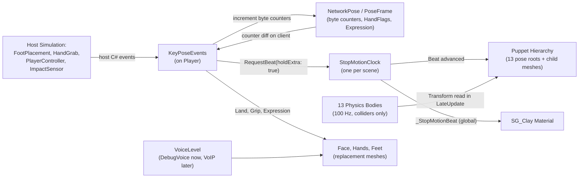

# Stop-Motion Claymation Look — Master Design Document

**Project:** Physical Walking Prototype (drunk active-ragdoll character). Moves into the main game repo with the character.  
**Version:** 0.5, 2026-10-29. Revised for readability, codebase accuracy, and expanded architectural pathways (see [Section 17](#17-review-record)).  
**Owner of every look decision and asset:** Alan. This document guides implementation; it contains exact specifications, architecture, and values rather than copy-paste scripts.

---

## Table of Contents

- [How to Use This Document](#how-to-use-this-document)
- [Units, Proportions, and Pixel Scale](#units-proportions-and-pixel-scale)
- [Timeline and Phase Overview](#timeline-and-phase-overview)
- **Part I — Principles and Research**
  - [1. Executive Summary](#1-executive-summary)
  - [2. Core Look Principles](#2-core-look-principles)
  - [3. What Makes Stop Motion Read (and Lessons from Shipped Games)](#3-what-makes-stop-motion-read-and-lessons-from-shipped-games)
  - [4. Key Architectural Decisions & Viable Alternatives](#4-key-architectural-decisions--viable-alternatives)
- **Part II — System & Art Design**
  - [5. Puppet & Clock Architecture](#5-puppet--clock-architecture)
  - [6. Body Construction & Asset Creation Pathways](#6-body-construction--asset-creation-pathways)
  - [7. Readability & Physical Comedy (Face, Voice, Hands, Feet, Dents, Get-Up, Cosmetics)](#7-readability--physical-comedy)
  - [8. The Clay Surface Shader (`SG_Clay`)](#8-the-clay-surface-shader-sg_clay)
  - [9. Comfort, Accessibility, and Photosensitivity](#9-comfort-accessibility-and-photosensitivity)
  - [10. World Lighting, Camera, and Post-Processing](#10-world-lighting-camera-and-post-processing)
- **Part III — Step-by-Step Build Plan**
  - [Phase 1 — Stop-Motion Prototype & Blind Playtest (30–40 h)](#phase-1--stop-motion-prototype--blind-playtest-3040-h-4-weeks)
  - [Phase 2 — Physical Maquette & Style Frame (12–18 h)](#phase-2--physical-maquette--style-frame-1218-h-2-weeks)
  - [Phase 3 — Look-Dev Scene & Clay Material (22–32 h)](#phase-3--look-dev-scene--clay-material-2232-h-3-weeks)
  - [Phase 4A — Readability Prototype: Face, Voice, Hands, Feet (25–35 h)](#phase-4a--readability-prototype-face-voice-hands-feet-2535-h-3-weeks)
  - [Phase 4B — Impacts, Get-Up Styles & Physical Cosmetics (60–85 h)](#phase-4b--impacts-get-up-styles--physical-cosmetics-6085-h-79-weeks)
  - [Phase 5 — Learn Blender & Graded Exercises (30–45 h)](#phase-5--learn-blender--graded-exercises-3045-h-4-weeks)
  - [Phase 6 — Sculpt the 16 Body Parts (40–70 h, or 15–30 h via Fast-Track)](#phase-6--sculpt-the-16-body-parts-4070-h-6-weeks)
  - [Phase 7 — Sculpt Face Pieces, Hands, Shoes & Cosmetics (24–36 h)](#phase-7--sculpt-face-pieces-hands-shoes--cosmetics-2436-h-34-weeks)
  - [Phase 8 — Assemble, Fix Poses & Match Style Frame (12–20 h)](#phase-8--assemble-fix-poses--match-style-frame-1220-h-2-weeks)
  - [Phase 9 — World Set Lighting, Camera & Comfort Menu (18–26 h)](#phase-9--world-set-lighting-camera--comfort-menu-1826-h-2-weeks)
  - [Phase 10 (Optional) — Continuous Skinned Body (60–100 h)](#phase-10-optional--continuous-skinned-body-60100-h)
  - [12. Playtest & Verification Protocols](#12-playtest--verification-protocols)
  - [13. Master Dials Reference Table](#13-master-dials-reference-table)
  - [14. Learning & Tool Resources](#14-learning--tool-resources)
- **Part IV — Project Records**
  - [15. Decision Log](#15-decision-log)
  - [16. Risks, Mitigations & Verified Engine Facts](#16-risks-mitigations--verified-engine-facts)
  - [17. Review Record](#17-review-record)
  - [18. Sources](#18-sources)

---

## How to Use This Document

- **Document Structure:**
  - **Part I** defines the artistic principles, industry research, and high-level architectural choices.
  - **Part II** specifies the technical and visual design of every subsystem.
  - **Part III** is the sequential build plan, test protocols, and tuning dials.
  - **Part IV** tracks project decisions, technical risks, review history, and reference sources.
- **Working the Steps:** Execute phases and steps in order. Each step includes an estimate in **focused hours**, and each phase ends with a **Done when** checklist. Tick every box before moving to the next phase.
- **Logging Decisions:** Whenever a step instructs you to *"record in Section 15"*, add a dated row to the [Decision Log](#15-decision-log) with your choice and rationale. A logged decision overrides any default in this document.
- **Tuning Defaults:** Starting values live in the [Master Dials Table (Section 13)](#13-master-dials-reference-table). Update that table when you re-tune a value and log why.
- **Unity Play Mode Rule:** Never save a C# script while Unity Play Mode is running; recompiling during play mode stops the session and corrupts non-reloaded static state.

---

## Units, Proportions, and Pixel Scale

- **Game Metres by Default:** Every measurement in this document is in **game metres (m)** or **centimetres (cm)** at game scale unless explicitly labelled **"maquette"**.
- **Character Dimensions (`Player.prefab`):**
  - **Total standing height:** `1.85 m` (foot soles at `y = 0.00 m`, head crown at `y = 1.85 m`), total mass `62.0 kg`.
  - **Key primitives:** Head is a `0.36 m` sphere; forearms are `0.09 × 0.30 m` capsules; hands are `0.11 m` spheres; feet are `0.16 × 0.10 × 0.30 m` boxes (`width × height × length`).
- **Maquette Scale (`1 : 9.25`):** The physical maquette is **20 cm tall**. Multiply any maquette measurement by **`9.25`** to get the game size (or divide game size by `9.25` to get maquette size).
- **Screen-Space Readability at 1080p:** With the gameplay camera `4.5–5.0 m` behind the character at a `60°` vertical field of view, **1 screen pixel** covers:

| Viewing Distance | Who You Are Looking At | 1 Pixel Covers | Character Height on Screen |
|---|---|---|---|
| **5 m** | Your own character | **~5.4 mm** | ~345 px |
| **10 m** | Nearby players | **~11 mm** | ~170 px |
| **15 m** | Players across a room | **~16 mm** | ~115 px |

> [!IMPORTANT]
> **The 1-Pixel Readability Rule:** Any visual feature smaller than ~1 pixel at the distance where it must be understood is invisible. Expressive features (eyes, mouths, hands, feet) are intentionally oversized and high-contrast so they read at **10–15 m**, while surface details (fingerprints, tool marks) are for close-ups (**< 5 m**).

---

## Timeline and Phase Overview

Estimates assume **9 focused hours per week** (evenings and weekends) for a developer who is new to 3D art. Phases run sequentially because one person builds both code and art.

```mermaid
flowchart LR
    subgraph Motion["1. Motion Gate (4w)"]
        P1["Phase 1: Clock, Puppet & Playtest"]
    end
    subgraph Design["2. Look & Mechanics (16w)"]
        P2["Phase 2: Maquette & Style Frame (2w)"]
        P3["Phase 3: LookDev & Clay Shader (3w)"]
        P4A["Phase 4A: Face, Voice, Hands, Feet (3w)"]
        P4B["Phase 4B: Dents, Get-Up, Cosmetics (8w)"]
    end
    subgraph Art["3. Blender & Sculpting (13w)"]
        P5["Phase 5: Learn Blender (4w)"]
        P6["Phase 6: Sculpt 16 Body Parts (6w)"]
        P7["Phase 7: Sculpt Face, Hands, Cosmetics (3w)"]
    end
    subgraph Finish["4. Polish & World (4w)"]
        P8["Phase 8: Assemble & Tune (2w)"]
        P9["Phase 9: World, Camera & Settings (2w)"]
    end
    P1 --> P2 --> P3 --> P4A --> P4B --> P5 --> P6 --> P7 --> P8 --> P9
```



| Phase | Deliverables | Focused Hours | Weeks (at 9 h/wk) |
|---|---|---|---|
| **1** | Stop-motion clock, visual puppet hierarchy, network key-pose signals, debug window, blind playtest | 30–40 h | 4 w |
| **Gate** | **Continue stepped holds only if a stepped variant passes the Section 12.1 playtest** | — | — |
| **2** | Reference library, physical maquette at ragdoll proportions, lit tabletop style frame | 12–18 h | 2 w |
| **3** | `LookDev` scene, `SG_Clay` master material on primitives, lighting & scale-look decisions | 22–32 h | 3 w |
| **4A** | Placeholder face, voice-driven replacement mouth, hands, feet, contact squash, readability test | 25–35 h | 3 w |
| **4B** | Shader impact dents, get-up styles (jump cut, invisible hand, re-sculpt), physical cosmetics (on placeholders) | 60–85 h | 7–9 w |
| **5** | Blender courses and 5 graded sculpting exercises | 30–45 h | 4 w |
| **6** | Sculpt, vertex-paint, decimate, and export the 16 body parts *(see Fast-Track options in Section 6.2)* | 40–70 h *(15–30 h fast-track)* | 6 w *(2–3 w)* |
| **7** | Sculpt replacement mouths, eyelids, hand poses, shoes, and cosmetics; re-verify readability | 24–36 h | 3–4 w |
| **8** | Pose gap fixes, dial tuning, style-frame overlay check, full-character turntable | 12–20 h | 2 w |
| **9** | Set lighting in `TestScene`, MSAA/Volume setup, player comfort menu, EA IRIS flash check | 18–26 h | 2 w |
| **10** | *(Optional)* Continuous skinned body — a separate follow-on project if segmented seams bother you | 60–100 h | 7–11 w |

**Total for Phases 1–9:** **275–405 hours** (~37 weeks / 8½ months at 9 h/week, or ~220–320 hours if using a Phase 6 sculpting fast-track).

> [!TIP]
> **Modular Scheduling:**
> - **Phase 1 comes first** because it tests the riskiest question (*does stepped motion feel good to play?*) before spending a single hour on 3D art.
> - **The Phase 1 Gate:** If no stepped variant passes [Section 12.1](#121-motion-playtest-phase-1), disable pose holds and record it in [Section 15](#15-decision-log). Phases 2–9 still deliver the full claymation aesthetic at 60+ fps (just as *Harold Halibut* did).
> - **Phase 4B is modular:** Its three features (dents, get-up styles, cosmetics) are independent and run on primitive placeholders. Any of them can be deferred until after Phase 8 without blocking the art pipeline.

---

# Part I — Principles and Research

## 1. Executive Summary

The character becomes a hand-crafted plasticine puppet while its underlying 100 Hz active-ragdoll physics remains completely untouched:

1. **Decoupled Visual Puppet:** A separate visual hierarchy (`Puppet`) copies the physics ragdoll's pose only on the ticks ("beats") of a shared `StopMotionClock`, holding still between beats just like a physical puppet between camera exposures.
2. **Animator-Chosen Key Poses:** Gameplay sensors (`FootPlacement`, `HandGrab`, `PlayerController`, `ImpactSensor`) request an immediate beat—plus an extra beat of hold—on key physical moments (foot plant, grab, stumble start, impact, direction reversal). Held frames land on expressive extremes rather than arbitrary mid-swing in-betweens.
3. **Long-Range Readability:** Face pieces, mitten hands, and shoes are oversized and high-contrast so players can read gazes, grips, foot plants, and who is speaking over proximity voice at up to **15 m**.
4. **Tactile Clay Surface & Physical Comedy:** Sculpted asymmetry, thumbprints, an oily clear-coat sheen over a matte subsurface base, motion-scaled surface "boil" on handled limbs, shader-driven impact dents, stop-motion get-up styles, and knock-off physical hats sell the physical medium.
5. **Player Comfort First:** Every stop-motion layer is an independent dial with an "Off" position exposed in player settings.

---

## 2. Core Look Principles

Every technical and artistic choice is checked against these 12 principles. Only change a principle by logging the rationale in [Section 15](#15-decision-log).

1. **Physics Never Steps:** The 100 Hz physics simulation and joint drives run continuously; only the rendered puppet holds.
2. **The Camera Never Steps:** The gameplay camera follows the smooth physics center of mass at full monitor refresh rate.
3. **Hold the Poses That Matter:** Foot plants, grabs, stumbles, impacts, and reversals trigger an immediate beat and an extra hold beat.
4. **Hand-Made Before Stepped:** Stepped holds on smooth CG primitives look like framerate lag. Judge stepped motion fairly only once the clay surface is active (Phase 3).
5. **Imperfect, Not Random:** Puppet "chatter" is a subtle per-part spatial pose error when handled. Clock timing stays rhythmic because rhythm sells physical slapstick.
6. **Clay Remembers:** Landing squashes and impact dents persist across beats until "re-sculpted." Surface boil only appears on limbs that actually moved.
7. **Readable at Play Distance (15 m):** Face, hands, and feet use exaggerated proportions and ≥ 30–50% luminance contrast. Fine fingerprints fade out beyond 8 m.
8. **Visible Voice:** You can tell who is talking by their replacement mouth shapes at any distance where their proximity voice is audible.
9. **Instant Player Identity:** Every player is identifiable at a glance by clothing hue and luminance value—even in greyscale, and even after their hat is knocked off.
10. **Physical Comedy Stays Clay:** Hard impacts dent the mesh; getting up looks staged by an animator; loose hats and glasses are real grabbable physics props.
11. **Comfort is a Setting:** Every stepped or flickering effect can be toned down or switched off individually. Luminance flicker never exceeds `±3%` (well below the `10%` photosensitivity flash threshold).
12. **Alan's Hand is in It:** Proportions, asymmetry, thumbprints, and colour palette come from Alan's physical maquette rather than generic asset packs.

---

## 3. What Makes Stop Motion Read (and Lessons from Shipped Games)

### 3.1 The Nine Visual Layers of Clay Stop Motion

| Layer | What Happens Visually | Production Evidence & Design Target |
|---|---|---|
| **1. Pose Holds** | The visual pose updates on discrete beats and holds rigid in between. | Classic TV clay (*Morph*, *Gumby*) shoots "on twos" (12 fps / 12 bps). Feature films mix ones (24 bps) and twos. *Spider-Verse* found holds of 3+ frames (≤ 8 bps) begin to feel choppy in fast action. |
| **2. Uneven Spacing (Chatter)** | Each moved limb has a tiny, non-accumulating positional/rotational error per beat where the animator's fingers nudged it. | Pure uniform sampling of a smooth curve just looks like low framerate. Micro-gauge error (`±0.75°`, `±4 mm`) gives the human hand away. |
| **3. Chosen Key Poses** | Contacts, stumbles, grabs, and reversals force a beat and hold 1 beat longer. | *Guilty Gear Xrd* proved stepped 3D characters feel responsive at 60 fps when the held poses hit the exact keyframes of contact and impact. |
| **4. Zero Motion Blur / Zero TAA** | Every frame is a razor-sharp still photograph. | *Spider-Verse*: *"If you stop on any frame in the movie, it's solid, sharp."* Temporal anti-aliasing (TAA) ghosts stepped frames together and must be disabled. |
| **5. Tactile Clay Surface** | Thumb facets, fingerprint ridges, waxy subsurface scatter, oily fingerprint sheen, and dust specks. | Shorts (*Morph*, Adam Elliot) embrace heavy prints; Aardman features smooth most prints out except at joints. Our shader dial spans both. |
| **6. Motion-Driven Boil** | Fingerprints and subtle surface lumps shift only on parts the animator just touched. | Global timer boil looks like animated wallpaper. Scaling boil by per-part displacement (`_BoilMotion`) keeps stationary limbs still while moving limbs shimmer. |
| **7. Moving Holds (Idle)** | An idle puppet still has a subtle stepped breathing rock. | Without a moving hold, a stepped character looks completely frozen like a paused video when standing still. |
| **8. Exposure Flicker** | Tiny frame-to-frame brightness shifts from studio lamps and aperture variance. | `±1%` luminance (`±0.0144 EV`) reads as photographed film; clamped in code to `±3%` (`±0.0426 EV`) and **Off** by default for accessibility. |
| **9. Studio Set Scale** | Close spot lamps with steep inverse-square falloff, warm 3200 K key light, and optional shallow depth of field. | Shallow bokeh screams "20 cm tabletop miniature"; deep focus reads as a full-scale set. Tested side-by-side in Phase 3 Step 9. |

### 3.2 Lessons from Games That Shipped (or Cut) Stepped Motion

- **Harold Halibut** *(Slow Bros, Unity — photogrammetry-scanned physical puppets):* Experimented with stepping character animations at 12 fps and **cut it before launch**. The developers explained on Steam: *"Since camera movements still need to be very fluid, we felt the effect was more distracting than pleasing."*
- **South of Midnight** *(Compulsion Games, Unreal 4):* Shipped stepped character motion at 60 fps with **per-character tuning** and a **gameplay toggle** after playtests showed heavy-handed stepping induced motion sickness in a subset of players.
- **Spider-Verse** *(Sony Pictures Imageworks):* Simulated secondary physics (cloth, hair) on ones while characters stepped on twos, because stepping raw physics simulations directly causes chaotic visual snapping.

### 3.3 The Core Motion Risk: Centre-Screen Judder

When a smooth 60+ Hz camera tracks a smooth 100 Hz physics pelvis while the rendered puppet holds its **world position** for 83 ms (at 12 bps), the rendered body drifts up to ~25 cm behind the camera's focus point and snaps forward 12 times a second. That **12 Hz centre-screen judder** is the primary trigger for simulator sickness in third-person games.

Phase 1 directly tests two hold modes in a blind playtest ([Section 12.1](#121-motion-playtest-phase-1)):
- **World Hold (`rootSmooth = false`):** Every part holds its world-space position and rotation between beats. Most authentic for remote players and props, but judders against the local follow camera.
- **Root-Smooth Hold (`rootSmooth = true`):** The pelvis part tracks the smooth physics pelvis every render frame, while the torso, head, and limbs hold their poses *relative to the pelvis* on beats. Eliminates centre-screen judder against the camera while keeping all limb and torso animation stepped.

---

## 4. Key Architectural Decisions & Viable Alternatives

Before diving into implementation, this section reviews the major architectural choices in the plan alongside equally viable alternatives and their trade-offs.

### 4.1 Motion Stepping Architecture

| Option | How It Works | Pros | Cons | Verdict |
|---|---|---|---|---|
| **A. Sibling `Puppet` Hierarchy in `LateUpdate`** *(Selected)* | Physics bodies lose their renderers; a sibling `Puppet` hierarchy copies transforms on clock beats in `LateUpdate`. | 100% isolated from physics & networking; supports `rootSmooth`, per-part chatter, squash, and mesh swapping cleanly; automatic shadow/culling bounds. | Adds 16 lightweight Transform nodes per player. | **Use this.** Cleanest separation of simulation and presentation. |
| **B. Render-Hook Transform Override (`beginCameraRendering`)** | Keep renderers on physics bodies; cache held poses and overwrite/restore transforms around `RenderPipelineManager` camera callbacks. | Zero extra GameObjects in `Player.prefab`. | Fragile with Rigidbody interpolation, child colliders (`Hand_L/R`), shadow passes, and non-uniform squash scaling. | **Skip.** High risk of subtle physics/collider side effects. |
| **C. GPU Vertex / Matrix Buffer Stepping** | Upload beat-held transform matrices to the shader via a `ComputeBuffer` or material properties. | No CPU Transform updates on beats. | Breaks Unity frustum culling, shadow caster bounds, and attachment hierarchy for cosmetics/faces. | **Skip.** Over-engineered for 16 rigid parts. |

### 4.2 Clay Lighting & Shader Architecture (URP 17.6.0)

Real plasticine has a **matte, slightly translucent mineral/wax base** (soft light terminator) topped by a **glossy dielectric skin-oil film** where fingers pressed it (Rowbotham's two-layer Weidlich–Wilkie model).

| Option | How It Works in URP 17.6 | Pros | Cons | Verdict |
|---|---|---|---|---|
| **A. URP `Lit` + Built-in `Clear Coat` + Subsurface Wrap** *(Recommended)* | Enable `Clear Coat` in `SG_Clay`'s `Lit` Graph Settings (`Coat Mask` & `Coat Smoothness` driven by fingerprints) over a matte base (`Smoothness 0.18`), plus a wrapped diffuse term in `Emission`. | Gives Rowbotham's exact **two-layer oily-over-matte BRDF** out of the box; full support for Forward+, Spot Lights, Reflection Probes, Soft Shadows, and normal-mapped `DepthNormals` SSAO. | Slightly higher fragment cost than single-lobe `Lit` (negligible at 4 players on PC). | **Best visual & technical fit.** |
| **B. Standard Single-Lobe URP `Lit` (`Smoothness + 0.15`)** | Base `Lit` shader with `Smoothness = 0.20 + 0.15 * printMask`. | Simplest possible graph (Phase 3 Step 3 baseline). | Narrows the single GGX specular lobe instead of layering a sharp oil glint over a wide waxy base; hard Lambertian shadow terminator looks plastic. | **Use as Step 3 baseline, then enable Clear Coat in Step 4.** |
| **C. Shader Graph `Custom Lighting` Sample (`Unlit` Target)** | Uses `Samples~/CustomLighting` (`LightOrenNayar` / `LightURP`) on an `Unlit` master node. | Total manual control over diffuse math. | **Verified URP 17.6 traps:** (1) `Lit Oren Nayar` in the sample has **no `AdditionalLights` loop** and renders **100% black** under `LookDev`'s spot lights; (2) `AdditionalLightsURP` averages multi-light colours incorrectly; (3) `Unlit` targets do not write fragment normals to `DepthNormals`, breaking fingerprint SSAO. | **Avoid the `Unlit` sample.** Keep `URP Lit` as the master target. |

### 4.3 Facial & Hand Replacement Animation Architecture

| Option | How It Works | Pros | Cons | Verdict |
|---|---|---|---|---|
| **A. 3D Mesh Swapping (`MeshFilter.sharedMesh`)** *(Selected)* | Swap between 5 sculpted mouth meshes, 3 eyelid meshes, and 3 hand poses on beats. | Authentic to Aardman/Laika replacement trays; works freely with Blender Voxel Remesh (`Ctrl+R`) and `Decimate`; zero runtime deform cost; natural per-piece fingerprint boil. | Can show an intersection seam against the head if sculpted as a bare hole rather than a raised clay lip/muzzle patch. | **Use this.** Sculpt mouths with a rounded outer lip rim so the seam looks thumb-pressed. |
| **B. 2D/Normal Atlas Flipbook or URP Decal** | Project or UV-map a texture/normal flipbook of mouths and eyes onto the head sphere. | Zero mesh seam; trivial to draw 12+ expressions in 2D. | Flat silhouette in side profile; reads more like *Lego Movie* painted plastic than 3D clay; URP Decals require Rendering Layer Masks to avoid projecting onto hands near the face. | **Viable fallback** if 3D mouth sculpting feels too slow in Phase 7. |
| **C. BlendShapes (Blender Shape Keys)** | Morph a single head/hand mesh between expressions, stepped on clock beats. | Continuous mesh with no replacement seam. | **Incompatible with Blender's `Voxel Remesh` and `Decimate` modifiers**; requires `SkinnedMeshRenderer` (breaks static `MeshRenderer` batching); linear vertex travel looks like CG morphing. | **Skip** for main face/hands (reserve for optional single-axis flatten). |

### 4.4 Impact Dent Architecture

| Option | How It Works | Pros | Cons | Verdict |
|---|---|---|---|---|
| **A. Shader Vertex Displacement (`SG_Dent`)** *(Selected)* | Up to 2 active dents per part (`_DentA/B`), displacing vertices inward at the exact world impact point with a raised rim and recomputed normals. | Dents appear at the **exact collision contact point and angle**; zero extra meshes to sculpt; feeds shadow pass automatically. | Requires sufficient vertex density (~1–2 cm spacing, met by Section 8.6 budgets) and world-normal tangent construction (since meshes have no UVs). | **Use this.** |
| **B. Pre-Sculpted "Dented" Replacement Meshes** | Swap `P_Head` or `P_Torso` to a pre-sculpted dented mesh on hard impact. | Hand-sculpted creases and folds. | Dents appear in a fixed spot regardless of where the hit landed; doubles the number of body meshes to sculpt and maintain. | **Optional supplement** for one signature gag (e.g. a pancake-flat head). |

---

# Part II — System & Art Design

## 5. Puppet & Clock Architecture

### 5.1 Current `Player.prefab` Structure (Verified Against Codebase)

Currently, [`Player.prefab`](file:///home/sam/Repos/personal/PhysicalWalkingPrototype/Assets/DrunkCharacter/Prefabs/Player.prefab) renders the character using **16 Unity primitive meshes** attached to **13 physics `Rigidbody` objects** (all on Layer 8 `PlayerBody`, total mass `62.0 kg`, standing height `1.85 m`, with `RigidbodyInterpolation.Interpolate` enabled on host):

| Physics Body (`Rigidbody`) | Mass | Prefab Local Rotation | Scale (`lossyScale`) | Extra Rendered Child Parts (No `Rigidbody`) |
|---|---|---|---|---|
| `Pelvis` | 14.0 kg | `identity` | `(0.34, 0.20, 0.22)` | — |
| `Torso` | 13.0 kg | `identity` | `(0.40, 0.36, 0.24)` | — |
| `Head` | 4.0 kg | `identity` | `(0.36, 0.36, 0.36)` | `Nose` (no collider; local pos `(0, -0.05, 0.55)`, world scale `(0.0648, 0.0648, 0.108)`) |
| `UpperArm_L` / `UpperArm_R` | 2.0 kg each | **`+90° Y` (L) / `-90° Y` (R)** | `(0.10, 0.14, 0.10)` | — |
| `Forearm_L` / `Forearm_R` | 1.5 kg each | `identity` | `(0.09, 0.15, 0.09)` | `Hand_L` / `Hand_R` (have `SphereCollider`s acting as compound colliders on the forearm `Rigidbody`; world scale `(0.11, 0.11, 0.11)`) |
| `Thigh_L` / `Thigh_R` | 7.0 kg each | `identity` | `(0.18, 0.21, 0.18)` | — |
| `Shin_L` / `Shin_R` | 3.5 kg each | `identity` | `(0.14, 0.20, 0.14)` | — |
| `Foot_L` / `Foot_R` | 1.5 kg each | `identity` | `(0.16, 0.10, 0.30)` | — |

- **Flat Hierarchy:** The 13 physics bodies, `CameraTarget`, and the `Ghost` rig are direct children of `Player`. The `Player` root never moves after spawn.
- **Zero Renderer Dependencies:** No existing script reads or modifies `MeshRenderer` or `MeshFilter` components, so moving all renderers to a sibling `Puppet` hierarchy is 100% safe.
- **Client Simulation Disabling:** [`NetworkPlayer.OnNetworkSpawn`](file:///home/sam/Repos/personal/PhysicalWalkingPrototype/Assets/DrunkCharacter/Scripts/NetworkPlayer.cs#L57-L99) disables all 14 `simulation` behaviours on clients and sets all 13 `Rigidbody` components to `isKinematic = true` and `interpolation = None`. Therefore, `FootPlacement`, `HandGrab`, and `PlayerController` physics events never fire directly on clients; instead, [`NetworkPose`](file:///home/sam/Repos/personal/PhysicalWalkingPrototype/Assets/DrunkCharacter/Scripts/NetworkPose.cs) drives client transforms from unreliable 60 Hz [`PoseFrame`](file:///home/sam/Repos/personal/PhysicalWalkingPrototype/Assets/DrunkCharacter/Scripts/PoseFrame.cs) packets.

### 5.2 The New `Puppet` & Event Architecture



> [!WARNING]
> **Critical Invariant — No `Rigidbody` or `Collider` Under `Puppet`:**
> - [`BalanceSensor.Awake` (line 54)](file:///home/sam/Repos/personal/PhysicalWalkingPrototype/Assets/DrunkCharacter/Scripts/BalanceSensor.cs#L54) calls `GetComponentsInChildren<Rigidbody>()` on `Player` to build `Bodies`, and [`NetworkPose.ReceivePoseRpc` (line 86)](file:///home/sam/Repos/personal/PhysicalWalkingPrototype/Assets/DrunkCharacter/Scripts/NetworkPose.cs#L86) drops any network frame whose body count differs from `Bodies.Length` (`13`).
> - [`PlayerController.Awake` (line 151)](file:///home/sam/Repos/personal/PhysicalWalkingPrototype/Assets/DrunkCharacter/Scripts/PlayerController.cs#L151) and [`HandGrab.Awake` (line 70)](file:///home/sam/Repos/personal/PhysicalWalkingPrototype/Assets/DrunkCharacter/Scripts/HandGrab.cs#L70) call `GetComponentsInChildren<Collider>()` on `Player`.
> - Therefore, **no object inside `Puppet` (including face pieces and attached cosmetics) may ever have a `Rigidbody` or `Collider`**. Always create puppet objects as empty `GameObject`s and add `MeshFilter` + `MeshRenderer` manually (never via *GameObject > 3D Object*, which adds a collider).

### 5.3 Hierarchy & Transform Rules for `PuppetPart`

To prevent non-uniform scale skew on rotated children (eyes, hats) and prevent `Nose` and `Hand_L/R` from detaching during chatter or idle breathing, `Puppet` uses a clean **Pose-Root + Mesh-Child** structure:

1. **Pose Roots vs. Mesh Children:**
   - Each `PuppetPart` (`P_Pelvis`, `P_Torso`, `P_Head`, `P_UpperArm_L/R`, `P_Forearm_L/R`, `P_Hand_L/R`, `P_Thigh_L/R`, `P_Shin_L/R`, `P_Foot_L/R`) sits at **scale `(1, 1, 1)`** and holds the `PuppetPart` script (which only updates position and rotation on beats).
   - Inside each `P_<Part>`, a child GameObject named **`Mesh`** holds the `MeshFilter`, `MeshRenderer`, and the part's `baseScale` (set to `source.lossyScale` while using Unity primitives in Phases 1–4B, and `(1, 1, 1)` once replaced by metre-scale sculpted FBX meshes in Phase 6).
   - **Why this matters:**
     - Face pieces (`Eyes`, `Mouth`) and head cosmetics (`Hat`, `Glasses`) are parented to **`P_Head`** (at scale `(1, 1, 1)`), **not** `P_Head/Mesh`. They stay at true metre scale in both Phase 4A and Phase 6, and never shear or squash when `P_Head/Mesh` flattens on impact!
2. **Rigid Attachment of `Nose` and `Hand_L/R`:**
   - **`P_Nose`** is a child of **`P_Head`** (not a separate `PuppetPart`), so it automatically moves with `P_Head`'s chatter and idle breathing. (In Phase 6, you can either export `Nose` on `P_Nose` or sculpt the nose directly into `SM_Puppet_Head`.)
   - **`P_Hand_L/R`** have `PuppetPart.parentPart` set to `P_Forearm_L/R` and `followParentChatter = true`. On each beat, `P_Hand_L/R` positions itself at `P_Forearm_L/R`'s post-chatter transform plus the hand's local offset from the forearm (`Forearm.InverseTransformPoint(Hand.position)`), with **zero independent positional chatter** so the wrist never separates into a gap.
3. **Execution Timing (`LateUpdate`):**
   - `StopMotionClock` advances in `Update`.
   - `PuppetPart` copies transforms in **`LateUpdate`** when `StopMotionClock.Beat != lastBeat`. Running in `LateUpdate` guarantees [`NetworkPose.Update`](file:///home/sam/Repos/personal/PhysicalWalkingPrototype/Assets/DrunkCharacter/Scripts/NetworkPose.cs#L101) has already applied the current frame's network pose on clients.
   - Always read `source.position` and `source.rotation` (the interpolated `Transform`), never `Rigidbody.position`.
4. **Domain Reload Off Reset:**
   - This project has **Enter Play Mode Options** enabled with Domain Reload **off** (`m_EnterPlayModeOptions: 3` in `EditorSettings.asset`). Reset all static fields (`StopMotionClock.Instance`, `Beat`, static events) inside a `[RuntimeInitializeOnLoadMethod(RuntimeInitializeLoadType.SubsystemRegistration)]` method.
5. **Spawn & Teleport Snapping:**
   - On spawn (`OnEnable`), `PuppetPart` copies every frame until the first beat after `OnEnable` (because `NetworkPlayer.OnNetworkSpawn` moves the character after `OnEnable`, and clients wait for their first `PoseFrame`).
   - Whenever `KeyPoseEvents.Snapped` fires (on `CharacterReset`, `StandAt`, or client `ResetCount` change), all parts copy immediately on that frame without waiting for a beat.
6. **Time-Scaled Benches & Frame Spikes:**
   - [`SwayBench`](file:///home/sam/Repos/personal/PhysicalWalkingPrototype/Assets/Sandbox/Debug/SwayBench.cs#L31) and [`TerrainBench`](file:///home/sam/Repos/personal/PhysicalWalkingPrototype/Assets/Sandbox/Debug/TerrainBench.cs#L57) speed up runs using `Time.timeScale`. The clock advances at most **one beat per rendered frame** (`nextBeatTime = Time.time + interval`) and never catches up on missed beats after a hitch.

### 5.4 `KeyPoseEvents` and Network Synchronization

Create `Assets/DrunkCharacter/Scripts/KeyPoseEvents.cs` (one on `Player`). Both host and client visual scripts subscribe solely to `KeyPoseEvents`:

```csharp
public enum KeyPose : byte
{
    LandL, LandR,
    GripL, GripR,
    StumbleStarted,
    Impact,
    Reversal,
    RecoverStart,
    RecoverStand
}

public enum Expression : byte { Neutral, Grimace, Shock }

// Members on KeyPoseEvents:
public event Action<KeyPose> Raised;   // fires on both host and clients
public event Action Snapped;           // fires on spawn reset, StandAt, or client ResetCount change
public byte HandFlags { get; private set; }       // bit0: L reach, bit1: L hold, bit2: R reach, bit3: R hold
public Expression CurrentExpression { get; private set; }
```

#### Host Signal Sources (Verified Against Existing Scripts)

| `KeyPose` | Existing Script & Line | What to Add |
|---|---|---|
| `LandL` / `LandR` | [`FootPlacement.AdvanceSwing` (line 677)](file:///home/sam/Repos/personal/PhysicalWalkingPrototype/Assets/DrunkCharacter/Scripts/FootPlacement.cs#L677), right where `LastLandTime = Time.time;` is set | Add `public event Action Landed;` to `FootPlacement` and invoke it at line 677. |
| `GripL` / `GripR` | [`HandGrab.TryGrip` (line 137)](file:///home/sam/Repos/personal/PhysicalWalkingPrototype/Assets/DrunkCharacter/Scripts/HandGrab.cs#L137), right after `gripping = true;` | Add `public event Action Gripped;` to `HandGrab` and invoke it after `holdsBody = held != null;` (line 138). |
| `StumbleStarted` | [`PlayerController.UpdateFallMeter` (line 286)](file:///home/sam/Repos/personal/PhysicalWalkingPrototype/Assets/DrunkCharacter/Scripts/PlayerController.cs#L286) | Add `public event Action StumbleStarted;` to `PlayerController`. Raise when `charge > 0f` this tick and `prevCharge == 0f` (reset `prevCharge = 0f` in `ClearFallMeter`). |
| `Impact` | No existing ground-impact signal (`Fell` fires while still upright when the fall meter fills) | Add `ImpactSensor` to the physics bodies. While `playerController.IsFallen`, on the first `OnCollisionEnter` against a non-self collider with approach speed `Δv > 1.0 m/s`, raise `Impact` once per fall. |
| `Reversal` | Computed in `KeyPoseEvents.FixedUpdate` (host only) | Track pelvis horizontal velocity `v = pelvis.linearVelocity.Flat()`. While `v.magnitude > 0.3 m/s`, store `lastDir = v.normalized`. Raise `Reversal` when `Vector3.Dot(v, lastDir) < 0f` and `v.magnitude > 0.3 m/s` (cooldown `0.3 s`). |
| `RecoverStart` / `RecoverStand` | Added in Phase 4B (`RecoveryController` / `PlayerController`) | Raised when recovery begins and when the character finishes standing up ([Section 7.6](#76-getting-up-recovery-styles)). |

#### Host State Polling (`HandFlags` & `CurrentExpression`)

- **Reaching (`bit 0` / `bit 2`):** `playerController.CurrentInput.GrabLeft` (or `GrabRight`) is `true` and `!handGrab.IsHolding`.
- **Holding (`bit 1` / `bit 3`):** `handGrab.IsHolding` is `true`.
- **`CurrentExpression`:**
  - `Shock` while `playerController.IsFallen` and `pelvis.linearVelocity.magnitude > 1.0 m/s`;
  - `Grimace` while `playerController.FallMeterFraction > 0.3f`;
  - `Neutral` otherwise.

#### Replicating to Clients via `PoseFrame`

- **Payload (`+11 bytes` on the existing 142-byte [`PoseFrame`](file:///home/sam/Repos/personal/PhysicalWalkingPrototype/Assets/DrunkCharacter/Scripts/PoseFrame.cs)):**
  - Add 9 `byte` counters (one per `KeyPose`; 7 used in Phase 1, 2 used in Phase 4B), `byte HandFlags`, and `byte Expression` to `PoseFrame.NetworkSerialize`.
  - Total `PoseFrame` size becomes **153 bytes** (~73.4 kbps at 60 Hz), well under `UnityTransport`'s 6144-byte payload limit.
- **Host Write:** `KeyPoseEvents` increments the corresponding `byte` counter whenever a `KeyPose` fires. [`NetworkPose.SendPose`](file:///home/sam/Repos/personal/PhysicalWalkingPrototype/Assets/DrunkCharacter/Scripts/NetworkPose.cs#L60) copies the counters, `HandFlags`, and `Expression` into the outgoing `PoseFrame`.
- **Client Read (Avoiding Late-Join Event Bursts):**
  - In [`NetworkPose.Update`](file:///home/sam/Repos/personal/PhysicalWalkingPrototype/Assets/DrunkCharacter/Scripts/NetworkPose.cs#L101), track `bool hasBaselineCounters`, `int lastToTick`, and the previous `to` frame's counters.
  - On the very first frame received (or whenever `from.ResetCount != to.ResetCount`), copy `to`'s counters into the baseline **without** raising events (so a late-joining client doesn't fire a burst of old events on spawn).
  - Thereafter, whenever `to.Tick != lastToTick`, compare each counter on `to` against the stored baseline; if changed, call `KeyPoseEvents.RaiseFromNetwork(pose)` and update the baseline. Using `byte` counters ensures events still fire even if an unreliable `PoseFrame` packet was dropped!
- **Client & Host Snapping:**
  - On a client, `NetworkPose.Update` calls `KeyPoseEvents.RaiseSnapped()` at line 118 when `from.ResetCount != to.ResetCount`.
  - On the host, `KeyPoseEvents` raises `Snapped` on `playerController.CharacterReset`.

### 5.5 `StopMotionClock` Specification

| Feature | Exact Behaviour |
|---|---|
| **Base Rate** | `beatsPerSecond` (default `12`). Normal interval `dt = 1f / beatsPerSecond`. |
| **Requested Beats (`RequestBeat`)** | Sets a pending flag (`pendingBeat = true`, `pendingExtraHold |= holdExtra`), safe to call from `FixedUpdate`. On the next `Update`, if at least `minBeatInterval` (`1/24 s`) has elapsed since the last beat, beat immediately and schedule the next beat after `(1 + (pendingExtraHold ? extraHoldBeats : 0)) * interval`. |
| **Timing Variation** | Multiplies each scheduled interval by `1f + Random.Range(-timingVariation, timingVariation)` (default `0`, range `0–0.05`). |
| **Holds Off** | Advances `Beat` every `Update` frame. |
| **Global Shader Beat** | On every beat, calls `Shader.SetGlobalFloat("_StopMotionBeat", Beat % 1200)`. (`1200` is divisible by `2, 3, 4, 5, 6, 8, 10, 12`, so modulo texture swaps never glitch at the wrap.) |

### 5.6 `PuppetPart` Behaviour Specification

| Feature | Exact Behaviour |
|---|---|
| **World Hold (`rootSmooth = false`)** | On a beat, set `transform.SetPositionAndRotation(source.position, source.rotation)`. |
| **Root-Smooth Hold (`rootSmooth = true`)** | `P_Pelvis` copies `Pelvis` every render frame in `LateUpdate`. Every other part stores its pose relative to `Pelvis` (`relPos = Pelvis.InverseTransformPoint(source.position)`, `relRot = Quaternion.Inverse(Pelvis.rotation) * source.rotation`) on a beat, and every render frame applies that held relative pose on top of `P_Pelvis`'s current smooth transform. |
| **Moved Threshold** | A part counts as having **moved** on a beat if `source.position` moved `> 1 mm` or `source.rotation` rotated `> 0.5°` since that part's previous beat. |
| **Chatter** | On a beat, if the part moved, apply a fresh random rotation of up to `chatterDegrees` (`0.75°`) around a random unit axis and a random offset of up to `chatterMetres` (`4 mm`, except `0 mm` on `P_Hand_L/R` so wrists stay attached). Replaces the previous beat's chatter; **never accumulates**. |
| **Moving Hold (Idle Breathing)** | Character is idle when pelvis speed `< 0.05 m/s` for `0.5 s`. On each beat while idle, add a pitch rotation of `idleAmplitude * Mathf.Sin(2f * Mathf.PI * 0.25f * Time.time)` degrees around `P_Pelvis.right` to `P_Torso` and `P_Head`. Clear on the first non-idle beat. |
| **Contact Squash** | Applied to the **`Mesh` child transform** (never the `P_<Part>` pose root). Multiplies `baseScale` by `(1.08f, 0.85f, 1.08f)` with `0.85f` aligned to the contact normal for `squashBeats` (`2`) beats, then restores `baseScale` on a beat. On `P_Foot_L/R`, also shifts `Mesh.localPosition.y` down by `(1f - 0.85f) * 0.05f = -0.0075 m` (`-7.5 mm`) during the squash so the shoe sole stays planted on the floor instead of lifting up! |

---

## 6. Body Construction & Asset Creation Pathways

### 6.1 Body Construction: Three Architectural Options

| Criterion | A. Segmented Puppet *(Selected)* | B. Continuous Skinned Body *(Optional Phase 10)* | C. Volumetric Blobs / SDF (MudBun / Clayxels) |
|---|---|---|---|
| **How it works** | One sculpted clay mesh per rigid part (16 total), with rounded ball ends overlapping at joints. | One unified mesh deformed by a 13-bone armature driven by the physics bodies. | Real-time GPU signed-distance-field metaballs that melt together on contact. |
| **Visual look** | Authentic stop-motion puppet; joints hide under clothing cuffs/collars or read as ball-and-socket seams. | Bends like a single continuous piece of rubber/clay (*Gang Beasts* / *Human Fall Flat*). | Goopy, liquid-clay fusion whenever limbs touch. |
| **Fit with active ragdoll** | 1-to-1 with the 16 parts; **zero rigging, zero weight painting, zero UVs**. | Requires retopology, UV unwrapping, normal baking, and careful weight painting. | Hard to control when a hand grabs another player or a prop. |
| **Failure mode** | Joint ball shows if a limb twists to an extreme ragdoll angle. | Mesh stretches like taffy if a joint pulls apart under `HandGrab` or fall forces. | Compute-shader heavy; `Clayxels` is broken in Unity 6 / URP 17; look belongs to the plugin. |

**Decision:** Start with **Option A (Segmented Puppet)**. Real stop-motion puppets use segmented limbs hidden by sleeves, collars, and trousers, or visible ball sockets, and replacement mouths/eyelids/hands are separate pieces anyway. **Option B** is fully specified as an optional Phase 10 if you later want seamless joints.

### 6.2 Three Viable Pathways to Create the 3D Clay Parts (Phase 6)

Because you are already sculpting a physical 20 cm clay maquette in Phase 2, you do **not** have to rely solely on slow freehand mouse/tablet sculpting from scratch in Phase 6. Here are three viable asset-creation pathways you can mix and match:

| Pathway | How It Works | Pros | Cons | Time for Phase 6 |
|---|---|---|---|---|
| **Pathway 1: Freehand Blender Voxel Sculpting** *(Baseline Plan)* | Duplicate each guide primitive in Blender, `Voxel Remesh` (`Ctrl+R`), sculpt with `Clay Strips` and `Clay Thumb` matching your maquette photos, `Decimate`, and export. | Teaches core freehand 3D sculpting skills; works well for simple shapes (limbs, nose, eyes). | Slowest for a beginner; matching 2D photos by eye across 16 parts takes 40–70 hours. | **40–70 h** |
| **Pathway 2: Phone Photogrammetry of Your Phase 2 Maquette** *(Fast-Track Hybrid)* | Take 50–80 overlapping phone photos around your physical Phase 2 maquette (dusted with cornstarch/talc if glossy), reconstruct a 3D mesh in **Meshroom** (free, native Linux) or **KIRI Engine / Polycam**, align to `Guide.fbx` in Blender, `Voxel Remesh`, and `Decimate`. | Captures your **literal hand-sculpted physical clay** (the exact *Harold Halibut* workflow); skips 40+ hours of re-sculpting proportions by eye; no drawing tablet needed. | Tiny parts (9 mm maquette eyes/mouths) are still easier to make in Blender than to scan; requires cleaning scan bases in Blender. | **15–25 h** |
| **Pathway 3: Non-Destructive Blender Modifier Stack** *(Programmer-Friendly)* | Block out parts with simple primitives or **Metaballs**, then stack three modifiers: **1. `Remesh` (Voxel `0.004 m`)** $\rightarrow$ **2. `Displace` (3D `Clouds`/`Voronoi` texture for automatic clay lumps)** $\rightarrow$ **3. `Decimate`**. Optionally apply and add 3–4 `Clay Thumb` strokes. | **100% non-destructive and mouse-friendly** (no tablet required); fixing a gap in Phase 8 is just moving a sphere in Edit Mode; very fast iteration. | Purely procedural lumps need a few manual `Clay Thumb` stamps on hero parts (Head, Hands) so they don't look uniform. | **15–30 h** |

> [!TIP]
> **Recommended Hybrid Strategy:** Learn the basics in Phase 5, then try **Pathway 3 (Non-Destructive Modifier Stack)** or **Pathway 2 (Maquette Scan)** on the Torso and Forearm first. Use freehand `Clay Thumb` sculpting only for the final 10% of hero surface marks!

---

## 7. Readability & Physical Comedy

All dimensions below are in **game metres** on the existing `0.36 m` head sphere. Pixel heights are at **1080p** from `15 m` away (`1 px ≈ 16 mm`).

### 7.1 Face & Voice-Driven Mouth

#### Eyes, Pupils, and Eyelids (Parented to `P_Head`)

| Piece | Game Size & Value Contrast | Screen Size at 15 m | Behaviour |
|---|---|---|---|
| **Eye Whites** | Two `8 cm` spheres, centres `10 cm` apart on upper front of head; value `≥ 90%` (off-white clay) | **5 px** across | Static children of `P_Head`. |
| **Pupils** | Two `3.5 cm` black discs/flattened spheres on front of eyes; value `≤ 10%` | **2 px** across | **Pupil Lead:** On each beat, `EyeDriver` rotates each pupil's yaw by `Mathf.Clamp(headYawRateDegPerSec * 0.2f, -25f, 25f)`. Computes `headYawRate` locally from `Head` source between beats (zero network cost). |
| **Eyelids** | 3 replacement meshes per eye (`Open`, `Half`, `Closed`), pivot at eye centre | **5 px** across | **Blinks:** 5-beat sequence (`Half → Closed → Closed → Half → Open`) every `2–6 s` at random.<br>**Drunk Rest Pose:** Rests at `Half` whenever `NetworkPlayer.DrunkAmount >= 0.6f` (already replicated), otherwise `Open`. |

#### Replacement Mouths (Parented to `P_Head`)

The mouth is a single child object under `P_Head` whose `MeshFilter.sharedMesh` swaps between **5 sculpted replacement pieces** (sculpted with a raised clay lip rim so the seam reads as a pressed-on clay piece, with a near-black interior of value `≤ 10%` against `≥ 60%` skin clay):

| Mouth Shape | Opening Size (W × H) | When Used | Height at 15 m |
|---|---|---|---|
| **1. `Closed`** | `14 cm` wide crease, `1.5 cm` deep | Silent & `Expression.Neutral` | 1 px |
| **2. `Mid`** | `16 × 8 cm` dark cavity | Talking (medium voice envelope `0.15–0.55`) | **5 px** |
| **3. `Wide`** | `18 × 12 cm` dark cavity | Talking (loud voice envelope `> 0.55`) | **7 px** |
| **4. `Grimace`** | `18 × 5 cm` with bright teeth band | Stumbling (`Expression.Grimace`: `FallMeterFraction > 0.3`) | 3 px |
| **5. `Shock`** | `9 × 11 cm` vertical "O" oval | Falling fast (`Expression.Shock`: `IsFallen` & speed `> 1 m/s`) | **7 px** |

> [!NOTE]
> **Why there is no "Small" talking mouth:** A `4 cm` mouth opening is under `2.5 px` at `15 m` and fails readability tests. Talking alternates strictly between `Closed`, `Mid`, and `Wide`.

#### Driving the Mouth from Voice (`VoiceLevel` & `MouthDriver`)

1. **`VoiceLevel` Component (on `Player`):** Exposes `public float Level` (`0–1`).
   - **Phase 4A Prototype (`DebugVoice`):** Generates a synthetic `5 Hz` syllable wave (random peaks `0.4–1.0`) on one selected player. Pressing **`F8`** cycles which character is talking (ordered by `OwnerClientId`, then none).
   - **Production Proximity Voice:** Each client measures the playback RMS loudness of each player's spatial audio stream locally and writes it to `VoiceLevel.Level`—requiring **zero extra network traffic**.
2. **`MouthDriver` Component (on the Mouth object):**
   - Smooths `VoiceLevel.Level` every frame into an asymmetric envelope (`attack = 0.03 s`, `release = 0.12 s`).
   - On each clock beat, selects the mouth mesh:
     - Envelope `< 0.15`: uses `KeyPoseEvents.CurrentExpression` (`Neutral → Closed`, `Grimace`, or `Shock`).
     - Envelope `0.15–0.55`: `Mid` (talking overrides expression).
     - Envelope `> 0.55`: `Wide`.
   - **Anti-Flutter Minimum Hold:** Holds any chosen mouth shape for at least `1/12 s` (`83 ms`) even if the player sets pose holds to `Light` (`18 bps`) or `Off`.

### 7.2 Exaggerated Hands

- **Proportions:** Mitten-like clay gloves with a distinct thumb, **`20 cm` across** (`1.8×` the `11 cm` physics sphere), centred on `Hand_L/R`.
- **Contrast:** Glove luminance value differs from both the body clay and the floor by **at least 30 points** (on a `0–100` scale).
- **Replacement Poses (Swapped on Beats from `KeyPoseEvents.HandFlags`):**
  1. **`Relaxed`:** Default lightly curved mitten.
  2. **`Reach`:** Wide-open spread palm and thumb while grab input is held (`GrabLeft/Right`) but not yet holding an object.
  3. **`Grip`:** Closed fist around a central hollow while `IsHolding` is true.
- **Contact Squash:** On `GripL` / `GripR`, that hand's `Mesh` child squashes (`(1.08, 0.85, 1.08)`) for `squashBeats` (`2`) beats.

### 7.3 Oversized Shoes (Preserving Stair Physics)

The foot box colliders (`0.16 × 0.10 × 0.30 m`) are tightly tuned for [`FootPlacement`](file:///home/sam/Repos/personal/PhysicalWalkingPrototype/Assets/DrunkCharacter/Scripts/FootPlacement.cs) on `Stairs15` and `Stairs20`. **Shoes never alter the physics colliders.**

| Dimension | Physics Collider | Max Shoe Visual Size | Growth Direction & Rule |
|---|---|---|---|
| **Sole (Bottom)** | `y = -0.05 m` from `Foot` centre | Flush (`0 mm` downward) | **Never extend below the collider sole.** |
| **Width (X)** | `0.16 m` | Up to **`0.22 m`** | Symmetric (`±3 cm` wider). |
| **Height (Y)** | `0.10 m` | Up to **`0.16 m`** | Upward only (`+6 cm` chunkier). |
| **Length (Z)** | `0.30 m` | Up to **`0.36 m`** | `+3 cm` past toe, `+3 cm` past heel, with **`2 cm` upward toe curl ("toe spring")** so the toe doesn't visually clip stair risers. |

- **Contrast:** Shoe luminance value differs from the floor by **at least 30 points**.
- **Landing Squash:** On `LandL` / `LandR`, that foot's `Mesh` child scales by `(1.08, 0.85, 1.08)` **and shifts its local Y down by `-7.5 mm`** for `squashBeats` (`2`) beats so the sole squashes flat against the floor.

### 7.4 Player Identity

- **Four Distinct Player Hues:** Spaced at least `60°` apart on the colour wheel, applied to the player's clothing (and skin/accent palette) via per-player material instances.
- **Greyscale Value Check:** With URP Color Adjustments `Saturation = -100`, all four players must remain visually distinct from the floor and walls.
- **Deterministic Assignment:** `hueIndex = (int)(OwnerClientId % 4)`. Requires zero new network state.
- **Cosmetic Independence:** Because hats can get knocked off ([Section 7.7](#77-physical-cosmetics)), player identity always lives on the body/clothing hue, never solely on a hat.

### 7.5 Hard Impacts: Dynamic Clay Dents

Hard collisions leave a physical dent in the clay at the exact point of impact, holding for `6 s` (or until get-up recovery) before re-sculpting out over `3` beats.

#### 1. Host Collision Detection (`ImpactSensor` on All 13 Physics Bodies)

- **Approach Speed Measure (`Δv`):** On `OnCollisionEnter(Collision collision)` against any collider not belonging to this `Player`:
  ```csharp
  ContactPoint contact = collision.GetContact(0);
  float approachSpeed = Mathf.Abs(Vector3.Dot(collision.relativeVelocity, contact.normal));
  ```
  > [!IMPORTANT]
  > **Why `relativeVelocity · normal` instead of `impulse / mass`:** On a jointed ragdoll, `collision.impulse` includes internal joint constraint forces and body weight support (~`4 m/s` on a standing foot), whereas `approachSpeed` measures true impact speed.
- **Foot Filter:** `Foot_L` and `Foot_R` only trigger dents while `playerController.IsFallen` is true, **or** when hit by a moving `Rigidbody` prop/player (stepping off the `0.5 m` terrain drop lands at `~3.1 m/s` and would otherwise dent feet on normal steps).
- **Part Mapping (`contact.thisCollider`):**
  - If `contact.thisCollider` is the `Hand_L` or `Hand_R` `SphereCollider` (which is a compound collider on `Forearm_L/R`), route the dent to `P_Hand_L` or `P_Hand_R`.
  - Otherwise, route the dent to that `Rigidbody`'s own `PuppetPart`.
- **Dent & Flatten Thresholds:**
  - **Dent (`Δv >= 2.5 m/s`):**
    - `depth`: `1 cm` at `2.5 m/s`, rising linearly to `6 cm` at `7.0 m/s` (clamped).
    - `radius`: `Mathf.Clamp(2.5f * depth, 0.06f, 0.5f * minWorldBoundsAxis)`.
    - Stored relative to the **unscaled `PuppetPart` pose root** (`P_<Part>`):
      ```csharp
      Vector3 localCentre = Quaternion.Inverse(body.rotation) * (contact.point - body.position);
      Vector3 localPushDir = Quaternion.Inverse(body.rotation) * (-contact.normal);
      ```
      *(Storing in unscaled metre offsets relative to the pose root makes the coordinates identical in Phase 4B scaled primitives and Phase 6 unit-scale sculpts!)*
  - **Whole-Part Flatten (`Δv >= 5.0 m/s`):** In addition to the dent, the hit part's `Mesh` child squashes for `3` beats (`0.75` along the local axis most parallel to `contact.normal`, `1.15` on the other two axes).

#### 2. Shader Displacement & Tangent-Free Normal Reconstruction (`SG_Dent`)

Each part's material instance has two dent slots (`_DentA`, `_DentADir`, `_DentB`, `_DentBDir` as `Vector4`s; a new dent overwrites the older slot):
- **`_DentA`:** `(localCentre.x, localCentre.y, localCentre.z, depth)`
- **`_DentADir`:** `(localPushDir.x, localPushDir.y, localPushDir.z, radius)`

> [!WARNING]
> **Critical Shader Graph Rule — Do Not Use Vertex `Tangent` / `Bitangent` in `SG_Dent`:**
> Sculpted meshes in Phase 6 use Voxel Remesh and have **no UV map (`UV0`)**. Unity's `Calculate Mikktspace` outputs `(0, 0, 0)` tangents on UV-less meshes, which causes tangent-offset cross products to divide by zero (`NaN` black mesh)! Instead, construct an orthonormal tangent basis directly from the World Normal `N_ws` inside `SG_Dent`:

1. **Transform to World Metres:**
   - Vertex position: `P_ws = Transform(Object → World, Type: Position, PositionOS)`.
   - Dent centre: `C_ws = P_part_ws + Transform(Object → World, Type: Direction, Normalized: false, _DentA.xyz)` (or if using `P_<Part>/Mesh`, divide `_DentA.xyz` by `_BaseScale` before `Transform(Object → World, Position)`).
   - Push direction: `D_ws = Normalize(Transform(Object → World, Type: Direction, _DentADir.xyz))`.
2. **Evaluate Displacement Function `Displace(pointWS)`:**
   - Distance `d = length(pointWS - C_ws)`.
   - Inward push: `w = pow(1.0 - saturate(d / radius), 2.0)`. Offset by `D_ws * (depth * w)`.
   - Displaced clay rim (volume conservation): `s = saturate(d / (1.4 * radius))`. Offset outward along `N_ws` by `depth * 0.3 * (4.0 * s * (1.0 - s))`.
3. **Recompute Normals Without UVs:**
   - Build two perpendicular unit vectors in the plane of `N_ws`:
     ```hlsl
     float3 helper = abs(N_ws.y) < 0.99f ? float3(0, 1, 0) : float3(1, 0, 0);
     float3 T_ws = normalize(cross(helper, N_ws));
     float3 B_ws = cross(N_ws, T_ws);
     ```
   - Evaluate `P0 = Displace(P_ws)`, `P_tan = Displace(P_ws + T_ws * 0.005)`, and `P_bitan = Displace(P_ws + B_ws * 0.005)`.
   - New World Normal: `N_new_ws = normalize(cross(P_tan - P0, P_bitan - P0))`.
   - Convert `P0` back with `Transform(World → Object, Type: Position)` and `N_new_ws` with `Transform(World → Object, Type: Normal)`.

#### 3. Repair & Networking

- **Network:** When a dent triggers on the host, send a reliable `[Rpc(SendTo.NotServer)] void DentRpc(byte partIndex, Vector3 localCentre, Vector3 localDir, byte depthMm, byte radiusMm, bool flatten)` (where `partIndex` indexes `Puppet.parts`).
- **Beat Sync & Repair:** Dents apply to the material on the next clock beat, hold static for `6.0 s` (or until `RecoverStand`), and then step down on beats over 3 steps (`2/3 depth → 1/3 depth → 0`).

### 7.6 Getting Up: Recovery Styles

Currently, a fallen character stays down until reset (`R`) teleports it back to spawn. Phase 4B adds in-place get-up recovery and compares three stop-motion styles behind a live switch.

#### Shared Recovery Rules & Codebase Integration

1. **Get-Up Input:**
   - Add `public bool GetUp;` to [`CharacterInput`](file:///home/sam/Repos/personal/PhysicalWalkingPrototype/Assets/DrunkCharacter/Scripts/CharacterInput.cs) and serialize it in `NetworkSerialize`.
   - In [`LocalPlayerInput`](file:///home/sam/Repos/personal/PhysicalWalkingPrototype/Assets/DrunkCharacter/Scripts/LocalPlayerInput.cs), bind a `getUpAction` to `<Keyboard>/space` and `<Gamepad>/buttonSouth`.
2. **Trigger & Carry Cancellation:**
   - Recovery starts on the host when the owner presses `GetUp` at least `minDownSeconds` (`1.5 s`) after `Fell`, or automatically after `autoRecoverSeconds` (`8.0 s`) since the later of `Fell` or the last time another player's `HandGrab` held any body of this character.
   - **Never Recover While Carried:** Add `bool IsHeld()` (true if any `HandGrab` in the scene has `HeldBody` in this character's `BalanceSensor.Bodies`). Check `IsHeld()` before starting recovery and every `FixedUpdate` during recovery. If grabbed—or if `CharacterReset` (`R`) fires—immediately cancel the recovery, destroy any Style A joint, and stay fallen (or reset).
3. **Standing Methods on `PlayerController` & `FootPlacement` (Verified Against Codebase):**
   - **Array Indexing Fix:** In [`PlayerController.cs` (lines 140–146)](file:///home/sam/Repos/personal/PhysicalWalkingPrototype/Assets/DrunkCharacter/Scripts/PlayerController.cs#L140-L146), `spawnLocalPositions` and `spawnLocalRotations` are `Vector3[]` and `Quaternion[]` indexed by `int i` into `balanceSensor.Bodies`. Cache `int pelvisIndex` and `int torsoIndex` in `Awake()`.
   - **`FootPlacement.PlantAt(Vector3 origin, Quaternion rot)`:**
     - Note that [`FootPlacement.Awake` (lines 235–236)](file:///home/sam/Repos/personal/PhysicalWalkingPrototype/Assets/DrunkCharacter/Scripts/FootPlacement.cs#L235-L236) already caches `spawnLocalPosition` and `spawnLocalRotation` relative to `playerRig.transform`.
     - Extract `public void PlantAt(Vector3 origin, Quaternion rot)` so `PlantAtSpawn()` simply calls `PlantAt(playerRig.transform.position, playerRig.transform.rotation)`. Inside `PlantAt`, sample the terrain height under each foot via `Ground.At(spawnPosition, origin.y, out Vector3 planted, out Vector3 normal)` so standing up on stairs or slopes plants each ghost foot on its own step height!
   - **`PlayerController.StandAt(Vector3 pelvisXZ, float yaw)` (Used by Styles B & C, and Style A timeout):**
     1. Compute `Quaternion rot = Quaternion.Euler(0f, yaw, 0f)`.
     2. Compute `Vector3 origin = pelvisXZ - (rot * spawnLocalPositions[pelvisIndex]).Flat()`.
     3. Sample ground height: use `Ground.HeightAt(pelvisXZ, pelvis.position.y)` (or if missed on a high ledge, raycast down `3.0 m`), and set `origin.y = groundY - (spawnLocalPositions[footIndex].y - 0.05f)`.
     4. **Overlap Safety Check:** Check `Physics.OverlapCapsule` covering the standing pelvis-to-head volume at `origin` (ignoring `ownColliders`). If blocked by world geometry, abort and stay fallen.
     5. Teleport all 13 `bodies[i]` to `origin + rot * spawnLocalPositions[i]` and `rot * spawnLocalRotations[i]`, zeroing `linearVelocity` and `angularVelocity`.
     6. Call `foot.PlantAt(origin, rot)` on both feet, set `headingYaw = yaw` (keeping `CurrentInput` without calling `ResetInputRpc`), clear fall meter/momentum/sway, set `IsFallen = false`, invoke `CharacterReset` (which clears `NetworkPlayer.isFallen` and increments `NetworkPose.resetCount` so clients snap!), and raise `RecoverStand`.
   - **`PlayerController.Stand(float yaw)` (Used by Style A upon gentle set-down):**
     1. Does **not** teleport bodies. Instead, calls a new `foot.PlantUnderPhysicalAnkle(yaw)` on both `FootPlacement`s (which sets `groundPoint` using `Ground.At(RealAnkle, RealSoleHeight, ...)` directly under where the physical feet landed so the legs don't snap!).
     2. Clears fall meter, momentum, and sway, sets `headingYaw = yaw` and `IsFallen = false`, and raises `RecoverStand`.
     3. **Crucial `NetworkPlayer` Hook:** In [`NetworkPlayer.OnNetworkSpawn`](file:///home/sam/Repos/personal/PhysicalWalkingPrototype/Assets/DrunkCharacter/Scripts/NetworkPlayer.cs#L70), subscribe `playerController.RecoverStand += OnCharacterReset;` (`isFallen.Value = false;`)! Without this, `NetworkPlayer.IsFallen` would stay `true` forever after Style A recovery, keeping `DrunkSway` disabled and the `"FALLEN"` HUD banner stuck on screen!
4. **Clay Settle & Cosmetic Put-Back on `RecoverStand`:**
   - Every machine boosts puppet chatter (`Puppet.BoostChatter(3f, 4)` — `3×` chatter for `4` beats) and repairs all active dents.
   - The host despawns any detached loose cosmetics belonging to this player and clears `detachedSlots` (the "animator's hand" putting the hat back on).

#### Comparison of the Four Recovery Styles

| Style | Visual Experience | Technical Mechanism | Effort | Pros & Cons |
|---|---|---|---|---|
| **Style C: Jump Cut** *(Baseline)* | Fallen pose holds for 3 beats, then pops upright into standing pose with 4 beats of heavy settle chatter. | Host calls `StandAt` at `3f / beatsPerSecond` seconds after `RecoverStart`. | **Low** (2–3 h) | **Pros:** Instant, foolproof on any geometry.<br>**Cons:** Can read as a teleport glitch without strong chatter/sound. |
| **Style A: Invisible Hand** *(Physics Lift)* | Puppet is lifted by the scruff of its upper back, dangles limp, rotates upright, sets its feet down, and wobbles free. *(Variant A2 adds a giant sculpted clay hand above the torso.)* | Host attaches a temporary world-anchored `ConfigurableJoint` to `Torso` (`positionSpring = 4000`, `damper = 1000`, `slerpDrive = 800/80`, **`maximumForce = float.MaxValue`**), animates `connectedAnchor` up (`0.8 s`), holds (`0.4 s`), lowers (`0.6 m/s`) until both soles are within `2 cm` of `Ground.HeightAt`, then calls `Stand(yaw)` and destroys the joint. | **Medium** (8–12 h) | **Pros:** Peak stop-motion charm and physical slapstick; limbs dangle naturally.<br>**Cons:** Can snag under low ceilings/stairs (mitigated by a `3.0 s` timeout that falls back to `StandAt`). |
| **Style B: Clay Re-Sculpt** | Fallen puppet squashes into a central ball of clay over 4 beats, then extrudes back into the standing character over 6 beats. | Visual-only interpolation on each machine toward a lump mesh at the pelvis over 4 beats; host calls `StandAt` at `4f / beatsPerSecond` s; parts scale/move out from the lump over 6 beats. | **Medium** (6–10 h) | **Pros:** Unmistakably claymation (*Morph* style); never snags on geometry.<br>**Cons:** Briefly obscures the body silhouette for ~0.8 s. |
| **Style D: Physics Scramble-Up** | Ragdoll rolls onto knees and pushes itself up. | Multi-stage IK/joint controller on the ghost rig. | **High** (20+ h) | **Skip** unless A, B, and C all fail in playtesting. |

> [!WARNING]
> **Three C# Physics Traps to Avoid in Style A (`InvisibleHand`):**
> 1. **`JointDrive.maximumForce` defaults to `0f` in C#:** When constructing `new JointDrive { positionSpring = 4000f, positionDamper = 1000f }`, you **must** also set `maximumForce = float.MaxValue`, or Unity PhysX applies **zero force**!
> 2. **Set `joint.autoConfigureConnectedAnchor = false` first:** Before assigning `joint.anchor = new Vector3(0f, 0.5f, 0f)` (top centre of `Torso` in its scaled local space) and updating `joint.connectedAnchor` in world space each `FixedUpdate`.
> 3. **Pause `TorsoLean` during Style A lift:** [`TorsoLean.FixedUpdate`](file:///home/sam/Repos/personal/PhysicalWalkingPrototype/Assets/DrunkCharacter/Scripts/TorsoLean.cs#L54) runs even while `IsFallen` (at 5% drive scale). Early-out of `TorsoLean.FixedUpdate` while `IsFallen` so it doesn't fight the lift joint.

### 7.7 Physical Cosmetics

Players wear cosmetic attachments (`Head`, `Face`, `Neck`, `Back`, `Hands/Feet`). `Head` and `Face` items (hats, glasses, false moustaches) are **detachable**: a hard jolt or blow knocks them off as real, networked physics objects that anyone can grab and throw.

- **Attached State (Visual Only):** Child of its `PuppetPart` pose root (`P_Head`, `P_Torso`), with **no `Collider` and no `Rigidbody`**. Hidden whenever its slot bit is set in `NetworkVariable<byte> detachedSlots` on `NetworkPlayer`.
- **Host Detach Calibration & Thresholds:**
  - First, log peak Head angular speed and 3-step-averaged linear acceleration (`(v_now - v_3stepsAgo) / 0.03f`) over 5 minutes of drunk walking (`drunkAmount = 1.0`) without falling, and set defaults to `1.5×` that peak.
  - Starting defaults: Head angular speed `> 12 rad/s`, 3-step acceleration `> 60 m/s²`, Head impact `Δv >= 3.0 m/s`, upside-down angle `> 110°` for `0.2 s`, or grabbed head pulled at `> 3.0 m/s`.
- **Loose Prefab (`loosePrefab`):**
  - Spawned by the host at **scene root** (never under `Player`, or [`BalanceSensor`](file:///home/sam/Repos/personal/PhysicalWalkingPrototype/Assets/DrunkCharacter/Scripts/BalanceSensor.cs#L54) would include its `Rigidbody`).
  - Uses Layer 8 **`PlayerBody`** (ignored by [`Ground`](file:///home/sam/Repos/personal/PhysicalWalkingPrototype/Assets/DrunkCharacter/Scripts/Ground.cs#L23) raycasts so players never step on a hat as floor, while [`HandGrab`](file:///home/sam/Repos/personal/PhysicalWalkingPrototype/Assets/DrunkCharacter/Scripts/HandGrab.cs#L106) can still grab and throw it!).
  - Components: `NetworkObject`, `Rigidbody` (`0.2–0.5 kg`), convex `Collider`, server-authoritative `NetworkTransform` + `NetworkRigidbody`, `LooseCosmetic`, and a visual child with a world-hold `PuppetPart` on the shared clock.
  - Ignores collision with the owner's colliders for `0.5 s` on spawn so it pops cleanly off the head (`head.GetPointVelocity(point) + Vector3.up * 1.0f`).
- **Putting It Back On:** Returns to the owner when the owner's `Head` or `Hand_L/R` collider touches it (after a `1.0 s` grace period), when `RecoverStand` fires, or after a `60 s` ground timeout.
- **Soft Items (Scarf Ends, Bobbles):** Visual-only 3-segment spring chain (`spring = 60, damping = 6`), simulated every frame on each machine (the *Spider-Verse* rule: simulate physics on ones) and sampled onto the mesh only on clock beats.

---

## 8. The Clay Surface Shader (`SG_Clay`)

One master Shader Graph (`SG_Clay`) drives every character part, replacement piece, cosmetic, and clay prop.

### 8.1 Lighting & Optical Response (URP 17.6.0)

Real plasticine has a soft, subsurface-scattered diffuse falloff and a dual-layer specular response (a broad waxy base plus a sharper skin-oil sheen on fingerprint ridges).

1. **Master Target Settings (`SG_Clay` Graph Inspector):**
   - **Target:** `Universal` $\rightarrow$ **Material:** `Lit`
   - **Clear Coat:** **Ticked (✓)** *(Exposes `Coat Mask` and `Coat Smoothness` on the Fragment node, enabling URP 17.6's native two-layer dielectric BRDF in Forward+).*
   - **Fragment Normal Space:** **`Object`** *(Critical: bypasses vertex tangents so UV-less Voxel Remeshed sculpts shade and normal-map cleanly without `NaN` errors!).*
2. **Base Matte Layer vs. Oily Fingerprint Coat:**
   - **Base `Smoothness`:** `0.18–0.20` (broad, matte waxy clay body).
   - **`Coat Mask`:** `fingerprintMask * 0.35` (skin oil and petroleum jelly sit on the raised fingerprint ridges).
   - **`Coat Smoothness`:** `0.65` (gives the distinct oily specular glint seen on studio clay puppets).
3. **Soft Subsurface Terminator (Wrapped Diffuse):**
   - Add a tiny custom lighting wrap term into `Emission` (`Albedo * Albedo * 0.08 * smoothstep(-0.3, 0.2, dot(WorldNormal, MainLightDirection))`) so the shadow edge has a warm, soft waxy roll-off instead of a harsh CG terminator.

> [!CAUTION]
> **Why Not Use Shader Graph 17.6.0's `Custom Lighting` Sample (`Lit Oren Nayar`)?**
> Source inspection of `com.unity.shadergraph@17.6.0/Samples~/CustomLighting` confirmed that `Lit Oren Nayar` only calls `GetMainLight()` (Directional Light) and has **no `AdditionalLights` loop**—meaning it renders **100% black** under `LookDev`'s three Spot Lights! Furthermore, the sample uses an `Unlit` target, which does not write fragment normals to URP's `DepthNormals` pass and breaks normal-mapped SSAO. Stick with **`URP Lit` + `Clear Coat`**.

### 8.2 Colour, Grime, Specks & Clothing Seams

- **Vertex Colour (`Col` Attribute) Holds Variation, Not Hue:**
  - **`R` channel:** Value streaks (`0.5` is neutral; `< 0.5` darkens, `> 0.5` lightens).
  - **`G` channel:** Crevice grime and dark mouth interiors (`1.0` darkens toward grime tint).
  - **`B` channel:** Optional secondary accent mask (`0.0` primary material colour, `1.0` secondary colour).
  - *Note on Clothing Boundaries:* In Phase 6, sculpt clothing cuffs, collars, and waistlines as **overlapping clay geometry** (or assign a second material slot `M_Clay_Cloth` vs `M_Clay_Skin`) rather than relying solely on vertex colour `B` across a single decimated cylinder. After `Decimate (Collapse)` down to 2,500 triangles, vertices are `1.5–2.5 cm` apart, which turns painted vertex-color borders into jagged sawtooth zigzags, whereas an overlapping sculpted cuff gives a crisp edge and real 3D clay thickness!
- **Dust, Lint & Specks:** Sampled from a tiling triplanar mask (`T_Specks_M`, or packed into the `B/A` channels of the fingerprint texture) so specks stay sharp regardless of mesh vertex density.

### 8.3 Fingerprints & Triplanar Mapping

- **Puppet Scale (`9.25×`):** Fingerprints are scaled as on the `20 cm` maquette (`Tile = 1.08`, so a `10 cm` clay slab covers `0.925 m` on the `1.85 m` character, making a `1.5 cm` thumb smudge `14 cm` / `26 px` tall at `5 m`).
- **Shader Graph `Triplanar` Node Settings:**
  - Set `Triplanar` **Type = `Normal`**, **Input Space = `Object`**, and **Normal Output Space = `Object`** (matching `SG_Clay`'s `Fragment Normal Space = Object`).
  - **Scale Correction Without Squash Swimming:** Multiply `Position (Object)` by a `Vector3` material property **`_BaseScale`** (set once from `source.lossyScale` on scaled primitives, and `(1, 1, 1)` on Phase 6 sculpted meshes) before wiring into `Triplanar.Position`. **Do not** use the `Object` node's live `Scale` output, or fingerprints will swim across the surface whenever a part squashes on landing/impact!
- **Distance Fade:** Fade normal strength from `100%` at `3 m` camera distance to `0%` at `8 m` (with mipmaps and `Aniso Level = 4`) so prints never shimmer at distance.
- **Creating Your Own Fingerprint Normal Maps on Linux (Phase 3 Step 6):**
  - Start with a stock fingerprint normal map (e.g., `cgbookcase` / `joebinns/clay`).
  - To capture your own thumbprints without Windows-only tools:
    - **Method A (Photometric Stereo in Blender Compositor — Native Linux):** Photograph a `10 cm` flat clay slab pressed with your thumbprints from directly above using a tripod, manual exposure, and 4 raking lamp directions (**East, West, North, South**). In Blender's **Compositor**, combine the 4 greyscale images using:
      $$N_x = I_{\text{East}} - I_{\text{West}}, \quad N_y = I_{\text{North}} - I_{\text{South}}, \quad N_z = \sqrt{\max(0, 1 - N_x^2 - N_y^2)}$$
      Normalize `(Nx, Ny, Nz)`, remap `-1..1` to `0..1` (`× 0.5 + 0.5`), and make seamless in GIMP (`Filters > Map > Tile Seamless`) or Krita. *(Note: Materialize only filters single images and does not do 4-light photometric stereo.)*
    - **Method B (Direct Blender Sculpt Bake — Fastest):** Subdivide a flat `10 × 10 cm` plane in Blender, stamp thumbprints across it with the `Clay Thumb` brush (with X/Y tiling symmetry enabled in Sculpt Mode), and bake `Normal` and `Height` to a `1024 × 1024` texture in Cycles. Repeat 3 times for the 3 boil variants!

### 8.4 Motion-Driven Boil & GPU Batching Rules

- **Non-Exposed Global Beat Property:** In `SG_Clay`'s Blackboard, create `Float` property `_StopMotionBeat`, **untick Exposed**, and set **Scope = `Global`** (exposed properties live in the per-material CBUFFER and ignore `Shader.SetGlobalFloat`).
- **3-Variant Texture Swap:** Cycle between 3 fingerprint/noise variants using `variant = (_StopMotionBeat + floor(_PartSeed * 3.0)) % 3` (never slide UVs, which looks like scrolling CG).
- **Local Boil Where Handled (`_BoilMotion`):**
  - On each beat, `PuppetPart` computes `boilMotion = Mathf.Clamp01(metresMovedSinceLastBeat / 0.05f)`.
  - Multiply both the normal-variant blend and vertex displacement (`5 mm` along vertex normal from a baked 3D/triplanar noise texture) by `_BoilMotion` so stationary parts remain dead still.
  - Note: Disable vertex displacement on Unity's default `Cube` primitive (`Pelvis`, `Torso`, `Foot_L/R`, `Nose` in Phases 3–4B) because `Cube` has hard split vertex normals that crack open at corners when displaced along the normal.
- **SRP Batcher & Memory Cleanup Rules (`renderer.material`):**
  - Instantiate `mat = renderer.material` once in `PuppetPart.Awake()` (preserves URP SRP Batcher compatibility, whereas `MaterialPropertyBlock` breaks it).
  - **Prevent Memory Leaks:** Always call `if (mat != null) Destroy(mat);` inside `PuppetPart.OnDestroy()` so despawned players and loose hats do not leak unmanaged `Material` instances!
  - **Avoid Redundant GPU Uploads:** Because `PC_RPAsset.asset` has `GPU Resident Drawer` enabled, only call `mat.SetFloat("_BoilMotion", boilMotion)` on a beat when `Mathf.Abs(boilMotion - lastBoilMotion) > 0.01f`.

### 8.5 Performance & Triangle Budget

| Part | Max Triangles | Vertex Spacing (~cm) |
|---|---|---|
| `Head` | 8,000 | ~0.8 cm |
| `Torso` | 4,000 | ~1.4 cm |
| `Pelvis` | 2,500 | ~1.4 cm |
| Each `UpperArm`, `Forearm`, `Thigh`, `Shin` (×8) | 2,500 each (20,000 total) | ~1.2 cm |
| Each active `Hand` pose (×2) | 2,000 each (4,000 total) | ~1.0 cm |
| Each `Foot` / Shoe (×2) | 1,500 each (3,000 total) | ~1.5 cm |
| `Nose` + active `Face` pieces (eyes, pupils, lids, mouth) | 5,500 total | ~0.5 cm |
| Worn `Cosmetics` (all slots combined) | 1,500 total | ~1.5 cm |
| **Total Active per Player** | **~48,500 triangles** | **~25 SRP-batched renderers** |

---

## 9. Comfort, Accessibility, and Photosensitivity

Stepped animation and luminance flicker at `12 Hz` sit directly inside the `3–30 Hz` band most likely to trigger simulator sickness or photosensitive reactions. Every effect has an independent player setting (exposed via the `F9` debug window in Phase 1 and the UI settings menu in Phase 9):

| Setting | Options | Default | Notes |
|---|---|---|---|
| **Pose Holds** | `Off` (every frame) / `Light` (18 bps, no extra hold, no chatter) / `Full` | `Full` *(subject to Phase 1 playtest)* | Global master preset for motion stepping. |
| **Beats Per Second** | `8` / `12` / `18` / `24` | `12` | Active when Pose Holds = `Full`. |
| **Root-Smooth Hold** | `On` / `Off` | *Set by Phase 1 playtest* | Keeps pelvis smooth with camera while limbs step. |
| **Puppet Chatter** | `On` / `Off` | `On` | Per-beat micro pose error on moved parts. |
| **Surface Boil** | `On` / `Off` | `On` | Fingerprint & lump variant swapping on moved parts. |
| **Exposure Flicker** | `Off` / `On (±1% luminance)` | **`Off`** | Clamped in code to `±3%` (`±0.0426 EV`); WCAG 2.3.1 / Xbox 117 flash threshold is `10%`. |
| **Film Grain** | `On` / `Off` | `On` | URP Volume `Thin1`, intensity `0.15`. |
| **Tabletop Depth of Field** | `On` / `Off` | *Per Phase 3 scale look* | Bokeh DoF when using the miniature tabletop look. |

- **Photosensitivity Verification:** Before release (Phase 9 Step 5), record 2 minutes of gameplay with maximum flicker and boil at 1080p 60 fps and verify zero flash violations using **EA's open-source IRIS analyser** (builds natively on Linux).

---

## 10. World Lighting, Camera, and Post-Processing

- **Anti-Aliasing (Never Use TAA or STP):** Temporal anti-aliasing blends previous frames into the current frame, ghosting every 12 bps pose snap and boil swap.
  - In [`Assets/Settings/PC_RPAsset.asset`](file:///home/sam/Repos/personal/PhysicalWalkingPrototype/Assets/Settings/PC_RPAsset.asset), change `m_MSAA` from `1` (Off) to **`4` (4× MSAA)**, or enable **SMAA** on `Main Camera`.
- **Dedicated Volume Profiles (Avoid Overwriting `SampleSceneProfile.asset`):**
  - Currently, both `PC_RPAsset`'s Default Volume Profile and `TestScene`'s Global Volume reference the same [`Assets/Settings/SampleSceneProfile.asset`](file:///home/sam/Repos/personal/PhysicalWalkingPrototype/Assets/Settings/SampleSceneProfile.asset). Create separate profile assets (`LookDevProfile.asset` and `TestSceneProfile.asset`) so scene tweaks don't overwrite project defaults.
  - Ensure **Motion Blur** is removed/disabled on all profiles.
- **Studio Set Lighting:**
  - Light play areas like a physical stop-motion stage: **Spot Lights** positioned `3–5 m` from the action with `Range <= 15 m` so the far edge of the room falls off by at least 1 stop.
  - **Key Light:** Warm `3200 K` halogen/tungsten colour temperature, soft shadows enabled.
  - **Practical Lamps:** Visible emissive lamp meshes inside the set.
- **Physics Props:** Dynamic grabbable props (boxes, bottles, loose hats) get a `PuppetPart` child on the shared `StopMotionClock` so a held prop and the hand gripping it step on the exact same frame.

---

# Part III — Step-by-Step Build Plan

## Phase 1 — Stop-Motion Prototype & Blind Playtest (30–40 h, 4 weeks)

**Branch:** `feature/stop-motion-prototype`  
**Goal:** Build the clock, visual puppet hierarchy, and network key-pose synchronization on the existing primitive meshes, then run a blind playtest to verify that stepped motion feels responsive and comfortable.

### Step 1.1 — `StopMotionClock` (3–4 h)
- Create `Assets/DrunkCharacter/Scripts/StopMotionClock.cs` and place it on a `StopMotionClock` GameObject in `TestScene`.
- **Serialized fields** (defaults from [Section 13](#13-master-dials-reference-table)): `holdsOn`, `beatsPerSecond` (`12`), `extraHoldBeats` (`1`), `timingVariation` (`0`), `rootSmooth` (`true`), `chatterDegrees` (`0.75f`), `chatterMetres` (`0.004f`), `idleAmplitude` (`0.5f`), `squashBeats` (`2`).
- **Static API:** `Instance`, `int Beat`, `event Action Beaten`, `static void RequestBeat(bool holdExtra = true)`, plus `[RuntimeInitializeOnLoadMethod(RuntimeInitializeLoadType.SubsystemRegistration)]` static reset.
- **Done when:** Logging `Beat` shows 12 beats/s, and pressing a test key calling `RequestBeat(true)` fires an immediate beat followed by a 2-interval hold (`~0.167 s`).

### Step 1.2 — Host Gameplay Signals (4–6 h)
- Add `public event Action Landed` to [`FootPlacement.cs` (line 677)](file:///home/sam/Repos/personal/PhysicalWalkingPrototype/Assets/DrunkCharacter/Scripts/FootPlacement.cs#L677).
- Add `public event Action Gripped` to [`HandGrab.cs` (line 138)](file:///home/sam/Repos/personal/PhysicalWalkingPrototype/Assets/DrunkCharacter/Scripts/HandGrab.cs#L138).
- Add `public event Action StumbleStarted` to [`PlayerController.cs` (line 286)](file:///home/sam/Repos/personal/PhysicalWalkingPrototype/Assets/DrunkCharacter/Scripts/PlayerController.cs#L286).
- Create `Assets/DrunkCharacter/Scripts/ImpactSensor.cs` and attach it to `Pelvis`, `Torso`, and `Head` (fires once per fall when `IsFallen` and `approachSpeed > 1.0 m/s` against a non-self collider).
- **Done when:** Each event logs cleanly once per action in host Play Mode (walk, grab, stumble, fall impact).

### Step 1.3 — `KeyPoseEvents` (3–4 h)
- Create `Assets/DrunkCharacter/Scripts/KeyPoseEvents.cs` on `Player` as specified in [Section 5.4](#54-keyposeevents-and-network-synchronization) (subscribing to host signals, tracking pelvis horizontal velocity reversals, polling `HandFlags` and `CurrentExpression`, raising `Snapped` on `CharacterReset`, and calling `StopMotionClock.RequestBeat(true)` on every `KeyPose`).
- **Done when:** Logs show every `KeyPose` (including `LandL`/`LandR` and `GripL`/`GripR`) and `Reversal` when strafing left-to-right.

### Step 1.4 — Network Replication in `PoseFrame` & `NetworkPose` (3–4 h)
- Add the `byte` counters, `HandFlags`, and `Expression` to [`PoseFrame.cs`](file:///home/sam/Repos/personal/PhysicalWalkingPrototype/Assets/DrunkCharacter/Scripts/PoseFrame.cs).
- Populate them in [`NetworkPose.SendPose`](file:///home/sam/Repos/personal/PhysicalWalkingPrototype/Assets/DrunkCharacter/Scripts/NetworkPose.cs#L60) on the host.
- In [`NetworkPose.Update`](file:///home/sam/Repos/personal/PhysicalWalkingPrototype/Assets/DrunkCharacter/Scripts/NetworkPose.cs#L101) on clients, initialize baseline counters from the first received frame (and on `ResetCount` changes), raise `KeyPoseEvents` whenever `to`'s counters advance, and raise `Snapped` when `from.ResetCount != to.ResetCount`.
- **Done when:** Running Multiplayer Play Mode (MPPM) shows identical `KeyPose` logs on both Host and Client for the same character, with zero spurious event burst when the client first spawns.

### Step 1.5 — `Puppet` and `PuppetPart` Scripts (4–5 h)
- Create `Assets/DrunkCharacter/Scripts/Puppet.cs` (holds `public List<PuppetPart> parts`) and `Assets/DrunkCharacter/Scripts/PuppetPart.cs` implementing [Section 5.3](#53-hierarchy--transform-rules-for-puppetpart) and [Section 5.6](#56-puppetpart-behaviour-specification).
- Support `source`, `pelvisPart`, `parentPart` (for `P_Hand_L/R` to follow `P_Forearm_L/R`'s chatter without wrist gaps), `Transform meshChild`, and `Vector3 baseScale`.

### Step 1.6 — Build the `Puppet` Hierarchy in `Player.prefab` (2–3 h)
Open [`Assets/DrunkCharacter/Prefabs/Player.prefab`](file:///home/sam/Repos/personal/PhysicalWalkingPrototype/Assets/DrunkCharacter/Prefabs/Player.prefab) in Prefab Mode:
1. Create an empty child `Puppet` under `Player` at local position `(0, 0, 0)`, rotation `0`, scale `(1, 1, 1)` and attach `Puppet`.
2. For each of the 15 main parts (`Pelvis`, `Torso`, `Head`, `UpperArm_L`, `UpperArm_R`, `Forearm_L`, `Forearm_R`, `Hand_L`, `Hand_R`, `Thigh_L`, `Thigh_R`, `Shin_L`, `Shin_R`, `Foot_L`, `Foot_R` — in that exact index order in `Puppet.parts`):
   - Create an empty child under `Puppet` named `P_<source>` (at scale `(1, 1, 1)`), and **copy the source's world position and rotation into `P_<source>` in Prefab Mode** *(so the character stands in its T/A-pose in Edit Mode and exports cleanly to `Guide.fbx` in Phase 6!)*.
   - Create an empty child `Mesh` under `P_<source>`, set `Mesh.localScale = source.lossyScale`, and copy the `MeshFilter` and `MeshRenderer` from `source` onto `Mesh`.
   - For `Nose`: create `P_Nose` as a child of **`P_Head`**, set its local position/rotation to match `Nose`'s offset from `Head` (`(0, -0.05, 0.55)`), and put its `MeshFilter`, `MeshRenderer`, and `lossyScale` `(0.0648, 0.0648, 0.108)` on `P_Nose/Mesh`.
   - Remove the `MeshRenderer` and `MeshFilter` from all 16 physics source objects (keeping all colliders and rigidbodies untouched).
- **Done when:**
  - [ ] In Edit Mode (Prefab view), the `Puppet` meshes align 100% with the physics colliders (not stacked at `(0,0,0)`).
  - [ ] In Play Mode with holds Off, the character looks identical to `main`.
  - [ ] `BalanceSensor.Bodies.Length` is still `13` and no object under `Puppet` has a `Collider` or `Rigidbody`.

### Step 1.7 — Live Debug Window (`F9`) & Blind Presets (`1–4`) (2–3 h)
- Create an IMGUI debug window toggled by **`F9`** exposing all [Section 9](#9-comfort-accessibility-and-photosensitivity) dials live, plus number keys **`1–4`** that switch the four blind playtest presets ("Preset A/B/C/D") without revealing their parameters on screen.

### Step 1.8 — Multiplayer Latency Verification (`Mobile4G`) (2 h)
- Test with MPPM Player 2 as Client using `NetworkSession`'s `Mobile4G` preset (`100 ms ±20 ms, 4% loss`, cycled with `F10`).
- **Done when:** Stepping frame-by-frame (`Ctrl+Alt+P`) while grabbing a prop or another player confirms the gripping hand and held body step on the exact same rendered frame on both Host and Client.

### Step 1.9 — Playtest Logger & Blind Playtest (8–12 h)
- Create `Assets/Sandbox/Debug/PlaytestLogger.cs` logging `Fell`, `StumbleStarted`, stumble recoveries, grab attempts, `Gripped`, and `Stairs15` start/finish times to `Logs/playtest_<player>_<variant>.csv`.
- Run the blind playtest protocol in [Section 12.1](#121-motion-playtest-phase-1).

### Phase 1 Done When:
- [ ] All four presets (`1–4`) switch live in Play Mode.
- [ ] `SwayBench.Run` on seeds `1–5` produces fall times within `±1.0 s` of `main` (proving physics is 100% unchanged).
- [ ] Playtest results, default beat rate, and `rootSmooth` default are logged in [Section 15](#15-decision-log).
- [ ] **Phase 1 Gate passed** (or if no stepped preset passed, holds are defaulted to `Off` and logged in Section 15 before proceeding to Phase 2).

---

## Phase 2 — Physical Maquette & Style Frame (12–18 h, 2 weeks)

**Goal:** Establish your physical reference proportions, surface texture, and lighting target in the real world before touching shaders or Blender.

### Step 2.1 — Reference Board (2 h)
- Collect 30–50 images/clips into `ArtSource/References/{films,games,puppets,drunk_poses}` (at least 5 per folder), spanning heavy-boil clay (*Morph*, Adam Elliot) and smooth studio clay (Aardman features, *Harold Halibut*).

### Step 2.2 — Materials & Tools (1 h; order early)
- **Clay:** `2 lb (1 kg)` Chavant NSP Medium (sulphur-free, holds crisp detail for the maquette) + `1 lb (450 g)` Newplast or Van Aken Plastalina (to feel classic animation plasticine).
- **Armature & Tools:** `1.5 mm` and `2.0 mm` aluminium armature wire (`5 m` each), wire-loop + ball-stylus tool set, flat and cone silicone colour shapers, petroleum jelly, and a microfibre cloth.

### Step 2.3 — Orthographic Ragdoll Print at `1 : 9.25` Scale (1 h)
- In Unity's Scene view (orthographic front and side views), screenshot the standing character and print both views so head-crown to foot-sole measures **exactly `20.0 cm`** on paper.

### Step 2.4 — Wire Armature & Segmented Maquette Sculpt (6–8 h)
- Mark the 12 joint centres on the printout and bend the `2 mm` wire (spine/legs) and `1.5 mm` wire (arms) within `2 mm` of the marks.
- Sculpt the maquette in separate overlapping pieces (Option A) matching the `1 : 9.25` readability sizes:

| Feature | Game Scale Size | Maquette Size (`÷ 9.25`) |
|---|---|---|
| Head diameter | `36 cm` | **`3.9 cm`** |
| Eye whites | `8 cm` | **`9 mm`** |
| Mouth (`Wide`) | `18 × 12 cm` | **`19 × 13 mm`** |
| Mitten gloves | `20 cm` across | **`22 mm`** across |
| Shoes | `22 × 36 × 16 cm` max | **`24 × 39 × 17 mm`** max |

- Decide on the base clothing silhouette (e.g. coat, sweater, scarf, baggy trousers) and log it in [Section 15](#15-decision-log).

### Step 2.5 — Lit Tabletop Style Frame & Orthographic Reference Photos (2–3 h)
- Build a small cardboard/fabric tabletop corner and light the maquette with three desk lamps:
  - **Key:** `45°` front-left and above (`~3000 K` warm bulb).
  - **Fill:** Opposite key at ~50% intensity.
  - **Rim:** Behind and above the maquette to catch grazing clay edges.
- Shoot `ArtSource/StyleFrame.jpg` with a phone on a tripod at maquette chest height (manual exposure) and record camera distance and height in `ArtSource/StyleFrame.txt`.
- Shoot flat-lit front and side reference photos against plain paper with a ruler in frame (`ArtSource/Maquette/Front.jpg`, `Side.jpg`).

### Phase 2 Done When:
- [ ] Maquette joint centres sit within `2 mm` of the `20 cm` ragdoll printout.
- [ ] `ArtSource/StyleFrame.jpg`, `ArtSource/StyleFrame.txt`, and `ArtSource/Maquette/{Front,Side}.jpg` exist.
- [ ] Clothing silhouette decision is logged in [Section 15](#15-decision-log).

---

## Phase 3 — Look-Dev Scene & Clay Material (22–32 h, 3 weeks)

**Goal:** Build `LookDev.unity` and the master `SG_Clay` shader so the primitive character already looks unmistakably like photographed plasticine.

### Step 3.1 — Learn Shader Graph Basics (3–4 h)
- Complete Unity Learn's *"Get started with Shader Graph"* tutorial.

### Step 3.2 — Build `Assets/Sandbox/LookDev.unity` (2–3 h)
- Create a dedicatedVolume Profile asset `Assets/Settings/LookDevProfile.asset` (with `Tonemapping = Neutral`, `Motion Blur = Off`) so you don't overwrite `SampleSceneProfile.asset`.
- Place the standing `Player` prefab on a neutral grey floor (`RGB 128, 128, 128`), add one Reflection Probe, match the three Spot Lights (Key, Fill, Rim) to your `StyleFrame.jpg`, and set up two cameras: **Gameplay (`5 m`)** and **Close-Up (`1.5 m`)**.

### Step 3.3 — Build `SG_Clay` and `M_Clay_Base` Incrementally (8–12 h)
Verify each sub-step in `LookDev.unity` before moving to the next:
1. **Graph Setup:** Create `SG_Clay` (`Universal > Lit`). In Graph Inspector, **tick `Clear Coat`** and set **Fragment Normal Space = `Object`**.
2. **Base Colour & Vertex Attribute:** Read `Vertex Color` (converted `sRGB → Linear`), apply `R` value streaks (`lerp(0.85, 1.15, R)`) and `G` crevice grime over the `_BaseColor` property, and blend in a triplanar speck mask (`T_Specks_M`).
3. **Scale-Corrected Object-Space Triplanar Normals:** Add a `Triplanar` node (`Type = Normal`, **Input Space = `Object`**, **Normal Output Space = `Object`**, `Tile = 1.08`) sampling the stock fingerprint normal map. Feed `Position (Object) * _BaseScale` into `Triplanar.Position` (where `_BaseScale` is set from `Mesh.localScale` in `PuppetPart.Awake`).
4. **Dual-Layer Clay Specular (Clear Coat):** Set base `Smoothness = 0.18`. Wire the fingerprint ridge mask into **`Coat Mask` (`× 0.35`)** and set **`Coat Smoothness = 0.65`**.
5. **Soft Subsurface Wrap:** Add the wrapped diffuse term ([Section 8.1](#81-lighting--optical-response-urp-1760)) into `Emission` and compare in `LookDev` against standard single-lobe `Lit`. Log your lighting setup in [Section 15](#15-decision-log).
6. **Distance Fade:** Fade fingerprint normal strength and `Coat Mask` from `100%` at `3 m` to `0%` at `8 m`.
7. **Motion-Driven Boil:** Add non-exposed global `_StopMotionBeat`, per-part `_PartSeed`, and `_BoilMotion` to swap between 3 fingerprint/noise variants on moved parts ([Section 8.4](#84-motion-driven-boil--gpu-batching-rules)). Update `PuppetPart` to write `_PartSeed` in `Awake`, update `_BoilMotion` on beats when changed, and call `Destroy(mat)` in `OnDestroy`.
8. **Boil Vertex Displacement:** Displace vertices along `Normal (Object)` by `5 mm × _BoilMotion` on spheres and capsules only (keep `_DisplacementStrength = 0` on Unity `Cube` primitives until Phase 6).

### Step 3.4 — Custom Fingerprints, Style Sheet, Rate & Scale-Look Decisions (6–9 h)
- *(Optional now or in Phase 6)* Capture or bake your own 3 fingerprint normal map variants ([Section 8.3](#83-fingerprints--triplanar-mapping)).
- Record an 8-second `360°` turntable video of a clay sphere in `LookDev` using **Unity Recorder**.
- Write `Docs/stop-motion-style-sheet.md` (6–8 hex palette swatches, smoothness/coat values, mark sizes in game cm).
- Compare `8`, `12`, and `18` beats/s in `LookDev` with the clay material active, and compare **Tabletop Bokeh DoF** (`50 mm, f/2.8`) vs. **Full-Size Deep Focus**. Log both choices in [Section 15](#15-decision-log).

### Phase 3 Done When:
- [ ] A `LookDev` gameplay-camera screenshot sits side-by-side with `ArtSource/StyleFrame.jpg`.
- [ ] At least 2 of 3 people unfamiliar with the project, asked *"What material is this character made of?"*, answer *"clay"* or *"plasticine"* unprompted.
- [ ] Lighting model, beat rate, and scale-look choices are logged in [Section 15](#15-decision-log).

---

## Phase 4A — Readability Prototype: Face, Voice, Hands, Feet (25–35 h, 3 weeks)

**Goal:** Prove long-range visual readability (`5–15 m`) using scaled primitive placeholders before sculpting final meshes.

1. **Placeholder Face Pieces under `P_Head` (3–4 h):** Add eye whites, pupils, 3 eyelid shapes (`Open`, `Half`, `Closed`), and 5 mouth shapes (`Closed`, `Mid`, `Wide`, `Grimace`, `Shock`) as collider-free mesh objects under `P_Head` (at `P_Head` scale `(1, 1, 1)`) using the exact [Section 7.1](#71-face--voice-driven-mouth) sizes and contrast values.
2. **`VoiceLevel`, `DebugVoice` (`F8`), and `MouthDriver` (5–7 h):** Implement synthetic `5 Hz` voice testing (`F8` cycles speaker) and `MouthDriver` (envelope `0.03 s / 0.12 s`, expression fallback, `1/12 s` minimum hold).
3. **`EyeDriver` (3–4 h):** Implement pupil yaw lead (`0.2 s` clamped to `±25°`), random 5-beat blinks (`2–6 s`), and `DrunkAmount >= 0.6` half-lid rest pose.
4. **Placeholder Gloves & `HandPoseDriver` (3–4 h):** Add `20 cm` high-contrast placeholder gloves on `P_Hand_L/R/Mesh` swapping between `Relaxed`, `Reach`, and `Grip` on beats from `HandFlags`.
5. **Placeholder Shoes & Stair Clearance Check (2–3 h):** Size `P_Foot_L/R/Mesh` to [Section 7.3](#73-oversized-shoes-preserving-stair-physics) limits (sole flush with collider bottom) and verify on `Stairs15` and `Stairs20` that no shoe visually clips more than `2 cm` into a step.
6. **Contact Squash (2 h):** Trigger `2`-beat squash on `P_Foot_L/R/Mesh` (with `-7.5 mm` Y offset so the sole stays on the floor!) on `LandL/R` and on `P_Hand_L/R/Mesh` on `GripL/R`.
7. **Player Hues & Greyscale Value Check (2–3 h):** Apply the 4 player hues (`OwnerClientId % 4`) and verify contrast with Volume `Saturation = -100`.
8. **Readability Test (4–6 h):** Run the protocol in [Section 12.2](#122-readability-test-phases-4a-and-7).

### Phase 4A Done When:
- [ ] The [Section 12.2](#122-readability-test-phases-4a-and-7) readability test passes (`≥ 90%` talker identification at `10 m`; `≥ 80%` grab/plant timing accuracy).
- [ ] The maximum readable talking distance (`≥ 80%` accuracy) is logged in [Section 15](#15-decision-log) as the proximity-voice audible range cap.
- [ ] The `Stairs15` / `Stairs20` shoe clipping check passes.

---

## Phase 4B — Impacts, Get-Up Styles & Physical Cosmetics (60–85 h, 7–9 weeks)

**Goal:** Build the three physical-comedy systems on placeholder meshes. *(Each block is self-contained and can be paused or reordered after its checklist.)*

### Block 4B.1 — Dynamic Shader Dents (12–16 h)
1. **`SG_Dent` Sub-Graph (4–6 h):** Build the 2-slot world-space displacement, rim bulge, and **world-normal tangent-basis normal reconstruction** ([Section 7.5.2](#2-shader-displacement--tangent-free-normal-reconstruction-sg_dent)). Test on a sphere in `LookDev` first.
2. **Dent Slots & Repair in `PuppetPart` (2 h):** Add `AddDent`, beat-stepped application, `6 s` hold, and 3-beat stepped repair.
3. **Host Detection & `DentRpc` (4–5 h):** Put `ImpactSensor` on all 13 physics bodies using `approachSpeed` (`Δv >= 2.5 m/s` dent, `Δv >= 5.0 m/s` 3-beat flatten, foot filter, hand-collider routing) and replicate via `DentRpc`.
4. **Dent Verification (2–3 h):** Test on spheres and capsules (`Head`, limbs). Drop the character from `2 m`, shove into a wall, and walk the stair course.
   - [ ] **Block 4B.1 Done when:** Dents are clearly visible from `5 m` on both Host and Client, repair in 3 beats after `6 s` (or on get-up), and normal stair walking triggers zero foot dents.

### Block 4B.2 — Stop-Motion Get-Up Styles (30–40 h)
1. **`StandAt`, `Stand`, `FootPlacement.PlantAt`, `NetworkPlayer` Hook & Get-Up Input (5–7 h):**
   - Implement `GetUp` in `CharacterInput` and `LocalPlayerInput` (`Space` / `ButtonSouth`).
   - Implement `PlantAt`, `PlantUnderPhysicalAnkle`, `StandAt` (with `Physics.OverlapCapsule` check), and `Stand` on `PlayerController` ([Section 7.6](#76-getting-up-recovery-styles)).
   - Subscribe `playerController.RecoverStand += OnCharacterReset` in `NetworkPlayer.cs` so `isFallen` clears on all styles!
2. **`RecoveryController` & Styles C, A, and B (18–25 h):**
   - Build `RecoveryController` (`minDownSeconds = 1.5 s`, `autoRecoverSeconds = 8.0 s`, `IsHeld()` check and mid-recovery cancel on grab or `CharacterReset`, `Puppet.BoostChatter(3f, 4)`, dent repair, and cosmetic put-back).
   - Build **Style C (Jump Cut)**, **Style A (Invisible Hand — remember `maximumForce = float.MaxValue` and `autoConfigureConnectedAnchor = false`!)**, and **Style B (Clay Re-Sculpt)**.
3. **Recovery Playtest (4–6 h):** Run [Section 12.3](#123-recovery-playtest-phase-4b) and record the winning style (or context fallback rule) in [Section 15](#15-decision-log).
   - [ ] **Block 4B.2 Done when:** All three styles switch live via `F9`, never explode on stairs/walls, cancel cleanly when grabbed or reset (`R`), clear `NetworkPlayer.IsFallen` on both Host and Client, and the playtest winner is logged in Section 15.

### Block 4B.3 — Physical Detachable Cosmetics (18–25 h)
1. **Data & Attached Visuals (5–7 h):** Build `CosmeticItem`, `CosmeticCatalogue`, `worn` list, `detachedSlots` `NetworkVariable<byte>`, and attach placeholder hat and scarf under `P_Head` / `P_Torso`.
2. **Calibration, Detach Logic & `loosePrefab` (8–11 h):** Run the 5-minute drunk head calibration log ([Section 7.7](#77-physical-cosmetics)), implement host detach checks, build `loosePrefab` on Layer `PlayerBody` (`NetworkObject`, `Rigidbody`, `NetworkTransform`, `NetworkRigidbody`, `LooseCosmetic`, world-hold `PuppetPart`), and implement touch/recovery/timeout put-back.
3. **Soft Scarf Chain (3–4 h):** Build the 3-segment local spring chain (simulated every frame, displayed on beats).
   - [ ] **Block 4B.3 Done when:** A hard fall knocks the hat off on Host and Client, any player can grab and throw the loose hat, touching it or recovering puts it back on, and `BalanceSensor.Bodies.Length` remains `13`.

---

## Phase 5 — Learn Blender & Graded Exercises (30–45 h, 4 weeks)

**Goal:** Build confident Blender navigation and clay-sculpting fundamentals on small, graded practice pieces before touching game assets.

### Step 5.1 — Core Courses (20–30 h)
Work through these free courses in order:
1. **Grant Abbitt — *"Get Started With Blender"* (GameDev.tv, 8–12 h with practice)** *(or Blender Guru's Blender 5.0 Donut, modelling & sculpting parts only).*
2. **CGBoost — *"Blender Sculpting for Beginners"* (8–10 h with practice):** Focus on Voxel Remesh (`Ctrl+R`) and symmetry.
3. **Ryan King Art — *"Stylized Male Head"* (Parts 1 & 2, 4–6 h):** Blocking in facial forms.
4. **Blender Manual — Sculpt Brushes (1 h):** Review `Clay`, `Clay Strips`, `Clay Thumb`, `Scrape`, and `Smooth`.

### Step 5.2 — Five Graded Practice Exercises (`ArtSource/Practice/`, 8–12 h)
1. **Viewport Muscle Memory (1 h):** Orbit, pan, zoom, frame selection (`Numpad .`), and switch Front (`Numpad 1`), Side (`Numpad 3`), and Top (`Numpad 7`) views 10 times without hesitation. *(Enable `Edit > Preferences > Input > Emulate Numpad` if using a tenkeyless keyboard.)*
2. **`pebble.blend` (1 h):** Voxel-remeshed sphere flattened on one side with three asymmetric lumps.
3. **`bean.blend` (1–2 h):** Bean form with a crisp `Clay Thumb` gouge. *(If this takes > 2 h with a mouse, get a $40–$70 Wacom One S / XP-Pen Deco tablet; works out of the box on Linux/Sway via `libinput`.)*
4. **`forearm.blend` (2–3 h):** One forearm piece matching your Phase 2 maquette side photo within `3 mm` (maquette scale).
5. **`head.blend` (3–5 h):** Head piece matching your Phase 2 maquette front and side photos within `3 mm` (maquette scale).

### Phase 5 Done When:
- [ ] All five practice `.blend` files are saved in `ArtSource/Practice/`.
- [ ] `head.blend` matches the maquette front and side outlines within `3 mm` at maquette scale.

---

## Phase 6 — Sculpt the 16 Body Parts (40–70 h, 6 weeks)

**Goal:** Replace the primitive body meshes with sculpted, vertex-painted clay meshes (`SM_Puppet_<Part>.fbx`). *(Note: Using the [Section 6.2](#62-three-viable-pathways-to-create-the-3d-clay-parts-phase-6) Maquette Scan or Non-Destructive Modifier Stack fast-tracks can reduce this phase to **15–30 hours**.)*

### Step 6.1 — File Conventions & Git LFS (1 h)
- Track `*.blend` and `*.fbx` with Git LFS (`git lfs track "*.blend" "*.fbx"`).
- Store all parts in one master file: `ArtSource/Puppet/Puppet.blend`.
- Export each mesh to `Assets/DrunkCharacter/Art/Meshes/SM_Puppet_<Part>.fbx`.

### Step 6.2 — Export `Guide.fbx` from Unity to Blender (2 h)
1. In Blender: set `Scene Properties > Units` to `Metric`, `Unit Scale = 1.000`, `Length = Meters`.
2. In Unity: install `com.unity.formats.fbx` via Package Manager.
3. Place `Player.prefab` at `(0, 0, 0)` in an empty scene. Confirm all `P_<Part>` transforms sit at their standing body positions (from Phase 1 Step 1.6), select `Puppet`, and run `GameObject > Export To FBX…` (`Binary`, `Model(s) Only`, `World Absolute`) to `ArtSource/Guide/Guide.fbx`.
4. Import `Guide.fbx` into `Puppet.blend`. Verify `Head` dimensions read `0.36 m` on X/Y/Z in the `N` panel.
5. Select all guide objects, press `Alt+P > Clear and Keep Transformation`, move them to a `Guide` collection (`M`), and set `Viewport Display > Display As: Wire`.

### Step 6.3 — First Round-Trip Verification (2–3 h)
Before sculpting real parts, test the exact export/import pipeline on a throwaway copy of `Head`:
1. Duplicate the `Head` guide (`Shift+D, Esc`), apply scale (`Ctrl+A > Scale`), and add a `5 cm` bump on the front (+Z) and left (-X).
2. **Save Blender FBX Export Preset (`Unity Part`):**
   - `Limit to: Selected Objects ✓`, `Object Types: Mesh`
   - `Transform: Scale 1.00`, `Apply Scalings: FBX All`, `Forward: -Z Forward`, `Up: Y Up`, `Apply Unit ✓`, **`Apply Transform ✗`**
   - `Geometry: Smoothing: Face`, `Apply Modifiers ✓`, `Vertex Colors: sRGB`, `Prioritize Active Color ✓`
   - `Animation: Bake Animation ✗`
3. **Save Unity FBX Model Import Preset:**
   - `Model`: `Scale Factor = 1`, `Convert Units ✓`, `Bake Axis Conversion ✓`, `Import Cameras/Lights/BlendShapes ✗`, `Generate Colliders ✗`, `Normals: Import`, `Tangents: None` *(or `Import`; `SG_Clay` uses Object-space normals so tangents are not required!)*.
   - `Rig`: `Animation Type = None` | `Animation`: `Import Animation ✗` | `Materials`: `Material Creation Mode = None`.
4. Assign the imported mesh to `P_Head/Mesh`'s `MeshFilter`, set `P_Head/Mesh`'s `localScale` and `baseScale` to `(1, 1, 1)`, and set `_BaseScale` to `(1, 1, 1)`.
- **Done when:** Both test bumps point the right way in Unity (`+Z` forward toward the nose, `-X` left) and the head size matches within `1 cm`.

### Step 6.4 — Sculpt, Mirror, Paint & Decimate Each Part (35–60 h, or 12–25 h via Fast-Track)

Work one part at a time in this order: `Head`, `Nose` *(or merge Nose into Head)*, `Torso`, `Pelvis`, `UpperArm_L`, `Forearm_L`, `Thigh_L`, `Shin_L`, then mirror the `_R` limbs.

1. **Initialize Part Origin (15 min/part):**
   - Duplicate the guide mesh (`Shift+D, Esc`), rename to `SM_Puppet_<Part>`, move to `Puppet` collection, and run **`Object > Apply > Scale` only** *(never apply Location or Rotation, so the pivot and local axes remain identical to the physics body!)*.
2. **Sculpt or Modifier-Stack the Form (2–5 h/part, or 45 min via Modifier Stack / Scan):**
   - **Joint Overlap Rule:** End every limb at a joint in a **rounded ball centred on the joint pivot** with a radius equal to the limb's radius (`4.5–5 cm` on arms, `7–9 cm` on legs) so joints never open gaps when bent.
   - **Clothing Cuffs & Collars:** Where sleeves, trousers, or collars end, sculpt an overlapping clay lip (or separate sub-mesh joined before export) so the transition has physical clay thickness and doesn't rely on low-poly vertex-color borders.
   - If using Voxel Remesh (`Ctrl+R`), block in at `0.005 m` and detail at `0.002 m` with `Preserve Volume ✓` and `Preserve Color Attributes ✓`.
3. **Mirror Left Limbs to Right Limbs (15 min/limb):**
   > [!WARNING]
   > **`UpperArm_L` vs. `UpperArm_R` Rotation Trap:** In `Player.prefab`, `UpperArm_L` has a `+90° Y` rotation while `UpperArm_R` has a `-90° Y` rotation (all other limbs have `0°` identity rotation). Always transfer the mirrored mesh data into a duplicate of the **right guide object** so `SM_Puppet_UpperArm_R` inherits `UpperArm_R`'s exact `-90° Y` local axes!
   1. Snap 3D Cursor to World Origin (`Shift+C`) and set Pivot Point to `3D Cursor`.
   2. Duplicate the finished `_L` high-poly sculpt and run `Object > Mirror > X Global`.
   3. Duplicate the `_R` guide object, enter Edit Mode, delete all its vertices (`A, X > Vertices`), return to Object Mode, select the mirrored sculpt first, `Shift`-click the emptied `_R` guide second, and press `Ctrl+J` (Join).
   4. Rename to `SM_Puppet_<Part>_R`, run `Object > Apply > Scale`, and verify `Overlays > Face Orientation` is **blue** (if red, `Edit Mode > A > Shift+N` to recalculate normals outside).
4. **Vertex Colour Painting (30–60 min/part, before Decimate):**
   - Create a Vertex `Byte Color` attribute named `Col` (`Object Data Properties > Color Attributes`).
   - In Sculpt Mode (`Paint Hard` / `Paint Soft` / `Blur`), paint value variation in `R` (`0.5` neutral) and crevice grime in `G`.
5. **Save `_HP` Backup & Decimate to Budget (20 min/part):**
   - Duplicate the painted high-poly mesh, rename to `SM_Puppet_<Part>_HP`, and hide it (`H`) inside a `HighPoly_Backup` collection (kept for edits and optional Phase 10).
   - Add a `Decimate (Collapse)` modifier to `SM_Puppet_<Part>`, dial the ratio down to the [Section 8.5](#85-performance--triangle-budget) triangle budget, apply the modifier, and enable `Object > Shade Smooth`.
6. **Export & Verify in Play Mode (15 min/part):**
   - Export with the `Unity Part` FBX preset, assign to `P_<Part>/Mesh`, set `Mesh.localScale`, `baseScale`, and `_BaseScale` to `(1, 1, 1)`, and verify in Play Mode before starting the next part.

### Phase 6 Done When:
- [ ] All body parts (except hands, shoes, and face pieces) use sculpted clay meshes in `Player.prefab`.
- [ ] Total triangle count across the body parts is within the [Section 8.5](#85-performance--triangle-budget) budget.
- [ ] All `_HP` high-poly backups are preserved in `Puppet.blend`.

---

## Phase 7 — Sculpt Face Pieces, Hands, Shoes & Cosmetics (24–36 h, 3–4 weeks)

**Goal:** Sculpt the expressive replacement pieces and swap out every remaining placeholder mesh.

1. **Eyes, Pupils & 3 Eyelid Poses (4–6 h):** Sculpt `SM_Puppet_Eye`, `SM_Puppet_Pupil`, and `SM_Puppet_Lid_{Open,Half,Closed}` (pivots at eye centre) at [Section 7.1](#71-face--voice-driven-mouth) sizes.
2. **Five Replacement Mouths (5–7 h):** Sculpt `SM_Puppet_Mouth_{Closed,Mid,Wide,Grimace,Shock}` on a shared origin at the mouth centre.
   - **Sculpting Tip:** Give each mouth piece a slightly raised, thumb-pressed outer clay lip/muzzle rim (`3–4 mm` thick) that sits snugly against the front of the head sphere so the mesh swap reads like an authentic Aardman replacement piece rather than a clipping boolean cut. Paint the interior cavity with `G = 1` (dark grime/interior).
3. **Three Hand Poses (5–8 h):** Sculpt `SM_Puppet_Hand_{Relaxed,Reach,Grip}_L` at `20 cm` width (origin at hand sphere centre), then mirror to `_R` (Step 6.4.3).
4. **Shoes (3–5 h):** Sculpt `SM_Puppet_Foot_L` within the [Section 7.3](#73-oversized-shoes-preserving-stair-physics) box limits (sole flat at `y = -0.05 m`, `2 cm` upward toe curl), then mirror to `SM_Puppet_Foot_R`.
5. **Cosmetics & Re-Sculpt Lump (4–6 h):** Sculpt at least one detachable hat, one face item (glasses/moustache), the neck scarf, one backpack, and (if Style B was chosen) `SM_Puppet_Lump`.
6. **Swap In & Re-Verify Readability (2–4 h):** Replace all placeholders in `Player.prefab`, re-run the `Stairs15`/`Stairs20` shoe check, and re-run the [Section 12.2](#122-readability-test-phases-4a-and-7) readability test.

### Phase 7 Done When:
- [ ] Zero primitive placeholders remain on the character or cosmetics.
- [ ] The [Section 12.2](#122-readability-test-phases-4a-and-7) readability test and [Section 7.3](#73-oversized-shoes-preserving-stair-physics) stair check pass with the final sculpted meshes.

---

## Phase 8 — Assemble, Fix Poses & Match Style Frame (12–20 h, 2 weeks)

1. **Five Worst-Case Pose Inspection (3–5 h):** Pause Play Mode (`Ctrl+Shift+P`) in five extreme poses: **(1) sprawled fall, (2) deep stumble, (3) overhead/forward grab, (4) carrying another player, and (5) climbing `Stairs20`**. Fix any visible joint gap by adjusting the `_HP` joint ball in Blender, re-decimating, and re-exporting (never by shifting object origins).
2. **Final Dial Tuning (3–5 h):** Fine-tune all [Section 13](#13-master-dials-reference-table) dials with the complete character and log any updates in [Section 15](#15-decision-log).
3. **Style Frame Overlay Check (2–3 h):** In `LookDev.unity`, place a Physical Camera (`26 mm` focal length) at `9.25 ×` the phone distance from `StyleFrame.txt` and overlay a screenshot at `50%` opacity over `ArtSource/StyleFrame.jpg`. Adjust lighting/material dials until silhouette, joint positions, and warmth match.
4. **Full Character Turntable (1 h):** Record an 8-second `360°` turntable movie in `LookDev.unity`.

### Phase 8 Done When:
- [ ] None of the 5 extreme poses show a gap between body parts.
- [ ] The `50%` opacity overlay matches `ArtSource/StyleFrame.jpg` in silhouette and lighting warmth.

---

## Phase 9 — World Set Lighting, Camera & Comfort Menu (18–26 h, 2 weeks)

1. **Anti-Aliasing Setup (30 min):** Set [`Assets/Settings/PC_RPAsset.asset`](file:///home/sam/Repos/personal/PhysicalWalkingPrototype/Assets/Settings/PC_RPAsset.asset) `Anti Aliasing (MSAA)` to **`4x`** (`m_MSAA: 4`) and keep `Main Camera` anti-aliasing at `None` or `SMAA` (never TAA/STP).
2. **`TestScene` Volume Profile & Flicker Driver (3–4 h):** Create `Assets/Settings/TestSceneProfile.asset` (assign to `TestScene`'s Global Volume so `SampleSceneProfile.asset` is untouched), configure `Film Grain` (`Thin1, 0.15`), optional Tabletop `Depth of Field` (`Bokeh, 50 mm, f/2.8` with focus distance tracking `CameraTarget`), and beat-stepped `Post Exposure` flicker (`±0.0144 EV`, hard-clamped to `±0.0426 EV` via `volume.profile`).
3. **Stage-Set Lighting & Environment Materials in `TestScene` (4–6 h):** Light the course with `3200 K` spot lamps (`Range <= 15 m`) and 2–3 emissive practical lamps, and apply matte hand-crafted materials to floors, walls, and stairs.
4. **Player Comfort Settings Menu & Photosensitivity Notice (4–6 h):** Build the UI menu for all [Section 9](#9-comfort-accessibility-and-photosensitivity) settings (persisted in `PlayerPrefs`) and display a one-time photosensitivity notice before enabling flicker or boil.
5. **EA IRIS Photosensitivity Flash Verification (1–2 h):** Record 2 minutes of 1080p 60 fps footage with maximum flicker (`±3%`) and boil active, and run it through **EA IRIS** on Linux.

### Phase 9 Done When:
- [ ] EA IRIS reports zero photosensitive flash or spatial pattern failures.
- [ ] All [Section 9](#9-comfort-accessibility-and-photosensitivity) settings persist and work in a standalone build.

---

## Phase 10 (Optional) — Continuous Skinned Body (60–100 h)

*Pursue this only as a separate follow-on project if segmented seams bother you after Phase 9.*

1. **Fuse & Retopologise:** Duplicate the `_HP` body parts in Blender, `Ctrl+J` join them, `Voxel Remesh` at `0.003 m` to fuse the joints, retopologise to `15,000–25,000` quads (`QuadriFlow` + manual loop cleanup around shoulders/hips/knees), mark UV seams, unwrap (`U > Unwrap`), and bake `Normal` (`T_Puppet_N`) and `Color Attribute` (`T_Puppet_VC`) at `2048 × 2048` in Cycles.
2. **Flat 13-Bone Armature:** Create 13 unparented bones matching the 13 physics body names and pivots, weight paint (testing the 5 Phase 8 extreme poses), and export with `Animation Type = Generic`.
3. **Unity Skinned Driver:** Drive the 13 bones in `LateUpdate` on beats (position and rotation only, never copying physics non-uniform scale), enable `SkinnedMeshRenderer.updateWhenOffscreen = true`, and switch `SG_Clay`'s fingerprint mapping from Triplanar to `UV0` (with `Fragment Normal Space = Tangent` and `Calculate Mikktspace` enabled now that `UV0` exists).

---

## 12. Playtest & Verification Protocols

### 12.1 Motion Playtest (Phase 1 Gate)

- **Participants:** 3–5 players unfamiliar with the project (including at least 1 player prone to motion sickness).
- **Four Blind Variants (Keys `1–4`, Latin-Square Order, 4 min each at default `drunkAmount`):**
  1. `Smooth` (holds off)
  2. `12 bps World Hold` (`rootSmooth = false`)
  3. `12 bps Root-Smooth` (`rootSmooth = true`)
  4. `8 bps Root-Smooth` (`rootSmooth = true`)
- **Course:** Walk `TerrainCourse` start-to-end and back, then climb `Stairs15`.
- **Recorded Metrics (`PlaytestLogger.cs`) & Post-Round Questions:**
  - Metrics: `falls / min`, `recovered ÷ started stumbles`, `Stairs15 completion time`, `gripped ÷ grab attempts`.
  - Questions: *"Did anything feel laggy or broken?"* (before mentioning stop motion) + 16-item Simulator Sickness Questionnaire (SSQ).
- **Pass Criteria for a Stepped Variant:**
  1. Mean `falls / min` and `stumble recovery rate` are each within `±10%` of `Smooth`.
  2. At least `3 of 5` players describe the motion as an intentional style rather than lag.
  3. No player's SSQ total score increases by more than `20 points` over their `Smooth` baseline.

### 12.2 Readability Test (Phases 4A and 7)

- **Viewers:** 5 viewers unfamiliar with the project watching 1080p Unity Recorder clips.
- **Clips:**
  - **Talking (18 clips):** 3 characters standing side-by-side at `5 m`, `10 m`, and `15 m` (6 clips per distance, 10 s each, random speaker driven by `DebugVoice`). Viewer answers *"Who is talking?"* within `3 s`.
  - **Contact (6 clips):** 1 character walking, grabbing, and releasing a cube at `10 m`. Viewer presses a key on each foot touchdown and hand grab.
- **Pass Criteria:**
  - `≥ 90%` correct speaker identification at `10 m`.
  - `≥ 80%` of foot plants and hand grabs marked within `±0.25 s` of the logged event.
  - Record the furthest distance with `≥ 80%` speaker accuracy in [Section 15](#15-decision-log) as the proximity-voice audible range limit.

### 12.3 Recovery Playtest (Phase 4B)

- **Participants:** 3–5 players (including a 2-player MPPM session with Client on `Mobile4G`).
- **Protocol:** 5 minutes per recovery style (**Style C Jump Cut**, **Style A Invisible Hand**, **Style B Re-Sculpt**) in Latin-square order on `TerrainCourse` at `drunkAmount = 1.0`.
- **Selection Rule:** Pick the style with the highest delight score (`1–5`) whose median `RecoverStart → RecoverStand` duration is `< 2.0 s` and which zero players report as getting in their way (or combine Style A with automatic fallback to Style C on timeout).

---

## 13. Master Dials Reference Table

| Dial | Default | Tuning Range | Notes & Where Used |
|---|---|---|---|
| `beatsPerSecond` | `12` | `8–24` | Base stop-motion clock rate; re-judged in Phase 3 Step 3.4 |
| `rootSmooth` | *Per Phase 1 playtest* | `true / false` | Pelvis smooth with camera while limbs step relative to pelvis |
| `extraHoldBeats` | `1` | `0–2` | Extra hold intervals added after a `KeyPose` beat |
| `minBeatInterval` | `1/24 s` (`0.0417 s`) | Fixed | Prevents rapid key poses from forcing a beat every frame |
| `timingVariation` | `0.0` | `0.0–0.05` | Random interval jitter; keep near `0` to preserve comedic rhythm |
| `chatterDegrees` | `0.75°` | `0°–2.0°` | Per-beat random rotation error on moved parts |
| `chatterMetres` | `4 mm` (`0.004 m`) | `0–8 mm` | Per-beat random offset on moved parts (`0 mm` on `P_Hand_L/R`) |
| `idleAmplitude` | `0.5°` | `0°–2.0°` | Moving-hold breathing pitch on `P_Torso` & `P_Head` at `0.25 Hz` |
| `squashBeats` | `2 beats` | `1–3 beats` | Scale `(1.08, 0.85, 1.08)` on `Mesh` child (`-7.5 mm` Y shift on feet) |
| `_BoilStrength` | `0.3` | `0.0–1.0` | Multiplied by per-part `_BoilMotion` (`metresMoved / 0.05 m`) |
| `_DisplacementStrength` | `5 mm` (`0.005 m`) | `0–15 mm` | Boil vertex displacement along normal (`0` on Unity `Cube` primitives) |
| `_PrintNormalStrength` | `0.5` | `0.0–2.0` | Triplanar fingerprint normal strength; fades `3 m → 8 m` |
| `_Smoothness` (Base) | `0.18` | `0.05–0.40` | Matte waxy clay base smoothness |
| `_CoatMask` / `_CoatSmoothness` | `0.35` / `0.65` | `0–0.6` / `0.4–0.85` | Oily fingerprint Clear Coat layer on `SG_Clay` |
| Mouth envelope `attack / release` | `0.03 s / 0.12 s` | `0.01–0.1 / 0.05–0.3 s` | `MouthDriver` voice follower smoothing |
| Mouth thresholds (`Mid / Wide`) | `0.15 / 0.55` | — | Minimum hold `1/12 s` (`83 ms`) to prevent flutter |
| Pupil yaw lead | `0.2 s` (clamped `±25°`) | `0.0–0.4 s` | `headYawRate * 0.2f` on beats |
| Blink interval & duration | `2–6 s`, `5 beats` | — | `Half → Closed → Closed → Half → Open`; rests at `Half` if `DrunkAmount >= 0.6` |
| Dent threshold & depth | `Δv >= 2.5 m/s` (`1–6 cm`) | `1.5–4.0 m/s` | Linearly `1 cm` at `2.5 m/s` to `6 cm` at `7.0 m/s`; radius `2.5 × depth` (`>= 6 cm`) |
| Dent hold & repair | `6.0 s`, `3 beats` | `2–15 s` | Or until `RecoverStand`; steps down `2/3 → 1/3 → 0` |
| Whole-part flatten | `Δv >= 5.0 m/s` (`3 beats`) | `3–8 m/s` | Scales `Mesh` child `(1.15, 0.75, 1.15)` along impact normal |
| Get-up `minDown / autoRecover` | `1.5 s / 8.0 s` | `0.5–4 s / 4–20 s` | Cancelled if `IsHeld()` is true or `CharacterReset` fires |
| Style A lift height & timeout | `0.3 m` foot clearance, `3.0 s` | `0.1–0.6 m`, `2.5–5 s` | Falls back to Style C (`StandAt`) on timeout |
| Style A linear / angular drives | `4000 / 1000`, `800 / 80` | — | **Must set `maximumForce = float.MaxValue` in C#** |
| Hat detach thresholds | `12 rad/s`, `60 m/s²`, `Δv 3 m/s`, `110° (0.2 s)` | Calibrated in Phase 4B | Re-calibrate to `1.5×` peak drunk walking head motion |
| Loose cosmetic grace & timeout | `1.0 s` grace, `60 s` timeout | `15–180 s` | Despawns and returns to owner on touch, `RecoverStand`, or timeout |
| Scarf spring / damping | `60 / 6` | `20–150 / 2–15` | Simulated every frame locally, sampled onto mesh on beats |
| Exposure flicker | `Off` (`±1%` / `±0.0144 EV` when On) | `0–±3%` (`±0.0426 EV`) | Hard-clamped in code |
| Film grain | `0.15` (`Thin1`, response `0.8`) | `0.0–0.4` | On `TestSceneProfile.asset` |

---

## 14. Learning & Tool Resources

| Resource | Cost | Platform / Notes | Used In |
|---|---|---|---|
| [Grant Abbitt — *Get Started With Blender*](https://gamedev.tv/courses/get-started-blender) | Free | Web video course (8–12 h with practice) | Phase 5 |
| [Blender Guru — *Blender 5.0 Donut Tutorial*](https://www.blenderguru.com/posts/blender-donut-v5-tutorial) | Free | Fallback beginner course (modelling & sculpting sections) | Phase 5 |
| [CGBoost — *Blender Sculpting for Beginners*](https://www.cgboost.com/courses/blender-sculpting-for-beginners) | Free | 23 lessons (~3.5 h video; covers Voxel Remesh) | Phase 5 |
| [Ryan King Art — *Stylized Male Head*](https://bazaar.blendernation.com/?p=15686) | Free | 2-part head sculpting tutorial | Phase 5 |
| [Unity Learn — *Get Started with Shader Graph*](https://learn.unity.com/tutorial/get-started-with-shader-graph) | Free | Beginner Shader Graph walkthrough | Phase 3 |
| **Blender Compositor / Cycles Bake / DeepBump** | Free | Native Linux tools for fingerprint normal maps (replaces Windows Materialize) | Phase 3 |
| **Meshroom / KIRI Engine / Polycam** | Free | Optional photogrammetry scan of Phase 2 maquette (Pathway 2 fast-track) | Phase 6 |
| [EA IRIS Photosensitivity Analyser](https://github.com/electronicarts/IRIS) | Free | Open-source C++ tool; builds natively on Linux via CMake + OpenCV | Phase 9 |

---

# Part IV — Project Records

## 15. Decision Log

Add a dated row whenever an open question, style choice, or dial is settled.

| Date | Decision | Rationale |
|---|---|---|
| 2026-10-28 | Physics and camera never step; only the rendered `Puppet` holds | *Spider-Verse* simulation rule; *Harold Halibut* and *South of Midnight* camera lessons |
| 2026-10-28 | Segmented puppet (Option A) first; Skinned mesh (Option B) optional Phase 10 | Authentic to physical stop-motion puppets; maps 1-to-1 to the 16 ragdoll parts with zero rigging or UVs |
| 2026-10-28 | Every stop-motion layer has an independent player setting; flicker capped at `±3%` (default Off) | Addresses player split and motion sickness in *South of Midnight*; satisfies WCAG 2.3.1 & Xbox 117 flash rules |
| 2026-10-28 | Face, hands, and feet oversized and high-contrast; replacement mouths driven by voice level | Enables players to see who is speaking in proximity voice and read grabs/foot plants at `10–15 m` |
| 2026-10-28 | Shoes never alter Foot box colliders; sole stays flush with collider bottom | Stair walking physics (`FootPlacement`) is tightly tuned around the existing `0.16 × 0.10 × 0.30 m` boxes |
| 2026-10-28 | Maquette scale is `1 : 9.25` (`20 cm` maquette = `1.85 m` character); doc measurements are game metres | Single consistent scale factor across physical and digital assets |
| 2026-10-28 | Vertex colour (`Col`) stores value streaks (`R`) and grime (`G`), not player hue | Allows 4 deterministic player hues (`OwnerClientId % 4`) to be applied via material properties |
| 2026-10-28 | Global shader beat modulo `1200` | Divisible by `2, 3, 4, 5, 6, 8, 10, 12` for glitch-free texture variant cycling |
| 2026-10-28 | Dynamic shader vertex dents (`SG_Dent`) repaired over 3 beats | Dents appear at the exact collision contact point rather than fixed pre-sculpted locations |
| 2026-10-28 | Compare get-up Styles C (Jump Cut), A (Invisible Hand), and B (Re-Sculpt) in Phase 4B | Getting up is new gameplay; playtest determines which style feels best without obstructing play |
| 2026-10-28 | Loose detached cosmetics spawn at scene root on Layer `PlayerBody`, never under `Player` | Any `Rigidbody` under `Player` would corrupt `BalanceSensor.Bodies` (`13`) and break `NetworkPose` |
| 2026-10-29 | Pose-Root (`P_<Part>` at scale `1`) + `Mesh` child hierarchy; `P_Nose` under `P_Head`; `P_Hand` follows `P_Forearm` chatter | Prevents non-uniform squash skew on face/cosmetics, prevents `2.78×` scale jump between Phase 4A and Phase 6, and prevents nose/wrist separation during chatter and breathing |
| 2026-10-29 | `SG_Clay` uses `URP Lit` + `Clear Coat` + `Fragment Normal Space = Object` + world-normal basis in `SG_Dent` | Gives Rowbotham's two-layer oily-over-matte clay reflectance in Forward+ while avoiding `NaN` tangent crashes on UV-less Voxel Remeshed sculpts and avoiding broken `Custom Lighting` sample subgraphs |

---

## 16. Risks, Mitigations & Verified Engine Facts

### Key Risks & Mitigations

| Risk | Mitigation Built Into This Plan |
|---|---|
| **Stepped holds feel like framerate lag or cause motion sickness** | Key-pose beats (`RequestBeat`), `rootSmooth` mode, clay surface before final rate judgement, independent comfort toggles, and the Phase 1 blind playtest gate. |
| **Input-to-visual latency (0–83 ms at 12 bps)** | `KeyPoseEvents` forces an immediate beat on foot touchdown, grab, stumble, impact, and reversal—removing hold latency at the exact moments players react to. |
| **UV-less sculpted meshes produce `(0,0,0)` tangents and black `NaN` normals** | `SG_Clay` uses `Fragment Normal Space = Object`, `Triplanar` uses `Input/Output Space = Object`, and `SG_Dent` constructs its tangent basis directly from the World Normal `N_ws`. |
| **Non-uniform squash/flatten skews rotated child eyes/hats or lifts feet off the floor** | Scale is applied only to the `P_<Part>/Mesh` leaf child while `P_<Part>` stays at `(1, 1, 1)`; foot squash shifts `Mesh.localPosition.y` down by `-7.5 mm` so soles stay planted. |
| **Style A "Invisible Hand" lift snags on low geometry or leaves `isFallen` stuck true** | `3.0 s` timeout falls back to `StandAt` (Style C); `NetworkPlayer` subscribes to `RecoverStand` to clear `isFallen.Value`; `JointDrive.maximumForce` is explicitly set to `float.MaxValue`. |
| **Sharp clothing-to-skin borders zigzag after `Decimate (Collapse)`** | Sculpt clothing cuffs, collars, and hems as overlapping clay geometry (or separate material slots) rather than relying on vertex colour `B` across `2 cm` decimated triangles. |
| **Phase 6 manual sculpting takes too long for a beginner** | Section 6.2 provides two fast-track options: **Pathway 2 (Phone Photogrammetry of the Phase 2 Maquette)** and **Pathway 3 (Non-Destructive Blender Modifier Stack)**. |

### Verified Project & Engine Facts (Checked 2026-10-29)

- **Unity & Packages:** `Unity 6000.6.0f1`, `URP 17.6.0`, `Shader Graph 17.6.0`, `Netcode for GameObjects 2.13.3`.
- **URP Asset (`Assets/Settings/PC_RPAsset.asset` & `PC_Renderer.asset`):** Uses `Forward+` (`m_RenderingMode: 2`), `SRP Batcher` enabled, `GPU Resident Drawer` (`Instanced Drawing`) enabled, `MSAA` currently `Off` (`m_MSAA: 1`), and `SSAO` enabled (`Source: DepthNormals`). Both `PC_RPAsset` and `TestScene` currently share `SampleSceneProfile.asset`.
- **Enter Play Mode Options (`ProjectSettings/EditorSettings.asset`):** Enabled with `Disable Domain Reload` + `Disable Scene Reload` (`m_EnterPlayModeOptions: 3`).
- **`Player.prefab` UpperArm Rotations:** `UpperArm_L` has local rotation `(0, 0.7071068, 0, 0.7071068)` (`+90° Y`) and `UpperArm_R` has `(0, -0.7071068, 0, 0.7071068)` (`-90° Y`), whereas all other 14 parts have `identity` rotation.
- **Blender Environment:** `Blender 5.2.2 LTS` is installed locally; Sculpt Mode's brush shelf includes the `Paint` category (`Paint Hard`, `Paint Soft`, `Blur`) which paints directly into active `Byte Color` vertex attributes.

---

## 17. Review Record

| Version | Review Perspective | Key Improvements & Fixes |
|---|---|---|
| `0.1 → 0.2` | **Unity Programmer, Art Director, Stop-Motion Animator, 3D Teacher, Game Designer** | 13 bodies; `lossyScale`; no colliders on parts; `Puppet` sibling; `LateUpdate` copy; static reset; non-exposed global beat property; `LookDev` scene & style frame; `1 : 9.25` maquette; key-pose beats; motion-scaled 3-variant boil; `rootSmooth` vs world hold; blind playtest with SSQ. |
| `0.2 → 0.3` | **Literal Follower (Phases 0–7) & Alan's Requirements** | Client replication via `PoseFrame` byte counters and `Snapped`; pixel sizes at `5/10/15 m`; voice-driven replacement mouth; exaggerated gloves & shoes with contact squash; dynamic shader dents; 4 get-up styles; physical detachable cosmetics; IRIS flash check. |
| `0.3 → 0.4` | **Gameplay, Physics & Network Programmer** | Approach-speed impact measure (`Δv = |relativeVelocity · normal|`); foot dent filter; world-space dent math; `StandAt` with moved origin and `OverlapCapsule` check; `Stand` for Style A; `IsHeld()` carry protection; detach threshold calibration; `loosePrefab` on `PlayerBody` layer. |
| `0.4 → 0.5` | **Readability Overhaul, Full Codebase Audit & Claymation Rendering Research** | **Readability:** Added Table of Contents, architectural comparison tables, GitHub callout alerts, structured math/code blocks, and sub-step headings.<br>**Codebase Fixes:** (1) Fixed UV-less `Calculate Mikktspace` zero-tangent crash by setting `SG_Clay` & `Triplanar` to `Object` normal space and constructing `SG_Dent`'s tangent basis from `N_ws`; (2) Split `P_<Part>` (scale `1` pose root) from `P_<Part>/Mesh` (scaled mesh child) so face/cosmetics don't jump `2.78×` in Phase 6 or shear during impact flatten, parented `P_Nose` to `P_Head`, locked `P_Hand` to `P_Forearm` chatter, shifted foot squash `-7.5 mm` Y to stay on the floor, and used `_BaseScale` so squash doesn't swim triplanar prints; (3) Copied edit-mode poses in Phase 1 Step 1.6 for `Guide.fbx` export and documented `UpperArm_L/R` `±90° Y` rotations for mirroring; (4) Added `JointDrive.maximumForce = float.MaxValue`, `NetworkPlayer.RecoverStand` hook to clear `isFallen`, per-foot terrain sampling in `PlantAt`/`Stand`, and `TorsoLean` pause while fallen; (5) Fixed client initial counter sync in `NetworkPose`, `Destroy(mat)` leak in `OnDestroy`, `SampleSceneProfile.asset` sharing, and `Time.timeScale` bench note.<br>**Research & Pathways:** Enabled URP `Lit` native `Clear Coat` + wrapped subsurface (replacing broken `Custom Lighting` sample), replaced Windows `Materialize` with native Linux Blender Compositor / Cycles bake, and added Phase 6 fast-track pathways (Phone Photogrammetry of the Phase 2 Maquette and Non-Destructive Blender Modifier Stack). |

---

## 18. Sources

- [Spider-Verse animation technique (/Film)](https://www.slashfilm.com/562748/into-the-spider-verse-technique)
- [Harold Halibut developers on why they cut stepped character motion (Steam)](https://steamcommunity.com/app/924750/discussions/0/4208119923880796581)
- [Making Harold Halibut — photogrammetry puppet workflow (Creative Bloq)](https://www.creativebloq.com/features/making-harold-halibut)
- [South of Midnight's stop-motion visual language (ACM SIGGRAPH Blog, 2026)](https://blog.siggraph.org/2026/04/stop-motion-southern-gothic-and-games-the-visual-language-of-south-of-midnight.html/)
- [South of Midnight at 60 fps and motion sickness tuning (GamesRadar)](https://www.gamesradar.com/games/action/yes-south-of-midnight-will-still-run-at-60fps-despite-its-stop-motion-animation-youre-still-in-this-crafted-world-without-making-it-you-know-too-nauseating/)
- [South of Midnight stop-motion gameplay toggle (Gameranx)](https://gameranx.com/updates/id/517240/article/south-of-midnight-runs-on-unreal-4-xbox-targets-60-fps-stop-motion-can-be-toggled-off/)
- [Guilty Gear Xrd's stepped 3D art style (GDC Vault)](https://gdcvault.com/play/1022031/GuiltyGearXrd-s-Art-Style-The)
- [Rowbotham — *Creating a Realistic Clay Shader for Digital Stop Motion* (UWE / Aardman Report)](https://zar67.github.io/Portfolio/assets/ClayRendering/ClayRendering-Report.pdf)
- [Johansson — *Clay Material in Unity*](https://www.jonasjohansson.dev/blog/clay-material-in-unity/)
- [joebinns/clay — Unity Shader Graph Clay Material (GitHub)](https://github.com/joebinns/clay)
- [The Advanced Art of Stop-Motion Animation: Building Puppets (AWN)](https://www.awn.com/animationworld/advanced-art-stop-motion-animation-building-puppets-part-1)
- [Aardman's Early Man puppets (VFX Voice)](https://www.vfxvoice.com/aardman-goes-back-to-stop-motion-basics-with-early-man/)
- [WCAG 2.3.1 — Three Flashes or Below Threshold](https://www.w3.org/WAI/WCAG22/Understanding/three-flashes-or-below-threshold.html)
- [Xbox Accessibility Guideline 117 — Photosensitivity](https://devdocs.xbox.com/gaming/accessibility/xbox-accessibility-guidelines/117)
- [EA IRIS Photosensitivity Analyser (GitHub)](https://github.com/electronicarts/IRIS)
- [Blender Sculpt Brushes Manual](https://docs.blender.org/manual/en/latest/sculpt_paint/sculpting/brushes/brushes.html)
- [Blender to Unity FBX Export Checklist (Cinevva)](https://app.cinevva.com/guides/blender-to-unity-export-checklist)
- [Miniature Faking / Tabletop Depth of Field (Wikipedia)](https://en.wikipedia.org/wiki/Miniature_faking)
