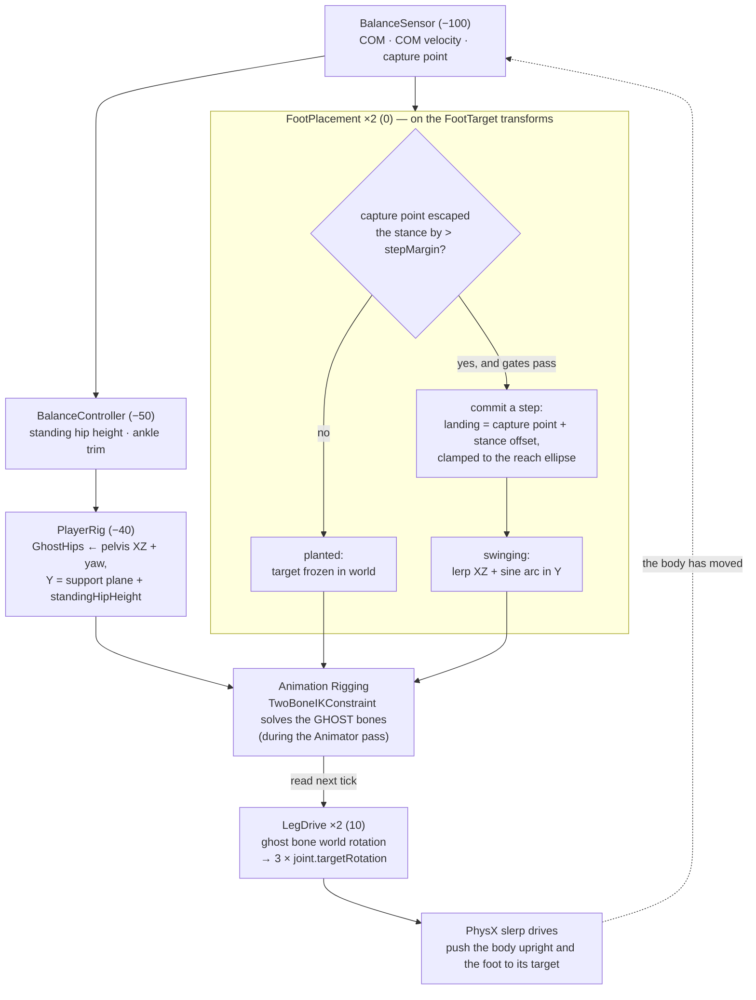

# Implementation Plan — Balance-Driven Foot Placement (Ghost Rig)

**The goal:** a character on physically simulated legs that stays upright by *deciding where to put its
feet*. The COM moves, the feet chase it, the legs are driven to reach them. Walking is what this looks
like when the COM keeps moving.

The mechanics follow DrunkWalkHome's `FootPlacement` — step trigger, swing arc, reach clamp, one foot at a
time, double-support beat — and reuse its actual solver: Unity's Animation Rigging `TwoBoneIKConstraint`.

The one structural difference is that the constraint cannot write our leg bones. Those bones are
Rigidbodies, and their transforms belong to PhysX. So the IK runs on a **ghost**: a hidden, non-physical
skeleton that mirrors the legs. The constraint poses the ghost, and we read the ghost's bone rotations and
feed them to the real joints as `targetRotation`. The solver — not an assignment — is what gets the leg
there.

Worth knowing what this costs and what it buys, because both are real:

- **Costs:** a package, an `Animator`, a duplicate hierarchy, and one physics tick of latency.
- **Buys:** the constraint's solve for free (hints, target rotation offsets, `MultiRotationConstraint` for
  the sole tilt), `FootPlacement` portable almost verbatim, and — the reason that matters most here — a
  **visible target pose**. Draw the ghost and you can see what the IK asked for next to what physics
  achieved. Tracking error is the hardest thing to diagnose in an active ragdoll, and this makes it
  something you can look at.

---

## Rules for this prototype

Every one of these exists to stop a specific kind of sprawl. Break one only when a play session forces it.

1. **One writer per joint.** Exactly one component computes `targetRotation` for a given joint. If two
   things want to influence a leg, they compose their inputs *before* the drive, never after.
2. **The ghost is a solver, not a source of truth.** It answers "what pose do we want". It is never asked
   where the character *is* — that question is always answered by the Rigidbodies. Nothing but `LegDrive`
   reads a ghost bone.
3. **A foot is planted or swinging.** One `bool` and a `float` progress. Not a state machine, not an enum.
4. **Everything on the physics clock.** `FixedUpdate` for our code, `AnimatorUpdateMode.Fixed` for the rig.
5. **Measure the rig, don't retype it.** Segment lengths come from the joint anchors and the constraint at
   `Awake`. A number typed into two places is a number that will disagree with itself.
6. **Gizmos before UI.** Every quantity that matters gets drawn in the scene view. `BalanceSensor` already
   does this; keep it up.
7. **One new knob per problem, added when a play session demands it** — not in advance.
8. **Every step below ends in something you can see.** If a step can't be verified by playing, it's too big.

---

## Part 1 — Player architecture

### The physical rig, as authored

All values measured from `TestScene.unity` — from the **joint anchors**, which are the truth, not the
transform positions.

| Element | Value | Notes |
|---|---|---|
| Hip socket (rest) | `(∓0.11, 0.92, 0)` | Thigh joint anchor ↔ Pelvis connected anchor |
| Knee | `y = 0.50` | |
| Ankle | `(∓0.11, 0.10, 0)` | |
| **Thigh `L1`** | **0.42 m** | hip → knee |
| **Shin `L2`** | **0.40 m** | knee → ankle |
| **Chain `L1+L2`** | **0.82 m** | the hard reach limit |
| Ankle → sole | 0.10 m | this is DrunkWalkHome's `footGroundOffset`, which is also 0.1 |
| Stance half-width | 0.11 m | |
| Masses | Torso 24, Pelvis 14, Thigh 7, Shin 3.5, Foot 1.5 | **62 kg** total, 12 kg per leg |
| Slerp drives | thigh 3500/168/7000, shin 2500/120/5000, ankle 1500/72/3000 | spring/damper/maxForce |

Kyle, DrunkWalkHome's character, has a 0.827 m leg chain on a 60 kg body. Our proportions are within a few
percent of his, so **every serialized value in their `FootPlacement` transfers as a starting number.**

Two facts about the physical joints that the drive step leans on:

- Every body is a **direct child of `Player`** with **identity local rotation** — the physical hierarchy is
  flat, the chain exists only through the joints.
- Every joint has `axis = (1,0,0)`, `secondaryAxis = (0,1,0)`, `configuredInWorldSpace = false`,
  `rotationDriveMode = Slerp`, all angular motions Free, projection on, preprocessing off.

Together those make the rotation → `targetRotation` conversion collapse to one line (Step 4).

**The reach budget.** Standing drop is `0.92 − 0.10 = 0.82` — exactly the chain. A leg at full extension
has *zero* horizontal reach, and `TwoBoneIKConstraint` has no bend plane to work in. This does **not** need
a scene edit: treat 0.92 as the extension limit and work at a hip height of **0.85**, which the drives will
settle into on the first tick. That leaves `sqrt(0.82² − 0.75²) = 0.33 m` of horizontal reach, enough for a
~0.6 m stride.

### The ghost

A second transform hierarchy under `Player` that mirrors the leg skeleton. **No Rigidbodies, no colliders,
no renderers** — pure transforms plus the rig components.

Unlike the physical bodies, the ghost bones are **nested**: `TwoBoneIKConstraint` requires `root`, `mid`
and `tip` to be an actual parent chain, because it solves by rotating parents and letting children follow.

```
Player                                 BalanceSensor · BalanceController · PlayerRig · PushTester
├── Pelvis · Torso                     physical, flat, ConfigurableJoints
├── Thigh_L · Shin_L · Foot_L
├── Thigh_R · Shin_R · Foot_R
└── Ghost                              Animator (no avatar, empty controller, updateMode = Fixed)
    │                                  RigBuilder → one layer
    ├── GhostHips                      driven each tick by PlayerRig
    │   ├── GhostThigh_L
    │   │   └── GhostShin_L
    │   │       └── GhostFoot_L
    │   └── GhostThigh_R
    │       └── GhostShin_R
    │           └── GhostFoot_R
    └── ProceduralAnimationRig          Rig, weight 1
        └── Legs
            ├── LeftLegIK  · RightLegIK           TwoBoneIKConstraint
            ├── LeftLegHint · RightLegHint        knee poles
            ├── LeftFootRotation · RightFootRotation   MultiRotationConstraint
            └── LFootTarget · RFootTarget         FootPlacement lives here
```

This is DrunkWalkHome's rig layout with the model bones swapped for ghost bones. Their constraint settings,
which we copy exactly:

| Field | Value |
|---|---|
| `root` / `mid` / `tip` | GhostThigh / GhostShin / GhostFoot |
| `target` | the FootTarget |
| `hint` | the LegHint |
| Target Position Weight | 1 |
| Target Rotation Weight | 1 |
| Hint Weight | 1 |
| Maintain Target Position Offset | off |
| Maintain Target Rotation Offset | **on** |

The `MultiRotationConstraint` constrains the GhostFoot to the same FootTarget, all axes, maintain offset on.
That's what puts the sole flat on a slope.

### Components

| Order | Component | Status | Owns | Publishes |
|---:|---|---|---|---|
| −100 | `BalanceSensor` | **have** | COM, COM velocity, capture point | `COM`, `COMVelocity`, `COMPrediction` |
| −50 | `BalanceController` | **have, repurpose** | standing hip height, pelvis upright, small-error ankle trim | `StandingHipHeight`, `AnkleTrim` |
| −40 | `PlayerRig` | **new** | places `GhostHips`; caches joints; asserts ghost/physical alignment | `HipPosition` ×2, `L1`, `L2`, `Chain` |
| 0 | `FootPlacement` ×2 | **port** | when to step, where to land, the swing arc | via its own transform, plus `IsPlanted`, `IsStepping`, `LastLandTime` |
| 10 | `LegDrive` ×2 | **new** | ghost bone rotations → three `targetRotation` writes | — |
| — | `FootController` | **have, absorb** | ground contact | `IsGrounded`, `GroundHeight` |
| — | `PushTester` | **have** | calibrated pushes for repeatable recovery tests | — |

### The tick, and the one deliberate frame of latency

Within a `FixedUpdate`, our components run in `DefaultExecutionOrder`. The **rig solve is not one of them** —
it happens inside the Animator's pass, which we don't control the position of. So rather than guess at
Unity's internal ordering, the design reads the ghost pose **solved during the previous tick**:

```
FixedUpdate
  −100  BalanceSensor    COM, COM velocity, capture point
   −40  PlayerRig        place GhostHips from the pelvis (see Part 2)
     0  FootPlacement    decide/advance the step → write the FootTarget transform
    10  LegDrive         read ghost bone rotations → write joint targetRotation
        …physics simulates…
        …Animator (updateMode = Fixed) evaluates the rig → ghost bones updated for next tick…
```

This is deterministic, needs no assumptions about Unity's internals, and costs one tick — ≤20 ms at 50 Hz.
The joint target is a **setpoint**, not a teleport, so a stale setpoint on a foot moving at 0.3 m/s is about
6 mm of error, far below the noise floor of a physically driven leg.

Note what `PlayerRig` running *before* `LegDrive` buys you: `GhostHips` moves this tick, and the ghost bones
are its children, so their **world** rotations are current with the pelvis. Only the internal *joint angles*
are a tick old. The leg's world orientation never lags the body.

If you later measure the latency and want it gone, disable the Animator and call
`rigBuilder.Evaluate(Time.fixedDeltaTime)` yourself at order 5. Try that only if you can see the problem.

### Data flow



### The one-writer rule in practice

`BalanceController` currently writes ankle `targetRotation` directly. Once `LegDrive` exists, that would be
two writers on one joint. `BalanceController` keeps *deciding* the ankle trim; it publishes it, and
`LegDrive` composes it into the foot rotation it writes.

There is a real balance hierarchy hiding in this, worth naming because it tells you which knob to reach
for: **ankle strategy** for small COM errors (what `BalanceController` does today), **hip strategy** for
medium ones, **stepping** for large ones. Stepping is the one this plan builds; keep the ankle trim at a low
gain underneath it rather than deleting it.

### File layout

```
Assets/Scripts/
  BalanceSensor.cs         have
  BalanceController.cs     have — repurpose
  PushTester.cs            have
  FootController.cs        have — ground contact only; the ankle write moves to LegDrive
  PlayerRig.cs             new — ghost placement, measurement, alignment assert
  JointTargetExtensions.cs new — static, world rotation → targetRotation
  FootPlacement.cs         port — trimmed from DrunkWalkHome
  LegDrive.cs              new — ghost → joints
```

---

## Part 2 — The mechanic

A standing biped is an inverted pendulum. Its **capture point** is the spot on the ground where, if you
planted a foot, the body would come exactly to rest:

```
omega        = sqrt(g / h)                        // h = COM height above the support plane
capturePoint = COM_xz + COMVelocity_xz / omega
```

At our working hip height, `omega = sqrt(9.81 / 0.85) = 3.40 rad/s`, so the capture point sits roughly
0.29 s of travel ahead of the COM.

`BalanceSensor.COMPrediction` **is already this quantity** — the code is written, gizmo included.

The rule is one sentence: **if the capture point escapes the stance, step to it.** Land exactly on it and
the body stops. Land short of it and the body keeps moving — which is walking. That gives one knob,
`captureGain`, that unifies balance and locomotion:

```
landing = stanceFoot + (capturePoint − stanceFoot) * captureGain
```

- `captureGain = 1.0` → step to catch, body stops. The recovery test.
- `captureGain ≈ 0.7` → the foot lands short, the COM keeps travelling, the next step triggers. Walking.

DrunkWalkHome has no COM, so it approximates this: stride from a Froude speed formula, with `leanFootBias`
nudging the landing toward the force vector. **We have the real quantity, so we use it directly and drop
`leanFootBias` entirely.**

### Where the support force comes from

This is the part that has no equivalent in DrunkWalkHome, and it is where the whole thing lives or dies.

Their body is kinematic — it is *held* at its height, and the legs are cosmetic followers. Ours is a free
body that falls. Something has to push it up, and the only thing that can is the leg joint drives. A drive
produces torque in proportion to the **error** between the joint's current angle and its target angle. So:

> **If the ghost is placed at the body's actual pose, the leg targets equal the leg's current angles, the
> error is zero, no torque is produced, and the character folds to the floor.**

The fix is one line, and it is why `PlayerRig` exists:

```
GhostHips.position = new Vector3(pelvisHip.x, supportPlaneY + standingHipHeight, pelvisHip.z);
GhostHips.rotation = pelvisYawOnly;
```

Take the pelvis's **actual horizontal position and yaw**, but override the **height** with where the hips
*should* be. The ghost then solves a leg that is slightly more extended than the real one. `LegDrive` writes
those more-extended angles as targets, the drives see a standing error, and correcting it lifts the body.
The character stands because its legs are permanently, slightly, trying to straighten against the ground.

Overriding only Y matters. If the ghost hips were placed above a *foot*, each leg would demand the body be
over its own foot, the two would fight, and leaning would be impossible. Vertical support comes from the
legs; horizontal position is left to foot placement. That division is the entire thesis of this prototype.

The swing leg is solved from the same ghost hips, so its foot lands low by the current hip error — a few
centimetres while standing, shrinking to zero as the stance legs push the body up to height. Against a
`stepHeight` of 0.10 m that is not worth correcting.

`supportPlaneY` is the planted feet's sole height: the lower of the two while both are down, the planted
one's while stepping.

---

## Part 3 — The steps

Each step is small enough to finish in a sitting and ends in something visible.

### Step 0 — Package and numbers

**Goal:** the tools are installed and the values in the table above are what the running scene reports.

**Do:**
- Window → Package Manager → **Add package by name** → `com.unity.animation.rigging`. Use the UI rather
  than editing `manifest.json` by hand so `packages-lock.json` is regenerated properly. DrunkWalkHome is on
  1.4.1.
- Set `Physics.defaultSolverIterations` to 12–20 in Project Settings → Physics. Default 6 is marginal for a
  stiff 8-body chain.
- Raise `maxAngularVelocity` on the six leg bodies from the default 7 rad/s to ~30, or a fast swing gets
  silently clamped.
- Confirm the ground plane carries the `Ground` tag that `FootController.OnCollisionEnter` checks for.
- Log each leg's hip socket, knee and ankle from the joint anchors and confirm the table.

**The anchor math.** A joint's `anchor` is in its own body's local space; `connectedAnchor` is in the
connected body's local space. They name the same world point, so read whichever side sits on a transform
you already have. `TransformPoint` applies scale, which is what you want here — these bodies are scaled
primitives:

```
hipWorld   = pelvis.TransformPoint(hipJoint.connectedAnchor)
kneeWorld  = thigh .TransformPoint(kneeJoint.connectedAnchor)
ankleWorld = shin  .TransformPoint(ankleJoint.connectedAnchor)
```

**Done when:** `L1 = 0.42`, `L2 = 0.40`, hip socket at `y ≈ 0.92`.

---

### Step 1 — Build the ghost skeleton

**Goal:** a nested chain of empty transforms sitting exactly on top of the physical legs.

**Do:** create the `Ghost` → `GhostHips` → `GhostThigh_L` → `GhostShin_L` → `GhostFoot_L` chain (and the
right side) as empty GameObjects. Place each one at the world position of the corresponding **joint anchor**
from Step 0 — hips at `(0, 0.92, 0)`, thigh at `(−0.11, 0.92, 0)`, shin at `(−0.11, 0.50, 0)`, foot at
`(−0.11, 0.10, 0)`.

Leave every local rotation at identity. That matters: because the physical bodies are also identity at
rest, ghost bone world rotation maps 1:1 onto the physical body's desired world rotation, with no offset to
carry. (An offset table is the alternative and it is a thing that silently rots. Don't build one until a
model with a real bind pose forces it.)

No Rigidbody, no Collider, no Renderer on any of them. Ever.

**Verify:** an `OnDrawGizmos` on `PlayerRig` drawing the ghost chain in one colour and the physical joint
anchors in another. At rest they should be indistinguishable.

**Done when:** the two chains overlap at rest, and `Quaternion.Angle(ghostBone.rotation, body.rotation)` is
under half a degree for all six bones. Assert this in `Awake` and log an error if it fails — a ghost that
is silently 5° off produces a lean nobody will trace back to here.

---

### Step 2 — The rig and the constraints

**Goal:** dragging a target transform bends the ghost leg.

**Do:**
- `Animator` on `Ghost`: no avatar, and an empty `AnimatorController` asset assigned. (DrunkWalkHome's
  Animator likewise has no avatar.) Set `updateMode` to **Fixed** — in code at `Awake`, so it can't be lost
  to an inspector edit: `animator.updateMode = AnimatorUpdateMode.Fixed;`
- `RigBuilder` on `Ghost`, **the same GameObject as the Animator** — it finds the Animator with
  `GetComponent`. One rig layer, pointing at `ProceduralAnimationRig`.
- Build the `ProceduralAnimationRig` → `Legs` subtree from the hierarchy in Part 1, with the constraint
  settings from the table there.
- Place each `LegHint` roughly a knee's-width in front of the knee, and each `FootTarget` at the ankle
  anchor.

**Verify:** press play and drag `LFootTarget` in the scene view. The ghost leg should bend to follow, knee
forward. **Nothing physical moves yet** — that's correct, nothing is reading the ghost.

**Done when:** both ghost legs track their targets, knees bend forward, and a target pulled beyond reach
straightens the leg rather than detaching it.

---

### Step 3 — `PlayerRig`: place the ghost

**Goal:** the ghost follows the body, at the height the body *should* be.

**Implement:** `PlayerRig : MonoBehaviour`, `[DefaultExecutionOrder(-40)]`, on `Player`.

References: the pelvis Rigidbody, the two `FootPlacement`s, `BalanceController`, `GhostHips`, and the six
physical `ConfigurableJoint`s.

Cached at `Awake`: `L1`, `L2`, `Chain` (Step 0's anchor math), the three `startLocalRotation` values per
leg, and the ghost/physical alignment assert from Step 1.

`FixedUpdate` — read the pelvis pose **once**, here, and let everything downstream use this snapshot:

```
supportY = lower sole height of the planted feet
yaw      = Quaternion.Euler(0, pelvis.rotation.eulerAngles.y, 0)

GhostHips.SetPositionAndRotation(
    new Vector3(hipCentre.x, supportY + balance.StandingHipHeight, hipCentre.z),
    yaw);
```

Yaw only, not the pelvis's full rotation. A pelvis pitched forward mid-stumble should not tilt the whole
solve — lean is something the *body* does, not something the target pose should chase.

**Verify:** play with the character resting on the ground and push it with `PushTester`. The ghost chain
should ride along with the body horizontally while its hips stay at a constant height above the ground.

**Done when:** the ghost tracks the body without jitter and its hip height is visibly independent of the
pelvis sagging.

---

### Step 4 — Drive one joint to a world rotation

**Goal:** hand any leg joint a world-space rotation and watch the physical body servo to it.

**Implement:** `JointTargetExtensions`, a static class with one method:

```csharp
public static void SetTargetWorldRotation(
    this ConfigurableJoint joint,
    Quaternion desiredWorld,
    Quaternion startLocalRotation,   // captured at Awake
    Transform connectedBody)
```

**The math.** `targetRotation` is expressed in the joint's basis, relative to the pose the joint was created
in:

```
desiredLocal = Inverse(connectedBody.rotation) * desiredWorld
joint.targetRotation = Inverse(desiredLocal) * startLocalRotation
```

On this rig, `axis = X` and `secondaryAxis = Y` make the joint basis identity, which is why there is no
`worldToJointSpace` term here — the one you'll find in every copy of the community `SetTargetRotationLocal`
helper. And because every body starts identity, `startLocalRotation` is identity too, so it reduces to
`Inverse(desiredLocal)`. **Capture it properly anyway** — one line that keeps the code honest if the rig
changes.

`FootController.SetAnkleTarget` is already this method for one joint and one axis; this generalises it.

**Always pass the connected body's *actual current* rotation.** If the thigh lags, the shin target computed
against the actual thigh still puts the shin in the right world place. The chain self-corrects instead of
compounding error.

**Verify:** a temporary `[SerializeField] Vector3 testEuler` driving the thigh, scrubbed in the inspector
while playing. The leg should move firmly and settle without buzzing.

**Done when:** the thigh tracks the inspector, and the pelvis reacts — that's correct, the drive torque is
equal and opposite.

---

### Step 5 — `LegDrive`: the physical leg follows the ghost

**Goal:** close the loop. The leg chases whatever the ghost is doing.

**Implement:** `LegDrive : MonoBehaviour`, `[DefaultExecutionOrder(10)]`, one per leg.

References: the three ghost bones, the three physical joints and their connected bodies, `PlayerRig`,
`BalanceController`.

`FixedUpdate`:
```
hipJoint  .SetTargetWorldRotation(ghostThigh.rotation, thighStart, pelvis);
kneeJoint .SetTargetWorldRotation(ghostShin .rotation, shinStart,  thigh);
ankleJoint.SetTargetWorldRotation(ghostFoot .rotation * balance.AnkleTrim, footStart, shin);
```

That is the entire component. The ankle trim composes here so there is still exactly one writer per joint.

**Verify:** play and drag `LFootTarget` again. Now the *physical* leg follows the ghost. Watch both drawn
together — the gap between them is your tracking error, and it is the number you will be tuning for the
rest of this project.

**Done when:** both legs track without buzzing or exploding. If they buzz, raise solver iterations before
touching gains.

---

### Step 6 — Standing

**Goal:** the character holds itself up. First real milestone.

**Implement:**
- In `BalanceController`, replace the manual pitch experiment with `standingHipHeight = 0.85f`, and add a
  pelvis upright PD torque:

  ```
  axisErr = Vector3.Cross(pelvis.transform.up, Vector3.up);
  pelvis.AddTorque(axisErr * uprightSpring − pelvis.angularVelocity * uprightDamper, ForceMode.Acceleration);
  ```

  `AddTorque` is legitimate *here and nowhere else in this system*: the pelvis is the root body with no
  joint above it. DrunkWalkHome measured that script torque applied to a body *behind* a joint gets absorbed
  by the constraint solver — it couldn't hold a 1.25 kg arm at 400 rad/s². Anything behind a joint goes
  through `targetRotation`, always.
- Park each `FootTarget` at a fixed world point under its hip. No stepping yet.
- Keep the ankle trim from COM error at a low gain.

**Verify:** press play. The character should settle into a slight knee bend at hip ≈ 0.85 and stay there.
Nudge with `PushTester` at low `pushSpeed` — it should wobble and recover on ankle trim alone. Push harder
and it falls over, because it can't step yet.

**Done when:** it stands unaided for 30 seconds and survives a 0.1 m/s push.

---

### Step 7 — The foot state: planted and swinging

**Goal:** a foot that can be told to step, and moves along a believable arc when it does.

**Implement:** `FootPlacement : MonoBehaviour`, `[DefaultExecutionOrder(0)]`, **on the FootTarget
transform** — exactly as DrunkWalkHome does it. The component owns a world position and writes it to its own
transform; the constraint reads that transform. The target is not parented to the body in any meaningful
sense: it is overwritten in world space every tick.

State — the complete list, and it should stay that way:

```csharp
Vector3 currentPos;      // where the foot is NOW, in WORLD space
Vector3 targetPos;       // where this step is going
Vector3 liftoffPos;      // where it left from
Vector3 currentNormal;   // ground normal under currentPos
bool    isStepping;
float   stepProgress;    // 0 → 1
float   LastLandTime;
```

`FixedUpdate`:
```
if (isStepping)
{
    stepProgress += Time.fixedDeltaTime / swingDuration;

    t  = smoothstep(clamp01(stepProgress));
    xz = Vector3.Lerp(liftoffPos, targetPos, t);
    y  = Mathf.Lerp(liftoffPos.y, targetPos.y, t) + stepHeight * Mathf.Sin(stepProgress * PI);
    currentPos = new Vector3(xz.x, y, xz.z);

    if (stepProgress >= 1f) { isStepping = false; currentPos = targetPos; LastLandTime = Time.time; }
}

transform.SetPositionAndRotation(
    currentPos + Vector3.up * footGroundOffset,
    Quaternion.FromToRotation(Vector3.up, currentNormal) * bodyYaw);
```

That sine arc is the whole swing. DrunkWalkHome's version adds lift-scaling, ataxia and stair rises on top —
all later, all optional.

Plus `public void BeginStep(Vector3 landing, Vector3 normal)`: `liftoffPos = currentPos`,
`targetPos = landing`, `stepProgress = 0`, `isStepping = true`.

`footGroundOffset` exists because the IK target is the **ankle**, not the sole. Ours is 0.10 m.

**Verify:** a debug key calling `BeginStep` with a point 0.3 m forward. One foot lifts, arcs and plants while
the other leg carries the body.

**Done when:** a commanded step completes without the body collapsing, and the planted foot doesn't slide.

---

### Step 8 — The balance trigger

**Goal:** the character catches itself. This is the payoff.

**Implement:** the decision in `FootPlacement.FixedUpdate`, before the swing advance.

Gates first — all three are from DrunkWalkHome and all three earn their place:
```
if (isStepping)                                  return;   // already busy
if (otherFoot.IsStepping)                        return;   // one at a time; lifting both is a jump
if (Time.time − otherFoot.LastLandTime < dwell)  return;   // the double-support beat
```

The trigger:
```
stanceCenter = otherFoot.IsPlanted ? (currentPos + otherFoot.FootPos) * 0.5f : currentPos;
error        = capturePoint − stanceCenter;      // XZ only
if (error.magnitude < stepMargin) return;
```

Which foot steps: **the planted foot further from the capture point** — the trailing one. Compare
`|capturePoint − FootPos|` against the other foot's and return if you are the nearer. This is a decision,
not a race; without it both feet chase the same threshold and whichever crosses first wins, which reads as
a shuffle.

The landing:
```
landing  = currentPos + (capturePoint − currentPos) * captureGain;
landing += pelvis.right * (side * stanceHalfWidth);     // side = ∓1, keeps the feet from crossing
```

Then two clamps, in this order:

1. **Reach.** Horizontal budget from the ghost hip: `maxHorizontal = sqrt((Chain*0.9)² − drop²)` where
   `drop = GhostHips.position.y − landing.y`. Clamp the horizontal offset to it. Measure from the hip the
   solver actually uses — DrunkWalkHome logged a real bug where the clamp measured from a nominal hip while
   the constraint measured from the bone, so the guard silently never fired and the leg straight-legged. We
   get this right for free by reading `GhostHips`.
2. **Ground.** Raycast down from `landing + up * 0.5` with a mask that **excludes the player's own layers** —
   cast against `Everything` from near the body and you will hit your own collider and try to stand on
   yourself. Take `hit.point` as the landing and `hit.normal` as the foot normal.

Then `BeginStep(landing, normal)`.

**Verify:** `PushTester`. Push at 0.3 m/s — the character should step in the push direction and stop.
Increase until it needs two steps, then three. Watch the `COMPrediction` gizmo; the foot should land under
it.

**Done when:** it recovers from a 0.5 m/s push in any of the four directions.

---

### Step 9 — Regimes and tuning

**Goal:** it stops looking like a puppet catching itself and starts looking like a body.

- **Ankle.** The stance ankle should not fight the ground. Scale the ankle joint's `slerpDrive.spring` by
  `stanceAnkleGain` (start 0.3) while planted, full stiffness while swinging.
- **Feed-forward.** Add `targetAngularVelocity` on the swing leg's joints, from
  `(target − prevTarget) / interval` where `interval` is the time between *target updates*, not
  `fixedDeltaTime`. DrunkWalkHome found this materially improves tracking of a fast swing.
- **`captureGain` sweep.** 1.0 for the recovery test, then walk it down and find where continuous stepping
  emerges. That number is your walk.
- **Stance width and `stepMargin`.** Too small a margin and it steps constantly; too large and it commits to
  falling before it reacts.
- **Tracking error.** Now that the ghost is drawable, log the mean angle between each ghost bone and its
  physical body. That single number tells you whether a problem is in the pose you're asking for or in the
  drive's ability to reach it — the distinction that costs the most time when guessed at.

**Done when:** it walks when pushed continuously and stands when left alone.

---

### Step 10 — Optional, once it walks

In rough order of value:

- **Froude stride bound.** `stepLen = 2.35 · Fr^0.25 · L · 0.5`, `Fr = v²/(gL)` — from DrunkWalkHome, whose
  coefficient is calibrated for almost exactly our leg length. Use it as a *ceiling* on stride, not as the
  trigger.
- **Speed-scaled swing duration** from the duty factor: 0.65 at a slow walk, 0.54 at a fast one, with
  `swingDuration` bounded to 0.2–0.7 s.
- **Mid-flight retargeting** (`retargetStrength ≈ 10`, faded to zero near landing so it always commits).
- **Knee hint posing** — DrunkWalkHome's `PoseKneeHint`: `cross(legDir, pelvis.right)`, mirrored forward
  when it points backwards so a deep tuck can't fold the knee the wrong way. Do this when you first see a
  knee fold inward on a turn.
- **Heel-strike / heel-off pitch**, which is most of what sells a walk visually.
- **Drunkenness**, the README's actual goal — variance sampled from an existing sway signal rather than a
  new random source.

---

## Part 4 — Starting values

| Knob | Start | Where it comes from |
|---|---:|---|
| `standingHipHeight` | 0.85 m | leaves 0.33 m of reach against the 0.82 m chain |
| `captureGain` | 1.0 → then down | 1.0 = catch and stop; lower = keep walking |
| `stepMargin` | 0.08 m | roughly half the foot width |
| `stanceHalfWidth` | 0.11 m | the authored hip offset |
| `stepHeight` | 0.10 m | DrunkWalkHome runs 0.35 — their tuned look, not a starting point |
| `swingDuration` | 0.30 s | their band is 0.2–0.7 s |
| `doubleSupportDwell` | 0.12 s | theirs, unchanged |
| `strideReachSafety` | 0.9 | theirs, unchanged |
| `footGroundOffset` | 0.10 m | our measured ankle → sole |
| `stanceAnkleGain` | 0.3 | guess; tune in Step 9 |
| `uprightSpring` / `uprightDamper` | 40 / 12 | guess; critically damp it |
| `Physics.defaultSolverIterations` | 12–20 | default 6 is marginal for this chain |
| `maxAngularVelocity` (leg bodies) | 30 rad/s | default 7 clamps a fast swing |

---

## Part 5 — Out of scope for v1

DrunkWalkHome's `FootPlacement` is 1345 lines. Roughly 60% of it is these, and **none are needed to get a
step**: surface carry (moving platforms), wall clearance, per-limb impact deflection, the stair probe,
ataxia, heel-off/heel-strike pitch, mid-flight retargeting, and the network pose stream.

Not deferred but *dropped*: `leanFootBias`. It is their approximation of the capture point, and we compute
the real thing.

---

## Part 6 — Pitfalls

1. **The ghost must never be read as state.** It answers "what pose do we want", never "where are we". The
   moment something asks the ghost where the foot *is*, you have two sources of truth and the physical one
   will start losing arguments it should win. Only `LegDrive` touches a ghost bone.
2. **The ghost hips are placed at the DESIRED height, not the actual one.** Place them at the real pelvis
   and the drives see zero error, produce no torque, and the character folds to the floor with nothing in
   the code to point at. See Part 2.
3. **Override only Y.** Hips at the desired *height* but the actual *horizontal* position. Otherwise the two
   stance legs fight over where the body should be.
4. **No Rigidbody or Collider on a ghost bone.** A ghost with a collider is a second, invisible character
   standing inside the first.
5. **Ghost bones must be a nested chain.** `TwoBoneIKConstraint` solves by rotating parents; the physical
   legs' flat hierarchy will not work for it.
6. **Bind pose mismatch is silent.** A ghost built 5° off produces a permanent lean that looks like a tuning
   problem. Assert the alignment at `Awake` and fail loudly.
7. **Never `AddTorque` behind a joint.** Measured in DrunkWalkHome as unable to hold a 1.25 kg arm at
   400 rad/s². The pelvis is the sole exception, because nothing is above it.
8. **The ground mask must exclude the player.** The landing ray casts down from near the body.
9. **Don't fully extend the leg.** No bend plane means the constraint has no way to choose a knee direction.
   Keep the reach clamp at `strideReachSafety = 0.9`.
10. **Reach failures are violent here.** In DrunkWalkHome an over-long stride made the IK straight-leg and
    render the foot floating. Ours yanks the pelvis instead.
11. **A planted foot must not be servo'd hard to a world position.** Friction holds it; the drive only fights
    the ground. Planted means `currentPos` is frozen and the leg's job is carrying the hip.
12. **Interpolation and the world frame.** If you enable `Rigidbody.interpolate` on the pelvis for camera
    smoothness, don't read the interpolated transform for foot logic — DrunkWalkHome notes the mismatch
    reads as foot vibration.

---

## Part 7 — The fallback

If the ghost proves more trouble than it's worth — the latency shows, or the Animator fights something —
the escape hatch is small and self-contained. Replace Steps 1, 2, 3 and 5 with a static two-bone solve and
delete the ghost entirely. Nothing else in the plan changes, because `FootPlacement` never knew how the leg
got there:

```
d    = clamp(|foot − hip|, |L1 − L2| + 0.001, (L1 + L2) * 0.995)
dir  = (foot − hip) / d
a    = acos(clamp((L1*L1 + d*d − L2*L2) / (2 * L1 * d), −1, 1))
face = normalize(pole − dir * dot(pole, dir))
n    = cross(dir, face)

thighDir = AngleAxis(−a * Rad2Deg, n) * dir
knee     = hip + thighDir * L1
shinDir  = normalize(foot − knee)

thighRot = LookRotation(face, −thighDir)      // capsule long axis is +Y; the bone points DOWN
shinRot  = LookRotation(face, −shinDir)
```

Then `LegDrive` feeds `thighRot`/`shinRot` where it currently reads `ghostThigh.rotation`, and the desired
hip is substituted per-leg instead of once on the ghost hips: **stance solves from the desired hip, swing
from the actual one.** Same idea as Part 2, applied twice instead of once.
